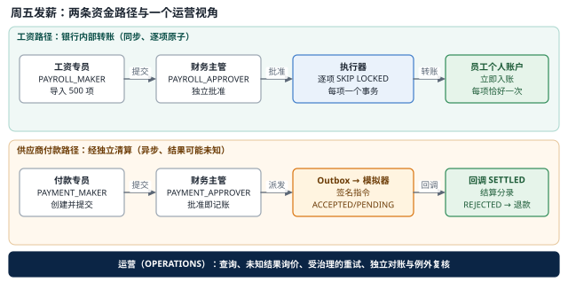

# 为什么是 LedgerCore：周五发薪与本书路线 {#ch-why}

:::: opener
::: q
业务问题

一家新西兰物流公司要在周五下午给 500 名员工发工资、给几家供应商付款。每一分钱都必须**恰好**移动一次；任何一步失败，都必须能回答三个问题：钱现在在哪里？它应该在哪里？谁、凭什么把它送过去？
:::
::: k
本章证据

- 四轮工程的交接记录：`docs/v2/ROUND-1-HANDOFF.md` 至 `ROUND-4-HANDOFF.md`
- 第四轮发现与修复登记：`docs/v2/ROUND-4-FINDINGS.md`
- E12 独立验收：`docs/v2/E12-ACCEPTANCE.md`
:::
::::

## 周五下午四点

Kererū Freight Ltd. 是本书虚构的一家物流公司。每个周五下午，工资专员 Aroha 从人事系统导出 500 行工资明细，在网银里创建一个工资批次并提交；财务主管 Wiremu 复核后批准；银行随即逐项把工资从公司的企业账户转入员工的个人账户。与此同时，Aroha 还要为三家供应商各创建一笔企业付款——这些收款人不在本行开户，钱必须经过一个**清算系统**（clearing system）才能到达对方。

到这里为止，一切都像教科书。真正的工程问题出现在下面这些时刻：

- 第 2 项工资在转账途中因余额不足失败，而执行器所在的 JVM 恰好在“失败已回滚、失败结果尚未记录”的那一瞬间被杀死。重启之后，第 1 项会不会被再付一次？第 2 项的失败会不会被记两次？
- 一笔供应商付款被清算系统确认为“已结算”（SETTLED），银行也回复了“收到”，可银行自己的结算分录却因为一次进程崩溃没有写成。第二天对账时，系统里没有任何一条记录说“这里欠着一笔结算”。
- 清算系统在银行停机期间重试了八次回调，全部失败之后放弃了。银行恢复上线，却永远收不到那条“已结算”的消息。
- 运维团队从昨晚的备份恢复了银行数据库；清算系统没有回到过去，它坚持说那笔钱早就结算了。

这些都不是假想。它们是本书逐一在真实进程、真实 PostgreSQL 上制造出来、观察、修复并独立评分过的故障。第二个场景甚至是第四轮审计在上一轮已经验收的代码里**真实发现**的缺陷（第 16 章）。

## 两条资金路径

@fig-friday-story 把周五的工作分成两条路径。上面一条是**银行内部转账**：工资从企业账户到员工账户，两边的账都在同一个数据库里，一个数据库事务就能保证“扣款与入账同时发生或同时不发生”。下面一条是**跨系统付款**：银行在批准时先把钱从客户存款转为“应付清算”（clearing payable），再通过 Outbox 把签名指令发给独立的清算模拟器，最后等待模拟器的签名回调决定结算或退款。

{#fig-friday-story}

第二条路径之所以难，不是因为代码多，而是因为**两个系统、两个数据库之间不存在共同的事务**。银行可以保证自己的数据库里“记账”和“写出待发送事件”同时提交，却无法保证对方收到了、处理了、并把结果送了回来。从这一刻起，“钱在哪里”变成了一个需要证据才能回答的问题：银行账本里的应付、模拟器数据库里的操作状态、两边各自的回调收件箱与发件箱，必须能被独立地核对。

## LedgerCore 是什么，不是什么

LedgerCore 是一个**可复现的工程实验室**：

- 银行是一个 Spring Boot 4 的模块化单体（第 2 章），所有金额只经过账本模块写入 PostgreSQL 18；
- 清算模拟器是另一个独立的 Spring Boot 进程，有自己的数据库，只通过 HMAC 签名的 HTTP 与银行交互（第 13 章）；
- 前端是 React 19，客户、企业和运营三类界面都调用真实 API（第 24 章）；
- 故障实验室能在指定代码行精确地杀死进程，再由独立 SQL 给结果打分（第 19 章）。

它**不是**一家银行。没有真实的钱、真实的客户或真实的清算网络；“模拟准备金”与“模拟司库”只是两本账，用来让“准备金不足”这种故障可以被合法地制造出来。本书所说的“生产式验证”，指的是用生产系统会遇到的方式去验证——真实进程、真实数据库、真实崩溃、独立评分——而不是声称这个系统可以直接上线。

## 四轮工程与本书的证据

LedgerCore V2 的代码由四轮工程累积而成，每一轮都以 `main` 分支上精确的提交与 CI 运行收尾（@tbl-rounds）。

| 轮次 | 负责 | 范围 | 结论 |
|---|---|---|---|
| 1 | GPT-6 Luna | E0–E3：账本、转账、组织、工资、性能实验 | 完成（`b584b95`）；E3 中 H01 为 INCONCLUSIVE、H03 为 MIXED |
| 2 | Claude Opus 5.5 | 独立审计并修复 E0–E3 | ACCEPTED_WITH_NONBLOCKING_RISKS；新增 V7 与回归测试 |
| 3 | GPT-6 Luna | E4–E11：持久事件、清算、故障实验、对账、安全、可观测性、备份、界面 | E4、E10、E11 VALIDATED；E5–E9 PARTIAL（`ba36f90`） |
| 4 | Claude Opus 5.5 | 最终审计、R4-01…R4-07 修复、补齐 E5–E9、E12 独立验收、本书 | 见第 26 章与 `docs/v2/E12-ACCEPTANCE.md` |

Table: 四轮工程的范围与结论（来源：`docs/v2/STATUS.md` 与各轮交接文档） {#tbl-rounds}

第三轮结束时，E5–E9 被诚实地标为 PARTIAL：例如准备金不足只在测试里注入过一个异常、从未真正发生；W3C 追踪尚未实现。第四轮的任务首先是**不相信**这些交接文档——在干净的数据库上重跑基线（95 个后端测试、6 个模拟器测试全部通过），然后带着新的问题去读代码。七个发现（@tbl-r4-findings）中有五个是 P1 级别：它们不会让账本失衡，却会让一笔已结算的付款永远停在半路，或者让关键异常可以被一句备注关闭。

| 编号 | 问题 | 严重度 | 处置 |
|---|---|---|---|
| R4-01 | 终态回调已被确认，结算/退款却可能永不过账 | P1 | 已修复（第 16 章） |
| R4-02 | 准备金不足无法通过任何合法途径发生，恢复从未被证明 | P1 | 已修复（第 17 章） |
| R4-03 | 对账看不见“外部已结算、本地未记账”；CRITICAL 例外可被备注关闭 | P1 | 已修复（第 20 章） |
| R4-04 | 超出投递预算的回调永远无法重投 | P1 | 已修复（第 18 章） |
| R4-05 | 清算集成关闭时，已记账付款的指令被静默确认 | P2 | 检测已修复，重发路径延后并记录风险 |
| R4-06 | 终态付款状态与分录之间没有数据库约束 | P2 | 已修复（V15，第 6、20 章） |
| R4-07 | 银行恢复到旧时点后，已投递的回调无法再次送达 | P1 | 已修复（第 18、23 章） |

Table: 第四轮独立发现（`docs/v2/ROUND-4-FINDINGS.md`） {#tbl-r4-findings}

## 如何阅读证据

本书区分四种陈述，并在正文中尽量把它们分开写：

1. **预注册假设**：实验之前写下的预测与判定规则，例如 E3 的 H01–H04（第 22 章）。假设可以被否定；被否定的假设照样保留。
2. **观测**：由脚本或测试直接产生、提交在仓库里的事实，例如 `evidence/round4/e12/lab/E12-LAB.json` 中某个崩溃用例的恢复判定。
3. **解释**：作者对观测的推理。解释可能出错，因此总是与观测分开写，并说明依据。
4. **限制**：这个证据**不能**说明什么。例如 E10 的 RPO 118.922 秒只属于一次本地运行。

每一次实验运行都记录源码 SHA、跟踪文件是否有未提交改动（`trackedTreeDirty`）、被测 JAR 的 SHA-256 与一次性数据库的名字。一个结论如果来自脏工作树、错误的 SHA，或者故障点根本没有到达（`NOT_INJECTED`），就不被当作验收证据——这条规则在第 26 章的 E12 判定中是硬性的。

## 本书结构

全书分六个部分。第一部分（第 1–4 章）讲背景、架构与可复现环境；第二部分（第 5–8 章）讲账本内核：复式记账、数据库约束、锁与幂等；第三部分（第 9–11 章）讲企业付款与工资：职责分离、不可变意图与 500 项批次；第四部分（第 12–18 章）讲异步清算，包括第四轮的三个核心案例；第五部分（第 19–23 章）讲可靠性工程：故障实验、对账、安全矩阵、可观测性、性能与恢复；第六部分（第 24–26 章）讲界面、契约测试与 E12 独立验收。附录给出环境搭建与清理、参考 SQL、术语表、验收清单、源码路径、故障排查、练习答案与证据索引。

::: exercise
1. 清算系统对银行的指令请求返回了 HTTP 200。为什么银行不能据此把付款标记为“已完成”？请至少给出两个理由。（答案见 [附录 G](#ans-1-1)）
2. 判断下列陈述分别属于“预注册假设、观测、解释、限制”中的哪一种：(a) “热点账户在 50 个客户端时 p95 为 606.04 ms”；(b) “吞吐下降是因为同一行锁使请求串行化”；(c) “这些数字不代表生产容量”；(d) “索引候选应当降低 5,000 项批次的 p95”。（答案见 [附录 G](#ans-1-2)）
:::
