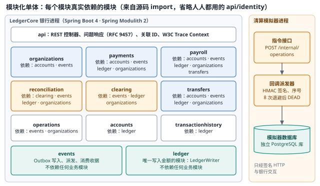

# 模块化单体与模块边界 {#ch-modules}

:::: opener
::: q
业务问题

工资模块需要转账，付款模块需要记账，清算模块需要结算，对账模块需要读一切。怎样让它们协作，又保证**只有一个地方能写金额**、任何模块都不能悄悄绕过另一个模块的规则？
:::
::: k
本章证据

- 模块声明：各包的 `package-info.java`（`@ApplicationModule`）
- 边界测试：`ModuleArchitectureTests`，每次 `mvn verify` 与 CI 都执行
- 唯一写入口：`LedgerWriter`
:::
::::

## 为什么不是微服务

讨论架构时，人们常把“可靠”与“拆分”画上等号。LedgerCore 的选择恰好相反：银行内部是一个**模块化单体**（modular monolith），只有在现实世界本来就存在系统边界的地方——银行与清算系统之间——才放置进程与数据库的边界。

理由是金融一致性的代价。一次企业付款的批准必须同时完成五件事：把付款状态从 SUBMITTED 改为 APPROVED、写一张借贷平衡的记账分录、刷新两个账户的余额投影、插入一条待派发的清算指令、写入审计与 Outbox 事件。在同一个 PostgreSQL 里，它们是一个 `COMMIT`；拆成五个服务，它们就变成了五个需要补偿、对账与人工介入的分布式步骤。本书第四部分会展示，仅仅是银行与模拟器之间**一条**跨系统边界，就需要持久工作项、签名回调、序号、询价、重投与独立对账才能变得可靠。把这种复杂度主动引入银行内部，并不会让系统更安全。

## 模块与真实依赖

@fig-modules 列出银行进程里的模块，以及每个模块从源码 `import` 中统计出来的真实依赖（省略几乎所有模块都会用到的 `api` 与 `identity`）。两个模块值得特别注意：

- **`ledger`** 不依赖任何业务模块。它不知道什么是工资、什么是供应商付款，只知道账户、分录、过账与余额。业务模块调用它，它从不回调业务模块。
- **`events`**（持久事件与 Outbox）同样不依赖任何业务模块。付款模块把“清算指令已就绪”写进 Outbox；清算模块实现一个处理器去消费它。两者之间没有直接的 Java 调用。

{#fig-modules}

右侧的清算模拟器是一个独立进程，有自己的数据库与 Flyway 迁移。它在本书中扮演“外部世界”：银行不能读它的表，只能通过签名请求询问它；它也不能写银行的表，只能通过签名回调告诉银行发生了什么（第 13 章）。

## 让边界可执行：Spring Modulith

模块边界如果只写在架构图上，几个月后就会被一次“临时修复”打穿。LedgerCore 用 Spring Modulith 2 把边界写进代码：每个模块在 `package-info.java` 里用 `@ApplicationModule` 声明自己**允许**依赖哪些模块（@code-2-1）。

@@excerpt backend/src/main/java/nz/ac/ledgercore/payments/package-info.java | @org.springframework.modulith.ApplicationModule | 3 | 企业付款模块只允许依赖六个模块；清算不在其中

付款模块的允许列表里没有 `clearing`：付款不知道清算如何进行，它只负责在批准的同一事务里写出一条持久事件。清算模块的处理器读取这条事件，再去读取已批准的意图。这种“只通过事实交流”的方向性，是第 12 章持久事件设计的前提。

声明本身不会阻止任何人写出违规的 `import`。真正的约束来自一个只有一行的测试（@code-2-2）：

@@excerpt backend/src/test/java/nz/ac/ledgercore/ModuleArchitectureTests.java | class ModuleArchitectureTests | block | 每次构建都验证模块之间无环、只访问允许的模块与公开类型

`ApplicationModules.of(...).verify()` 会解析整个代码库的类型依赖：如果出现环、如果某个模块引用了不在允许列表中的模块、或者引用了另一个模块内部（非公开）的类型，测试就失败，CI 就不会变绿。

## 唯一的金额写入口

所有分录最终都经过 `LedgerWriter` 的同一个私有方法写入数据库（@code-2-3）。

@@excerpt backend/src/main/java/nz/ac/ledgercore/ledger/LedgerWriter.java | private void writeEntryAndRefreshProjections | block | 写分录、逐行写过账，再从不可变过账重建涉及账户的余额投影

这段代码有三个值得记住的性质：

1. **分录与过账在调用者的事务中写入。** `LedgerWriter` 的公开方法都是 `@Transactional`，并且在写入之前已经按账本账户 UUID 的升序锁定了相关账户（第 7 章）。
2. **投影不是增量更新，而是从过账重算。** `rebuildProjectionFromLedger` 对该账户的全部过账求和，再写回 `account_balance_projection`。如果重算结果会让一个“正常方向”的余额变成负数，就抛出异常、整个事务回滚——这就是“不能透支”和“准备金不能为负”的最后一道应用层防线。
3. **数据库还会再检查一遍。** 分录是否平衡、过账是否只增不改，由第 6 章的约束与触发器在提交时独立核对；即使有人绕过 `LedgerWriter` 直接写 SQL，也会被拒绝。

第二条性质也有代价：账户的过账越多，重算越慢。E3 的 H01 实验测到，当源账户积累到 100,000 条过账时，余额聚合的中位数从 0.84 ms 增长到 105.59 ms（第 22 章）。这是一个被测量、被解释、但**没有**被贸然优化的权衡。

## 模块之间的三种协作方式

| 方式 | 例子 | 一致性 | 失败时 |
|---|---|---|---|
| 同步 Java 调用（同一事务） | 工资执行器调用 `TransferService` | 与调用者同一个 `COMMIT` | 一起回滚 |
| 持久事件（Outbox） | 付款批准 → `clearing.instruction.ready` → 清算处理器 | 事件与业务事实同一个 `COMMIT`；处理至少一次 | 重试、死信、受治理的重试 |
| Spring 应用事件 | 回调提交后发布 `ClearingOutcomeRecorded` | 监听器在**提交之后**运行，不在事务里 | 修复前：异常被吞掉（R4-01） |

Table: 模块协作方式与它们的失败语义 {#tbl-collab}

第三行是本书最重要的一课之一。Spring 的 `@TransactionalEventListener(AFTER_COMMIT)` 看起来像是“提交后再做”的优雅写法，但它运行在事务同步的 `afterCompletion` 回调里：此时事务已经提交，监听器抛出的异常会被 Spring 记录日志后**吞掉**，调用者照常返回成功。第三轮的结算就写在这样的监听器里，于是“回调已确认、结算未过账”成为可能。第 16 章会用修复前后的同一组崩溃实验讲清楚这件事。

## 权衡：模块化单体没有替你解决的问题

- **SQL 层面的耦合对 Modulith 不可见。** `verify()` 检查的是 Java 类型依赖。清算与对账模块会用 JDBC 直接读取 `corporate_payment_intents`；这种表级耦合不会出现在依赖图里。LedgerCore 的应对是把关键不变量写进数据库约束（V8、V9、V13、V15），无论哪个模块写，规则都一样。
- **不能独立扩缩容或独立部署。** 对一个实验室来说这不是问题；对一家真实银行，这是需要权衡的运维约束，而不是正确性约束。
- **单体不等于单点可靠。** 进程依然会崩溃。可靠性来自“事实先持久化、动作可重放、结果可独立核对”，而不是来自进程的个数。

::: exercise
1. 假设有人在工资模块里直接调用 `JdbcTemplate` 向 `postings` 插入一行“工资过账”，并且绕过了 `LedgerWriter`。哪些机制会发现或阻止它？哪些不会？（答案见 [附录 G](#ans-2-1)）
2. 为什么清算模拟器被实现为一个独立进程和独立数据库，而不是银行里的一个模块？如果把它做成模块，第 16–18 章的哪些故障将无法被真实地复现？（答案见 [附录 G](#ans-2-2)）
:::
