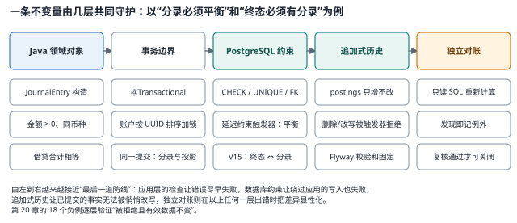

# 账本与业务流程的分离：19 条不变量 {#ch-invariants}

:::: opener
::: q
业务问题

付款有“草稿、已提交、已批准、等待清算、已完成”等十几种业务状态，账本却只认借贷。两者应当怎样分工？当它们说法不一致时，以谁为准？谁来保证它们永远一致？
:::
::: k
本章证据

- 不变量登记：`docs/v2/DOMAIN-INVARIANTS.md`（INV-01–INV-15 自第一至三轮，INV-16–INV-19 为第四轮新增）
- 负例测试：`ReconciliationNegativeFixturesPostgresIntegrationTests`
- 迁移：`V15__bind_terminal_payment_states_to_journals.sql`
:::
::::

## 两种事实

LedgerCore 的数据库里同时存放两类事实。

**业务事实**描述意图、审批与进度：一笔企业付款由谁创建、内容摘要是什么、谁批准、外部清算结果是什么；一个工资批次有哪些员工、每一项现在是 PENDING 还是 SUCCEEDED；一次转账的幂等键对应哪个回执。它们存在 `corporate_payment_intents`、`payroll_batches`、`payroll_item_results`、`transfers`、`idempotency_records` 等表里，状态会随流程推进而改变。

**资金事实**只有一种：分录（journal entry）与它的过账（posting）。一张分录说“某个时刻，这些账户按这些方向变动了这些金额”，借贷合计必须相等；一旦提交，永不修改。账户余额不是一个可以随意写的数字，而是全部过账的代数和。

两者的关系是单向的：**业务状态引用资金事实，资金事实从不引用业务状态。** 付款行里的 `booking_journal_entry_id`、`settlement_journal_entry_id`、`reversal_journal_entry_id`，工资结果里的 `transfer_id`，都是指向资金事实的外键；分录表里没有任何“付款状态”字段。这样做的好处是，当两边说法不一致时，判定规则是明确的：**钱以账本为准，流程以业务表为准，二者的对应关系由约束与对账共同保证。**

## 19 条不变量

不变量（invariant）是无论系统处于什么状态、发生了什么故障都必须成立的命题。LedgerCore 把它们登记在 `DOMAIN-INVARIANTS.md` 中，每一条都写明由什么机制保证、由哪个测试或实验验证。@tbl-invariants 给出精简版本。

| 编号 | 不变量 | 主要机制 |
|---|---|---|
| INV-01 | 每张已提交分录借贷平衡 | V1 延迟约束触发器 |
| INV-02 | 已提交的分录与过账不可变 | 追加式触发器；更正只能用冲销分录 |
| INV-03 | 金额是精确的整数最小单位 | `Money`、`BIGINT amount_minor`、正数 CHECK |
| INV-04 | 不发生未授权透支 | 排序加锁 + 权威余额 + 非负投影 |
| INV-05 | 业务操作幂等 | 按主体、操作、键限定的幂等记录 |
| INV-06 | 每个工资项原子 | 过账、回执、SUCCEEDED 同一事务 |
| INV-07 | 审批有效且独立 | Java 身份检查 + `ck_payroll_batches_maker_checker` |
| INV-08 | 已批准的工资意图不可悄悄改变 | 摘要 + 不可变触发器（V7 加固） |
| INV-09 | 组织资源相互隔离 | 成员资格过滤；非成员 404 |
| INV-10 | 部分执行可恢复 | 逐项持久结果；重启续跑 |
| INV-11 | 投影可独立与账本核对 | 投影从过账重算；对账比较 |
| INV-12 | 个人银行行为保持正确 | 每次迁移后的回归与升级测试 |
| INV-13 | 每个工资项恰有一个正确链接的结果 | V7 触发器与复合外键 |
| INV-14 | 已发布迁移永不改变 | 校验和固定；V7/V15 拒绝而不修复 |
| INV-15 | 企业出款必须有独立批准的不可变意图 | Policy B（V8） |
| INV-16 | 每个终态清算结果都有一个与之同时提交的效果所有者 | 回调收件箱 + 工作项同一事务（R4-01） |
| INV-17 | 付款终态与其分录绑定 | V15 `ck_corporate_payment_terminal_journals`（R4-06） |
| INV-18 | 模拟资产等于负债，准备金不为负 | 平衡触发器、V13 流动性分录约束 |
| INV-19 | 例外只能在独立复核之后关闭 | `ReconciliationService.resolveException`（R4-03） |

Table: LedgerCore 的 19 条领域不变量（完整版含验证证据，见 `docs/v2/DOMAIN-INVARIANTS.md`） {#tbl-invariants}

INV-01 至 INV-15 在第四轮中原样保留；第四轮只追加、不改写。这是本书反复出现的一条纪律：**历史记录可以被更正，但更正必须是新增的、署名的、可追溯的。**

## 一条不变量，五层防线

一条重要的不变量从来不靠单一机制守护。@fig-invariant-layers 以“分录必须平衡”和“终态必须有分录”为例，展示了从应用代码到独立对账的五层。

{#fig-invariant-layers}

每一层的职责不同：

- **Java 领域对象**让错误尽早、以可读的方式失败。`JournalEntry` 的构造函数拒绝非正金额、混合币种与借贷不等，开发者在单元测试里就能看到错误。
- **事务边界**保证一组相关写入同生共死。`LedgerWriter` 的公开方法在一个事务里加锁、写分录、重算投影；业务模块在同一个事务里更新自己的状态。
- **数据库约束**让绕过应用的写入同样失败。一个运维脚本、一次手工修数、一段未来新增的代码，只要违反规则，就在 `COMMIT` 时被拒绝。
- **追加式历史**让已经提交的事实无法被悄悄改写，所有更正都留下痕迹。
- **独立对账**用只读 SQL 重新计算一切，在以上任何一层出错时把差异变成一条有严重度、有负责人的例外。

如果只能保留一层，应当保留哪一层？答案是：**没有一层可以单独成立。** 只有数据库约束而没有对账，你不会知道约束本身漏掉了什么；只有对账而没有约束，错误数据已经写进去了，你只能事后补救。第四轮的 R4-06 正好说明了这一点。

## 例：终态必须有分录（R4-06）

第四轮为 E7 编写负例测试时，故意尝试在所有约束都启用的情况下制造“坏状态”，期望数据库拒绝。其中一条是：

```sql
UPDATE corporate_payment_intents SET status = 'COMPLETED' WHERE id = :bookedPendingPayment;
```

这条语句**成功了**。一笔已记账、尚在等待清算的付款，被标记为“已完成”，却没有结算分录，外部状态也不是 SETTLED。V8 的约束只要求 COMPLETED 的付款有记账分录，没有把“完成”与“结算”绑定起来。对账能发现这一行（`CORPORATE_PAYMENT_JOURNAL_MISMATCH`），但数据库允许它存在。更隐蔽的是 FAILED：V8 允许这个状态，应用从不使用它，可一旦有人写入，客户的钱就会永远停在清算应付里，而对账不会报警。

修复是一条只向前的迁移（@code-3-1）。

@@excerpt backend/src/main/resources/db/migration/V15__bind_terminal_payment_states_to_journals.sql | ALTER TABLE corporate_payment_intents ADD CONSTRAINT | /^\);/ | V15：把付款终态与证明它的分录绑定，FAILED 不再可表示

读这条约束时，可以把它拆成五个蕴含式：COMPLETED ⇒ 有结算分录、外部 SETTLED、无退款；有结算分录 ⇒ COMPLETED；已记账的 REJECTED ⇒ 有退款分录且外部 REJECTED；有退款分录 ⇒ REJECTED；状态不能是 FAILED。约束之前还有一段预检：如果现有数据里已经存在矛盾的行，迁移**拒绝执行**并报告数量，而不是自动“修复”。自动修复会改写财务历史——这正是本书禁止的事情。迁移兼容性测试 `v15RefusesToMigrateACompletedPaymentThatHasNoSettlementJournal` 在一个人为构造的 V14 数据库上验证了这种失败是“闭合”的：迁移失败、原数据不变、错误信息可诊断。

## 不变量如何被检验

一条不变量至少有三种检验：

1. **正例测试**证明正常路径满足它，例如结算后付款恰好有一张结算分录。
2. **负例测试**证明违反它的写入被拒绝，并且已有的有效数据保持不变。第 20 章的负例测试逐条执行了 18 种破坏，断言的是具体的约束名或错误信息，而不只是“抛了异常”。
3. **独立评分器**在任何一次运行之后用只读 SQL 重新检查，并把结果写成数字。E12 的 `financial-hard-gates.sql` 有 18 个必须为 0 的字段（第 26 章），其中 `unbalancedJournals` 对应 INV-01，`completedWithoutSettlement` 对应 INV-17，`balanceSheetDifferenceMinor` 对应 INV-18，`deliveredWorkMaskingOwedEffect` 对应 INV-16。

::: takeaway
把规则写进数据库并不是不信任开发者，而是承认系统会被很多入口写入：应用、迁移、脚本、未来的代码。约束让“规则”变成所有入口共享的事实；对账则承认约束本身也可能不完整。
:::

## 权衡

约束是政策的编码。V15 让 FAILED 不可表示，意味着未来如果要引入“付款失败”这条业务路径，必须先设计“失败时如何把记账退回客户”，再用一条新迁移放开约束并写明理由。这比在应用里加一个 `if` 麻烦得多——而这正是目的：任何会改变资金语义的决定，都应当昂贵到需要被明确地讨论。

::: exercise
1. 一笔企业付款的外部状态是 SETTLED，银行状态仍是 PENDING_CLEARING，结算分录为空。哪些不变量此刻被违反了？哪些没有？这种状态在修复后的系统里会被谁发现？（答案见 [附录 G](#ans-3-1)）
2. 对账发现一行“COMPLETED 却没有结算分录”的历史数据（例如来自修复前的数据库）。为什么正确做法不是让对账代码直接补写一张结算分录？应当怎样处理？（答案见 [附录 G](#ans-3-2)）
:::
