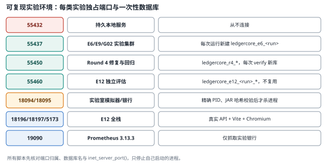

# 可复现实验环境与证据规则 {#ch-lab}

:::: opener
::: q
业务问题

一个实验说“崩溃后恢复成功”。你怎么知道它测的是你以为的那份代码、那个进程、那个数据库？怎么保证实验不会误伤别人的数据？一个从未真正发生的故障，怎样才能不被算作“通过”？
:::
::: k
本章证据

- 环境说明：`docs/v2/REPRODUCE.md`、附录 A
- 实验守卫：`assessment/e6/ClearingLab.Common.ps1`
- 一个被作废的官方评估：`evidence/round4/e12/attempt-1-6119274/README.md`
- 预演运行：`evidence/round4/e12/shakedown/README.md`
:::
::::

## 工具链与“干净的数据库”

LedgerCore 的所有验证都在本地可重建的工具链上进行：Temurin JDK 21.0.13+9、PostgreSQL 18.7 的二进制发行包、Node 22 与 Playwright 的 Chromium、用于告警实验的 Prometheus 3.13.3。它们被放在仓库下被 Git 忽略的 `work/` 目录里，版本写在 `REPRODUCE.md` 中。

比工具版本更重要的是**数据库的来历**。一个“通过”的集成测试，如果跑在一个积累了半年手工数据的库上，它证明不了什么；更糟的是，测试可能把那些数据改坏。因此本书的每一类验证都使用**一次性**（disposable）的 PostgreSQL：

- 每次 `mvn verify` 都在专用集群上新建一个空库，Flyway 从 V1 迁移到最新版本；
- 每次故障实验都在运行目录里 `initdb` 一个全新的集群，再为银行和模拟器各建一个带随机后缀的库与角色；
- E12 独立评估使用自己的集群和 `ledgercore_e12_<run>_*` 库名，绝不复用。

@fig-lab-topology 列出了这些实验各自独占的端口。最上面一行最重要：本机上那个持久的 PostgreSQL 服务（55432），任何脚本都**从不连接**。

{#fig-lab-topology}

## 守卫：先确认身份，再动手

一个会杀进程、删库、截断表的脚本，第一件事应当是证明“我面对的正是我自己创建的东西”。实验库的守卫并不复杂，但每一步都有理由（@code-4-1）。

@@excerpt assessment/e6/ClearingLab.Common.ps1 | function Assert-PostgresTarget | block | 写入之前核对库名前缀，并由服务器自己报告库名、地址、端口与当前角色

注意第二步：它不相信连接字符串，而是让 PostgreSQL 自己用 `current_database()`、`inet_server_addr()`、`inet_server_port()` 和 `current_user` 报告身份。连接字符串可能被环境变量覆盖、被代理转发；服务器的自我报告才是事实。

杀进程同样需要守卫（@code-4-2）。

@@excerpt assessment/e6/ClearingLab.Common.ps1 | function Assert-ExactJavaListener | block | 只有当端口上的监听者正是本次运行记录的 PID、并且命令行包含被测 JAR 时，才允许信任或停止它

如果你曾经在共享开发机上用 `taskkill /IM java.exe` 杀掉过同事的 IDE，就会理解这几行的价值。实验脚本只停止**自己启动并记录在案**的进程，结束后由 E12 运行器逐例确认端口已经释放（`cleanup` 字段）。

## 每一次运行都要能回答“测的是什么”

每次实验运行都会在 `run.json` 中记录：

| 字段 | 回答的问题 |
|---|---|
| `sourceSha` | 测的是哪一个提交 |
| `trackedTreeDirty` | 工作区里有没有未提交的跟踪文件改动（`git status --porcelain --untracked-files=no`） |
| `bankJarSha256` / `simJarSha256` | 实际运行的 JAR 是否就是那个提交构建出来的 |
| `bank.database` / `sim.database` | 写入了哪两个一次性库 |
| `checkpoint` | 故障点是否真的到达：进程号、故障名、当时的业务事实 |
| `timeline.log` | 每一步发生的时间 |

Table: 实验运行记录的关键字段 {#tbl-run-fields}

`trackedTreeDirty` 看起来琐碎，却是区分“预演”和“证据”的界线。第四轮在提交 E12 脚本之前，先在未提交的工作区里“预演”（shakedown）了所有从未执行过的脚本，记录为 `trackedTreeDirty: true`。预演找到了两个真实的脚本缺陷：工资实验的评分 SQL 读了一个不存在的列（`failure_code`，实际是 `error_code`）；全栈评估把 `--reporter=list,json` 交给 PowerShell 时，逗号被解析成数组分隔符，Playwright 根本没有运行。这些运行保留在 `evidence/round4/e12/shakedown/` 中，但**不**计入验收。

## 一个被作废的官方评估

纪律在真正出错时才显出价值。修复了预演发现的问题、提交并通过 CI 之后，第一次官方 E12 评估在干净的工作区、精确的提交 `6119274` 上运行：后端 118 个测试、模拟器 9 个测试、9 个浏览器旅程、恢复实验、告警实验全部通过——可 11 个故障实验在一分钟之内全部以 `HARNESS_ERROR` 结束，36 个用例中 8 个判为 FAIL。

原因是一行看似无害的 PowerShell：

```powershell
& $script @($step.inject)     # 错误：@(...) 是数组子表达式，整个数组被当作 -Action 的值
& $script @injectParams       # 正确：用哈希表展开（splatting），按参数名绑定
```

这次评估既不能说明应用有问题（没有任何故障被注入），也不能被当作通过（没有任何用例被评分）。正确的处理是：把整次运行原样保存在 `attempt-1-6119274/` 并写明原因，修复运行器，提交，再在新的提交上**完整地**重跑全部评估，而不是只补跑失败的部分、再把两个提交的结果拼在一起。第 26 章的验收结论只使用第二次评估。

::: why
为什么不能只补跑那 11 个故障用例？因为验收结论要回答“这个提交是否合格”。补跑意味着证据来自两个不同的提交；哪怕两者只差一个脚本文件，读者也必须自己去判断那个差异是否无关紧要。重跑一遍的成本是一个多小时，换来的是一句无需解释的话：所有证据都来自同一个提交、同一个干净的工作区。
:::

## 精确提交的 CI

本地证据之外，每一次推送到 `main` 的提交都会触发 GitHub Actions：前端依赖审计与构建、后端与模拟器的 `clean verify`（使用 CI 自己的 PostgreSQL 服务）、启动真实的银行与模拟器、比对生成的 OpenAPI TypeScript 契约、运行全部 Playwright 旅程，并单独用 OSV 扫描 Maven 依赖（第 25 章）。验收文档记录的永远是“这个 SHA 的这一次运行”；一个更早的提交上的绿色，不能证明之后改动过的代码。

## 秘密与合成数据

实验中出现的密码、HMAC 密钥与会话 Cookie 都是**按运行生成、只在一次性库中有效**的值：数据库角色的密码由运行号派生，HMAC 密钥由 `RandomNumberGenerator` 生成，告警实验抓取指标用的会话 Cookie 只写在被忽略的运行目录里。提交到仓库的证据文件在提交前都会被扫描，确保不包含这些值、个人邮箱或任何真实凭据。所有用户都使用 `example.test` 域名下的合成身份。

::: exercise
1. 某次故障实验的 `run.json` 显示 `trackedTreeDirty: true`，恢复判定为 PASS。这个结果可以作为验收证据吗？如果不可以，它还有什么用途？（答案见 [附录 G](#ans-4-1)）
2. 第一次官方 E12 评估中，8 个用例因运行器缺陷判为 FAIL。有人建议：“既然缺陷在脚本里，就把这 8 个用例改判为 NOT_RUN，其余 28 个 PASS 照用。”这个建议错在哪里？（答案见 [附录 G](#ans-4-2)）
:::
