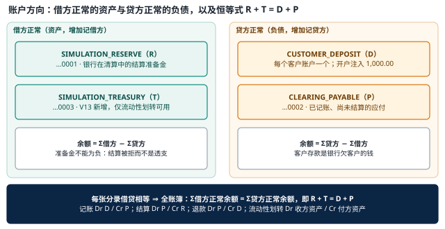
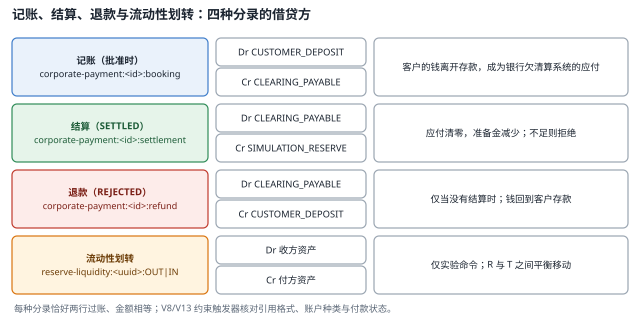

# 复式记账：账户方向与会计恒等式 {#ch-double-entry}

:::: opener
::: q
业务问题

Kererū 的企业账户里有 1,000.00 NZD。批准一笔 80.00 的供应商付款之后，钱“离开”了客户，却还没有到达收款人。这 80.00 此刻在哪里？账本怎样表达“银行欠着清算系统一笔钱”？
:::
::: k
本章证据

- 账户种类：`LedgerAccountKind`；分录工厂：`JournalEntry`
- 独立评分器：`assessment/e12/graders/financial-hard-gates.sql`
- 第四轮准备金实验：`evidence/round4/remediation/clearing-reserve-shortage-postfix.json`
:::
::::

## 为什么工程师需要复式记账

单式记账只记录“某个账户余额变成了多少”。它的问题不在于不够精确，而在于**无法自我校验**：如果一次更新只写了一半，或者被写了两次，余额本身不会告诉你。复式记账（double-entry bookkeeping）要求每一次资金变动都同时出现在至少两个账户上，一边记借方（debit），一边记贷方（credit），两边金额相等。于是全账簿的借方总额永远等于贷方总额——这是一个内置的校验和。任何只写了一半的变动、任何凭空出现或消失的钱，都会让等式失衡。

对工程师来说，复式记账的价值与其说是会计传统，不如说是一种**带冗余的数据编码**：它让“钱不会凭空产生或消失”从一句口号变成一条可以用 SQL 在任何时刻验证的等式。

## 账户方向

“借”和“贷”本身没有“增加”或“减少”的含义；含义取决于账户的**正常方向**（normal side）。资产类账户借方正常：记借方表示增加。负债类账户贷方正常：记贷方表示增加。LedgerCore 只有四种账户（@fig-polarity）。

{#fig-polarity}

- **CUSTOMER_DEPOSIT（D）**：每个客户账户对应一个，贷方正常。客户存款是银行欠客户的钱，是负债。
- **CLEARING_PAYABLE（P）**：系统账户，贷方正常。已经从客户那里扣下、但尚未交给清算系统的钱，是银行欠清算系统的负债。
- **SIMULATION_RESERVE（R）**：系统账户，借方正常。银行放在清算系统中、用于结算的模拟准备金，是资产。
- **SIMULATION_TREASURY（T）**：第四轮新增的系统账户，借方正常。准备金之外的模拟流动性，只能通过受限的流动性划转使用（第 17 章）。

在这个模型里，余额永远用“正常方向为正”的方式计算：资产余额 = Σ借方 − Σ贷方，负债余额 = Σ贷方 − Σ借方。一个正常余额变成负数，意味着资产被透支或负债变成了债权——这两种情况 LedgerCore 都拒绝（第 2 章的投影重算与第 6 章的约束）。

## 每一种分录长什么样

分录在 Java 里是一个不可变的 `record`，它的紧凑构造函数（compact constructor）在对象诞生的那一刻就检查了复式记账的基本规则（@code-5-1）。

@@excerpt backend/src/main/java/nz/ac/ledgercore/ledger/JournalEntry.java | public JournalEntry \{ | block | 分录在构造时就拒绝少于两行、同一账户重复过账与借贷不等

注意 `Math.addExact`：金额是 `long` 型的最小单位（分），累加溢出会抛出异常而不是悄悄回绕。浮点数从未出现在金额路径上。

企业付款相关的四种分录由专门的工厂方法生成，借贷方向写死在方法里，调用者无法弄反（@code-5-2）。

@@excerpt backend/src/main/java/nz/ac/ledgercore/ledger/JournalEntry.java | public static JournalEntry corporatePaymentBooking | 24 | 记账、结算、退款与流动性划转：方向由工厂方法固定

@fig-journals 把它们放在一起。读这张图时，可以用一句话检查每一行：**钱从哪里来（贷方的减少或借方的增加），到哪里去。**

{#fig-journals}

## 一笔 80.00 付款的完整账

回到开篇的问题。设 Kererū 的企业账户（D）开户时注入 1,000.00。开户本身也是一张分录：`OPENING_FUNDING`，借 R、贷 D——银行模拟“收到”了客户的存款，资产与负债同时增加 1,000.00。于是：

| 时刻 | 分录 | R（资产） | T（资产） | D（负债） | P（负债） | R+T−D−P |
|---|---|---:|---:|---:|---:|---:|
| 开户后 | Dr R 1,000.00 / Cr D 1,000.00 | 1,000.00 | 0 | 1,000.00 | 0 | 0 |
| 批准即记账 | Dr D 80.00 / Cr P 80.00 | 1,000.00 | 0 | 920.00 | 80.00 | 0 |
| 外部 SETTLED，结算 | Dr P 80.00 / Cr R 80.00 | 920.00 | 0 | 920.00 | 0 | 0 |
| （另一种结局）外部 REJECTED，退款 | Dr P 80.00 / Cr D 80.00 | 1,000.00 | 0 | 1,000.00 | 0 | 0 |

Table: 一笔 80.00 付款在各个时刻的账户余额（单位 NZD；为简化只显示一个客户） {#tbl-80}

批准之后、结算之前，这 80.00 就在 P 里：它已经不属于客户（D 减少了），也还没有离开银行（R 没有减少）。这正是“等待清算”在账本上的含义。结算把它从 P 转出、同时减少 R：银行用自己在清算系统里的准备金完成了支付。退款则把它从 P 还给 D。

无论哪一行，最后一列都是 0。这不是巧合，而是每张分录借贷相等的必然结果：R + T = D + P。

## 用 SQL 验证恒等式

复式记账最实用的地方，在于它把“账对不对”变成了一个可以随时执行的查询。E12 的独立评分器对任何一个数据库都会计算这几项（@code-5-3）。

@@excerpt assessment/e12/graders/financial-hard-gates.sql | 'unbalancedJournals' | 10 | 评分器的四个基础硬门槛：不平衡分录、非正或外币过账、投影偏差、负的正常余额与资产负债差

`balanceSheetDifferenceMinor` 就是 R + T − D − P（按“正常方向为正”计算后，借方正常账户之和减贷方正常账户之和）。在第四轮的每一次实验、每一次 E12 运行之后，这个值都必须是 0；它不是 0 的唯一可能，是某个地方写入了不平衡的分录或篡改了过账——而那会被 `unbalancedJournals` 同时捕获。

第四轮的准备金实验给出了一组可以手算核对的真实数字：企业账户开户注入 1,000.00 之后，受限的实验命令把准备金划入司库，只留 50.00；80.00 的结算因此被拒；补足 100.00 之后结算成功。实验结束时准备金 70.00、司库 850.00，资产合计 920.00；客户存款 920.00、应付 0——实验记录的借方正常合计与贷方正常合计都是 92,000 分（`evidence/round4/remediation/clearing-reserve-shortage-postfix.json`）。

::: limit
LedgerCore 的会计模型刻意保持最小：只有 NZD 一种币种，没有利息、手续费、外汇、在途资金分类或总分类账科目体系。它足以表达“钱在哪里”的全部问题，但不是一套会计系统。
:::

::: exercise
1. 一个客户账户的过账为：贷 1,000.00（开户）、借 30.00（转出）、贷 12.50（转入）、借 80.00（企业付款记账）。它的余额是多少？如果随后外部结果是 REJECTED，余额变为多少？（答案见 [附录 G](#ans-5-1)）
2. 为什么开户注入资金时要借记 SIMULATION_RESERVE，而不是凭空增加客户余额？如果去掉这一借方，哪一条评分器门槛会失败？（答案见 [附录 G](#ans-5-2)）
3. 一次流动性划转 OUT 把 50.00 从 R 转到 T。写出分录，并说明它对 R + T − D − P 的影响。（答案见 [附录 G](#ans-5-3)）
:::
