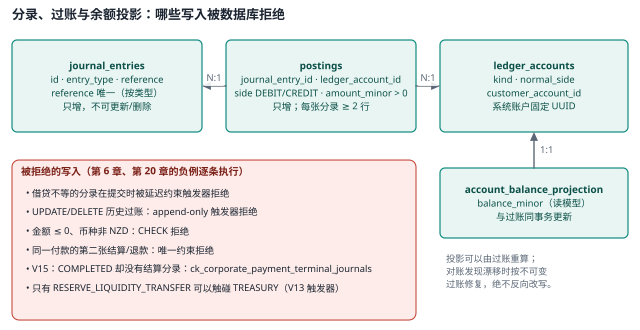
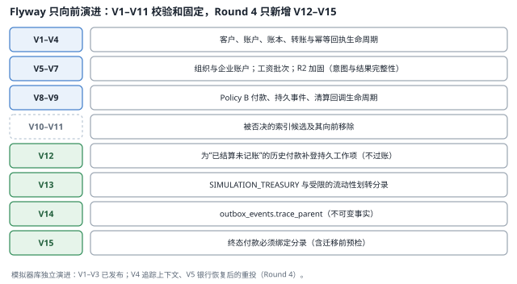

# 数据库约束：平衡、追加式历史与只向前的迁移 {#ch-constraints}

:::: opener
::: q
业务问题

应用代码已经检查过“借贷相等”。为什么还要让 PostgreSQL 再检查一遍？已经发布的迁移脚本里有一处注释写错了，能不能顺手改掉？
:::
::: k
本章证据

- `V2__create_ledger_tables.sql`：平衡与追加式触发器
- `V13__add_simulation_treasury_for_finite_reserve.sql`：司库只能被流动性划转触碰
- `MigrationCompatibilityPostgresIntegrationTests`：校验和固定与升级测试
- `V12__enqueue_stranded_clearing_financial_effects.sql`：只补登工作、不过账的修复迁移
:::
::::

## 让数据库成为最后的裁判

第 3 章说明了为什么每条重要的不变量都要有数据库层的防线：应用不是唯一的写入者。本章看这些防线具体怎样写、为什么这样写，以及它们自己的边界在哪里。@fig-journal-schema 给出了账本相关的四张表和被数据库拒绝的六类写入。

{#fig-journal-schema}

## 平衡检查为什么必须“延迟”

一张分录在 SQL 层面是一行 `journal_entries` 加上至少两行 `postings`。应用逐行插入：先插分录头，再插第一条过账，再插第二条。如果在**每一行插入之后**立刻检查平衡，第一条过账插入时必然失衡，任何合法的分录都写不进去。

解决办法是**延迟约束触发器**（deferred constraint trigger）：触发器在每次插入时被排队，但直到事务 `COMMIT` 的那一刻才真正执行（@code-6-1）。

@@excerpt backend/src/main/resources/db/migration/V2__create_ledger_tables.sql | CREATE FUNCTION ledgercore_assert_journal_entry_balanced | 40 | 两个延迟约束触发器在提交时重新求和，借贷不等或少于两行即拒绝整个事务

几个细节值得注意：

- 触发器挂在两张表上：插入分录头会检查，插入任何一条过账也会检查。这样无论哪种写入顺序，最终提交时每一张被触及的分录都会被重新求和。
- `RAISE EXCEPTION ... USING ERRCODE = '23514', CONSTRAINT = 'ck_journal_entries_balanced'` 让错误以标准的 `check_violation` 返回，并带上一个可以被测试精确断言的约束名。负例测试不只断言“失败了”，还断言“是因为这条规则失败的”。
- 求和用 `NUMERIC` 而不是 `BIGINT`，避免数据库端的累加溢出。

## 追加式历史

已提交的过账永远不能被修改或删除。规则写起来只需要几行（@code-6-2）。

@@excerpt backend/src/main/resources/db/migration/V2__create_ledger_tables.sql | CREATE FUNCTION ledgercore_reject_ledger_history_change | 17 | 任何对分录或过账的 UPDATE/DELETE 都被拒绝；更正只能新增冲销分录

错误信息本身就是操作指南：“请记录一张新的冲销分录”（reversal entry）。冲销分录引用被冲销的原分录，方向相反、金额相同；原分录与冲销分录都永久保留。`LedgerWriter.reverseJournalEntry` 实现了这一点，并且拒绝冲销流动性划转——那一类更正只能通过一次方向相反的划转完成，留下独立的请求号与审计。

第二轮审计发现过一个有意思的例外：V5 迁移需要给历史转账补写一个新列，而转账表同样是追加式的。V5 的做法是在**自己的迁移事务内**临时禁用这个触发器、补写、重新启用并验证后才提交（R2-08）。这是迁移脚本拥有、且只在迁移时行使的特权；应用运行时从不这样做，实验脚本也从不禁用任何完整性触发器。

## 系统账户的专用规则

第四轮新增的司库账户（SIMULATION_TREASURY）只允许一种分录触碰。V13 用另一个延迟约束触发器表达这条政策（@code-6-3）。

@@excerpt backend/src/main/resources/db/migration/V13__add_simulation_treasury_for_finite_reserve.sql | IF NEW.entry_type <> 'RESERVE_LIQUIDITY_TRANSFER' THEN | 23 | 只有流动性划转能触碰司库；引用必须是 reserve-liquidity:<uuid>:OUT/IN，恰好两行、方向与引用一致

这段 PL/pgSQL 检查了四件事：非划转分录不得触碰司库；划转必须带有格式正确的请求引用，且不能是冲销；恰好两行过账，一行在司库；OUT 必须是“借司库、贷准备金”，IN 必须相反。配合引用上的唯一索引，同一个请求号重放时会被识别为同一次划转，而不是再划一次（第 17 章）。

## 已发布的迁移永不改变

Flyway 为每个已执行的迁移记录一个校验和（checksum）。如果有人修改了一个已经在某个数据库上执行过的脚本——哪怕只是改了一处注释——那个数据库下次启动时 Flyway 会拒绝继续，因为它无法确定“已执行的历史”和“现在的脚本”是不是同一件事。

开发者常见的反应是执行 `flyway repair` 让校验和重新匹配。LedgerCore 明确禁止这样做：`repair` 会让一个已经部署的数据库**假装**执行过它从未执行过的脚本。正确的做法只有一种：已发布的脚本一字不改，任何修正都写成新的版本号。测试把 V1–V11 的校验和固定下来（@code-6-4），任何就地修改都会让构建失败。

@@excerpt backend/src/test/java/nz/ac/ledgercore/MigrationCompatibilityPostgresIntegrationTests.java | private static final Map<String, Integer> PUBLISHED_CHECKSUMS | 16 | V1–V11 的 Flyway 校验和被固定在测试中；就地修改历史迁移会让构建失败

同一个测试类还在真实的 PostgreSQL 上构造“已有数据的旧版本数据库”——V4 的个人银行、V5 的企业账户、V6 的工资、V8 的清算意图、V11 的“已结算未记账”付款——然后升级到最新版本，逐行比较升级前后的财务历史，确认迁移没有改写任何一行。@fig-flyway 概括了 15 个版本的演进。

{#fig-flyway}

## 修复迁移应当做什么，不应当做什么

第四轮修复 R4-01 时面临一个现实问题：一个运行过修复前代码的数据库里，可能已经存在“外部已结算、本地未记账”的付款。修复后的代码会为**新的**回调创建持久工作项，可那些历史付款没有工作项。

一种诱人的写法是在迁移里直接为它们补写结算分录。V12 没有这样做（@code-6-5）。

@@excerpt backend/src/main/resources/db/migration/V12__enqueue_stranded_clearing_financial_effects.sql | INSERT INTO outbox_events | /ON CONFLICT \(event_key\) DO NOTHING;/ | V12 只为搁浅的付款补登持久工作项，不写分录、不改付款与回调

理由有三：第一，迁移在部署时运行，不经过应用的授权、锁、审计与准备金检查；在迁移里过账，等于绕过了所有业务规则。第二，补登工作项之后，结算由正常的处理器在正常的事务里完成，准备金不足时同样会被拒绝并升级为例外（第 17 章）。第三，`ON CONFLICT (event_key) DO NOTHING` 让迁移可以安全地重放，不会产生第二个工作项。迁移兼容性测试 `populatedV11WithAStrandedSettlementUpgradesToDurableWorkWithoutPostingMoney` 验证了这三点：升级后恰好出现一个工作项，账本没有任何变化。

V7 与 V15 则代表另一种修复迁移：它们为历史数据增加新的约束，因此先做**预检**，发现矛盾就拒绝迁移并报告数量。拒绝是“闭合失败”（fail closed）：数据库停在旧版本，数据不变，错误信息说明原因，人工处理之后再重试。

## 权衡

- **性能**：延迟触发器在提交时为每张被触及的分录重新求和。对每张两行的分录，这几乎没有成本；如果一张分录有上万行（例如把整个工资批次写成一张分录），这个检查就会变重。LedgerCore 的工资逐项转账、每项一张分录，部分原因正在于此。
- **特权**：超级用户可以通过 `session_replication_role` 等手段跳过触发器。约束防不住拥有超级权限的人；这需要运维层面的权限分离来补足。实验环境里应用角色只拥有自己库的所有权，从不使用超级用户运行。
- **刚性**：已发布迁移不可改，意味着每个错误都要用一个新版本来修正，迁移列表只会变长。这是可审计性的代价，值得付出。

::: exercise
1. 如果把平衡触发器改成 `NOT DEFERRABLE`（每行插入后立即检查），会发生什么？有没有办法在不延迟的前提下仍然插入合法分录？（答案见 [附录 G](#ans-6-1)）
2. 一位同事发现 V9 的注释里有一个拼写错误，提交了修正。CI 会在哪里失败？已经部署了 V9 的数据库会怎样？正确的做法是什么？（答案见 [附录 G](#ans-6-2)）
3. 对账发现某个账户的投影比过账之和多了 5.00。写出修复步骤：哪些表可以动，哪些绝不能动？（答案见 [附录 G](#ans-6-3)）
:::
