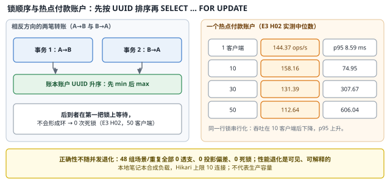

# 事务、锁顺序与并发扣款 {#ch-locks}

:::: opener
::: q
业务问题

周五下午，工资执行器、两名财务人员和一个自动对账任务同时从 Kererū 的企业账户扣款或读余额。怎样保证账户永远不会被扣成负数？两笔方向相反的转账会不会互相等待到天荒地老？
:::
::: k
本章证据

- `LedgerWriter.transferBetweenCustomerAccounts` 与 `lockLedgerAccounts`
- E3 H02 并发实验：`evidence/e3/verdicts/H02-financial-concurrency.md`
- Round 3 E9 投影读取补充实验：`evidence/round3/e9/R2-P2-PROJECTION-RESULTS.md`
:::
::::

## 检查再扣款为什么会出错

“先查余额，够就扣”是并发编程里最经典的竞态之一。两个事务同时读到余额 100.00，各自判断“够扣 80.00”，各自写入一笔扣款，余额变成 −60.00。数据库的事务并不会自动阻止这件事：在 PostgreSQL 默认的 READ COMMITTED 隔离级别下，两个事务读到的都是当时已提交的 100.00，谁也没有做错。

解决的办法有两类。一类是提高隔离级别（SERIALIZABLE），让数据库在提交时发现冲突并让其中一个事务失败，由应用重试。另一类是**悲观锁**：先锁住要扣款的账户，再读余额、再写入。持有锁的事务提交之前，其他想锁同一账户的事务只能等待。LedgerCore 选择后者，因为它的语义更直观：失败只来自“余额真的不够”，而不是“恰好有人同时操作”。

## 先加锁，再读权威余额

转账写入账本的方法很短，却把三件事的顺序固定了下来（@code-7-1）。

@@excerpt backend/src/main/java/nz/ac/ledgercore/ledger/LedgerWriter.java | public UUID transferBetweenCustomerAccounts | block | 先锁两个账本账户，再读权威余额，最后写分录与投影

“权威余额”（authoritative balance）指的是对该账户全部过账求和的结果，而不是读投影表。为什么锁之后这次读取就是安全的？因为调用它的 `TransferService.transfer` 运行在 READ COMMITTED 隔离级别下：这个级别里每一条 SQL 语句都会取一个新的快照。`SELECT ... FOR UPDATE` 拿到锁的那一刻，所有更早持有这把锁的事务都已经提交；紧随其后的余额查询取新快照，必然看到它们的过账。如果换成 REPEATABLE READ，快照在事务的第一条语句就固定了，锁之后的读取反而看不到别人刚提交的扣款（练习 7.2 会追问这时会发生什么）。隔离级别和锁不是两个独立的选择，它们必须一起推理。

## 锁的顺序

一笔转账要锁两个账户：付款方和收款方。设想 A 向 B 转账、B 同时向 A 转账。如果每个事务都“先锁付款方”，事务 1 锁住 A 等待 B，事务 2 锁住 B 等待 A——这就是死锁。PostgreSQL 会在约一秒后检测到环并杀掉其中一个事务，但那已经是一次用户可见的失败。

LedgerCore 的规则是：**无论业务上谁是付款方，总是按账本账户 UUID 的升序加锁**（@code-7-2）。

@@excerpt backend/src/main/java/nz/ac/ledgercore/ledger/LedgerWriter.java | private void lockLedgerAccounts | block | 去重、按 UUID 自然顺序排序，再逐个 SELECT ... FOR UPDATE

两个方向相反的事务现在都会先去锁 min(A, B)。后到者在第一把锁上等待，永远不会出现“我持有你要的、你持有我要的”的环（@fig-lock-order 左侧）。同样的规则也用于结算、退款与流动性划转：所有需要锁多个账本账户的地方都经过这个方法，因此所有路径共享同一个全局顺序。

{#fig-lock-order}

## 实测：正确性不随并发退化，性能会

第一轮的 E3 H02 实验用合成负载测试了四种场景，每种在 1、10、30、50 个并发客户端下各重复三次：互不相关的账户对、单一热点付款方、相反方向的账户对，以及“80% 余额充足、20% 故意不足”的混合负载。@tbl-h02 摘取了其中的关键数字。

| 场景 | 客户端 | 吞吐（ops/s） | p95（ms） |
|---|---:|---:|---:|
| 互不相关的账户对 | 1 | 83.33 | 15.32 |
| 互不相关的账户对 | 50 | 1,094.59 | 145.26 |
| 单一热点付款方 | 1 | 144.37 | 8.59 |
| 单一热点付款方 | 10 | 158.16 | 74.95 |
| 单一热点付款方 | 50 | 112.64 | 606.04 |
| 相反方向 | 50 | 109.48 | 743.35 |
| 80% 充足 / 20% 不足 | 50 | 108.94 | 680.76 |

Table: E3 H02 中位数（三次重复；本地笔记本，Hikari 最多 10 个连接） {#tbl-h02}

两条结论应当分开读：

- **正确性**：48 组“场景 × 重复”全部为零意外失败、零透支、零投影偏差、零死锁计数增长。混合负载里那 20% 的余额不足请求被正确拒绝（HTTP 422 `INSUFFICIENT_FUNDS`），没有一笔导致透支。
- **性能**：互不相关的账户对随并发增长到每秒一千多笔；热点账户在 10 个客户端之后吞吐反而下降、p95 急剧上升。原因很直接：同一行锁让所有扣款串行化，更多的并发只会排更长的队；Hikari 连接池最多 10 个连接，50 个客户端里有 40 个在等连接。

第二条不是缺陷，而是这个设计**有意接受**的代价：对一个账户而言，串行是正确性的来源。真正的银行会用别的手段缓解热点（例如把一个企业的出款分散到子账户、或者对批量出款做预留），这些都超出了 LedgerCore 的范围。

::: limit
这些数字来自一台笔记本上的本地 PostgreSQL 与合成负载，不包括 HTTP、TLS、浏览器或网络时间，也不代表任何生产容量。它们的用途是解释机制：锁让热点账户串行化，而串行化在高并发下表现为排队。
:::

## 权威余额的代价与投影读取

每次扣款都对付款账户的全部过账求和。账户历史越长，这一步越慢：E3 H01 测到，在 100,000 条过账时，仅余额聚合的中位数就从 0.84 ms 增长到 105.59 ms（第 22 章）。第三轮的 R2-P2 补充实验在 12 个夹具上比较了两种读法：在 100,000 条过账时，权威 SQL 的 p50/p95 为 39.165/51.389 ms，而读投影表只要 0.330/0.558 ms，且 12 个夹具全部零投影偏差。

既然投影又快又准，为什么扣款时不读投影？因为投影是**派生数据**：它由同一个事务从过账重算后写入，理论上永远一致，但“理论上”正是对账存在的理由。在扣款这个决定钱能否离开账户的时刻，LedgerCore 选择直接读事实本身；投影用于展示、对账与告警。这是一个被明确记录、可以被未来的预注册实验推翻的选择——它的代价被测量过，而不是被假设为零。

## 并发工资批次

第二轮补充了一个更接近周五场景的测试：两个工资批次共用同一个付款账户，60 个工资项的总额超过余额，两个执行器同时运行。`concurrentBatchesSharingOnePayerNeverOverdrawIt` 断言最终恰好 50 项成功、10 项因余额不足失败、付款账户余额恰好为 0——不是负数，也不是“为了安全多拒绝了几项”。工资执行器的认领机制见第 11 章。

::: exercise
1. 假设有人把 `lockLedgerAccounts` 改成“先锁付款方、再锁收款方”。哪一个 E3 场景最可能暴露问题？PostgreSQL 会怎样表现？用户会看到什么？（答案见 [附录 G](#ans-7-1)）
2. 把 `TransferService.transfer` 的隔离级别改成 REPEATABLE READ、其余不变。加锁之后的余额读取会看到什么？在 LedgerCore 的写入路径里，这个问题最终会以什么形式暴露？如果写入路径里没有更新投影这一步，又会发生什么？（答案见 [附录 G](#ans-7-2)）
:::
