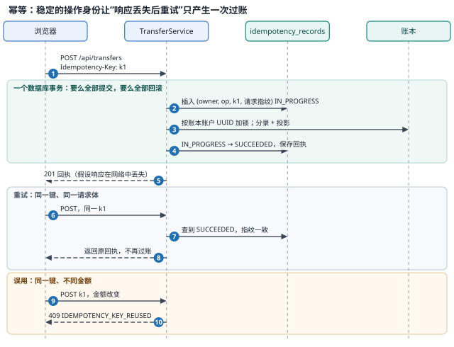

# 幂等：稳定的操作身份与响应丢失后的恢复 {#ch-idempotency}

:::: opener
::: q
业务问题

Aroha 点击“确认转账”之后，浏览器转了十秒，然后显示“网络错误”。她不知道钱有没有转出去。再点一次，会不会转两次？不点，会不会根本没转？
:::
::: k
本章证据

- `TransferService`：键保留、请求指纹与回执重放
- `V4__enforce_idempotency_receipt_lifecycle.sql`：保留只能以成功提交
- 浏览器旅程 `banking-flow.spec.ts`：丢弃一次成功响应后的恢复
- E6/E12 转账崩溃实验：提交前、提交后应答前、Outbox 派发前
:::
::::

## “至多一次”与“至少一次”之间

网络请求有三种结局：成功且你知道成功、失败且你知道失败、以及**你不知道**。第三种最常见于超时：服务器可能根本没收到请求，可能处理到一半崩溃了，也可能已经成功提交、只是响应在返回的路上丢了。客户端无法区分这三种情况。

如果客户端选择“不重试”，就是至多一次（at-most-once）：钱可能没转。如果选择“重试”，就是至少一次（at-least-once）：钱可能转两次。银行需要的是**恰好一次的效果**（effectively exactly-once），而唯一可行的做法是：客户端可以放心重试，服务器保证同一个操作无论收到几次都只生效一次。这要求每个操作有一个**稳定的身份**。

## 幂等键与请求指纹

LedgerCore 的转账 API 要求客户端在请求头里带上 `Idempotency-Key`。前端在用户点击“复核”时生成一个 UUID，并在本次意图的所有重试中复用它。服务器把这个键与三样东西绑定（@fig-idempotency）：

- **主体**：键属于哪个已认证的客户。不同客户使用相同的键互不干扰；工资使用自己的命名空间 `payroll-<batch>-<item>`，客户提交的键不能占用这个前缀（第二轮 R2-06）。
- **操作**：键用于哪一种操作（转账）。
- **请求指纹**：对“操作、主体、来源账户、目标账户、币种、金额”的规范化文本做 SHA-256。同一个键如果带着不同的金额回来，指纹不一致，服务器返回 409 `IDEMPOTENCY_KEY_REUSED`，而不是悄悄地执行或悄悄地返回旧结果。

{#fig-idempotency}

## 用唯一索引代替分布式锁

第一次请求和重试请求可能**同时**到达——例如用户在第一次请求还没返回时又点了一次。保留键的那一条 SQL 处理了这种情况（@code-8-1）。

@@excerpt backend/src/main/java/nz/ac/ledgercore/transfers/TransferService.java | String fingerprint = fingerprint\(authenticatedCustomerId | 14 | 用 INSERT ... ON CONFLICT DO NOTHING 保留键；保留失败就重放原回执

`(owner_customer_id, operation, idempotency_key)` 上有唯一约束。两个并发请求执行这条 `INSERT` 时，后到的那个会在唯一索引上**等待**先到者的事务结束：如果先到者提交，后到者得到“冲突、插入 0 行”，转而重放回执；如果先到者回滚（例如余额不足），后到者的插入成功，它会自己执行一次。不需要任何应用层的锁、缓存或分布式协调——数据库的唯一索引已经是一把按键粒度的锁。

重放时，服务器用常量时间比较指纹，再返回保存的回执（@code-8-2）。

@@excerpt backend/src/main/java/nz/ac/ledgercore/transfers/TransferService.java | private TransferReceipt replayReceipt | block | 指纹不一致即 409；一致则返回提交时保存的同一张回执

## “进行中”永远不能被提交

保留键时插入的记录状态是 IN_PROGRESS；同一事务在过账之后把它改为 SUCCEEDED 并写入回执。如果事务在中途失败，整条记录随之回滚，就像从未保留过。可是如果某段未来的代码忘了把状态改成 SUCCEEDED 就提交了呢？那条 IN_PROGRESS 记录会永远挡住这个键，之后的每一次重试都会因为“找不到成功回执”而失败。

V4 用一个延迟约束触发器把这种可能性关掉（@code-8-3）。

@@excerpt backend/src/main/resources/db/migration/V4__enforce_idempotency_receipt_lifecycle.sql | CREATE FUNCTION ledgercore_assert_idempotency_succeeded | 25 | 提交时幂等记录必须已是 SUCCEEDED：保留与成功回执要么一起提交，要么都不存在

同一迁移里的另外两个触发器规定：IN_PROGRESS 只能一次性地变为 SUCCEEDED；SUCCEEDED 的记录作为不可变回执永久保留。合起来，数据库保证了一个很强的性质：**任何已提交的幂等记录都带着它的成功回执，而且这张回执永远不会改变。**

## 三个崩溃窗口

“响应在网络中丢失”只是故障的一种。第三轮的 E6 实验在三个精确的位置杀死银行进程，再由独立 SQL 评分：

| 崩溃位置 | 崩溃时数据库里有什么 | 恢复后应当如何 |
|---|---|---|
| 提交之前（`precommit-crash`） | 什么都没有：保留、分录、回执一起回滚 | 用同一个键重试，执行一次 |
| 提交之后、响应之前（`postcommit-response-crash`） | 分录与成功回执都已提交 | 用同一个键重试，返回原回执，不再过账 |
| 业务事实已提交、Outbox 派发之前（`outbox-before-dispatch`） | 转账与待派发事件都已提交 | 重启后事件被派发恰好一次 |

Table: 转账的三个崩溃窗口与期望的恢复（E6 第三轮实现，E12 在冻结提交上重跑） {#tbl-transfer-crash}

第二种最能说明幂等键的价值：客户端看到的是连接中断，服务器那边钱已经转了。没有稳定的操作身份，客户端只能在“可能重复”与“可能遗漏”之间二选一。这三个用例在第四轮的 E12 评估中作为 E12-A04 与 E12-D02 在冻结提交上重新执行（第 26 章）。

## 浏览器里的同一件事

幂等不只是 API 的事。`banking-flow.spec.ts` 用 Playwright 拦截一次 25.00 的转账请求：让请求真正到达服务器、确认服务器返回了 200，然后以“网络断开”丢弃返回给浏览器的响应。界面显示警示“Transfer result unknown”，并说明原始请求已被保存（“original request is saved”）；即使刷新页面，这个提示仍在。点击“Check the saved transfer”时，前端用保存的同一个 `Idempotency-Key` 与同一请求体重新提交，得到的正是被丢弃的那个转账号；随后账户总额仍是 NZ$2,000.00，两个账户分别为 NZ$942.00 与 NZ$1,058.00——25.00 只被计算了一次。这个旅程在每次 CI 中执行。

::: why
为什么幂等键必须由客户端生成，而不是服务器？因为“这两次请求是不是同一个意图”只有发起者知道。服务器生成的任何标识都只能在响应里返回——而响应恰恰是可能丢失的那部分。
:::

## 权衡

- **键的生命周期**：回执被永久保留，`idempotency_records` 会一直增长。真实系统通常为键设定保留期（例如 24 小时或 30 天）并在过期后清理；LedgerCore 作为实验室选择永久保留，以便对账可以核对每一笔转账与它的回执（评分器字段 `transfersWithoutOneSucceededReceipt`）。
- **指纹的范围**：指纹覆盖了金额与账户，但没有覆盖“备注”之类的非财务字段。如果未来增加了会影响业务含义的字段，就必须把它加入指纹，否则同一个键可能被用于两个不同的意图。

::: exercise
1. 两个请求带着同一个 `Idempotency-Key`、同一个请求体，在相差 5 毫秒的时间内到达，第一个因为余额不足失败。第二个请求最终会怎样？请按时间顺序描述两个事务在数据库里发生了什么。（答案见 [附录 G](#ans-8-1)）
2. 一位开发者为了“提高性能”，把保留幂等键改为一个单独的 `REQUIRES_NEW` 事务，先提交保留、再执行转账。这会破坏哪些性质？V4 的哪个触发器会让这个改动立刻失败？（答案见 [附录 G](#ans-8-2)）
:::
