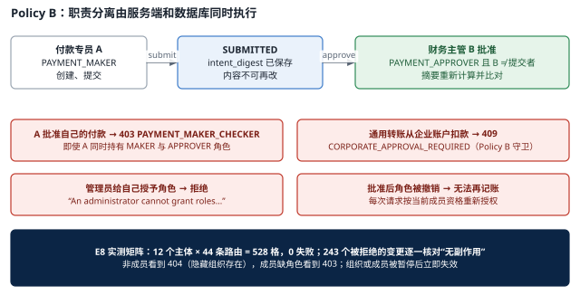

# Policy B：职责分离、角色与暂停 {#ch-policy-b}

:::: opener
::: q
业务问题

Aroha 既是付款专员又被临时授予了审批权限。她能不能自己批准自己创建的付款？一个刚被撤销审批角色的人，还能不能完成他在撤销之前打开的那一笔？一个其他公司的管理员，能不能看到 Kererū 的付款列表？
:::
::: k
本章证据

- 决策记录：`docs/v2/ADR/0005-corporate-payment-approval-and-clearing.md`
- 授权实现：`OrganizationAuthorizationService`、`CorporatePaymentService.approve`、`TransferService`
- E8 执行矩阵：`AuthorizationMatrixPostgresIntegrationTests`（528 格）
:::
::::

## 什么是 Policy B

企业的钱不属于任何一个员工。银行业对此的标准回答是**职责分离**（segregation of duties），最常见的形式是“制单—复核”（maker-checker）：一个人准备付款，另一个人独立批准，两个人缺一不可。

LedgerCore 第三轮在 ADR 0005 中把这条原则写成了 **Policy B**：**任何从企业账户出去的钱，都必须由一个持久化的、不可变的、被另一人独立批准的意图支持**——企业付款由已批准的付款意图支持，工资由已批准的工资批次支持。通用的“转账”接口不能直接扣企业账户，无论调用者在企业里是什么角色。@fig-maker-checker 汇总了这条政策在代码与数据库中的落点，以及被它拒绝的四类请求。

{#fig-maker-checker}

## 角色与成员资格

组织内的权限由七个角色组合而成：`ORG_ADMIN`（管理成员与账户）、`PAYMENT_MAKER` 与 `PAYMENT_APPROVER`、`PAYROLL_MAKER` 与 `PAYROLL_APPROVER`、`FINANCE_VIEWER`（只读）、`OPERATIONS`（运营与恢复）。一个人可以同时持有多个角色，这正是职责分离必须在“人”这一层而不是“角色”这一层检查的原因。

每一次授权判断都从同一个查询开始（@code-9-1）。

@@excerpt backend/src/main/java/nz/ac/ledgercore/organizations/OrganizationAuthorizationService.java | public List<OrganizationRole> rolesFor | 29 | 角色只在“组织 ACTIVE 且成员 ACTIVE”时存在；非成员 404，成员缺角色 403

这段代码编码了三条规则：

1. **暂停立即生效。** 组织被暂停，或成员被暂停，`rolesFor` 就返回空列表——角色本身并没有被删除，只是在暂停期间不存在。恢复之后，角色自动回来，审计记录保留了整个过程。
2. **非成员看到 404，而不是 403。** 403 会告诉调用者“这个组织存在，只是你没有权限”；404 则让一个外部的人无法通过试探得知某个组织 ID 是否存在。这叫**租户隐藏**（tenant concealment）。
3. **成员缺少角色看到 403。** 对组织内部的人，没有必要隐藏组织的存在；明确的 403 帮助他找对审批人。

## 自己不能批准自己

批准付款的方法在做任何资金动作之前，先检查两次“是不是同一个人”（@code-9-2）。

@@excerpt backend/src/main/java/nz/ac/ledgercore/payments/CorporatePaymentService.java | public PaymentView approve\(UUID actorCustomerId | 19 | 批准前检查审批角色、与创建者不同、与提交者不同，并重新计算内容摘要

第一次检查在 `requireCanApprovePayment` 里：批准人必须持有 `PAYMENT_APPROVER`，并且不是付款的创建者。第二次检查比较批准人与**提交者**——创建和提交可以是两个人，两者都不能批准。返回码是 403 `PAYMENT_MAKER_CHECKER`；即使 Aroha 同时持有 MAKER 与 APPROVER 两个角色，这个请求也会被拒绝。

服务端的检查之外，数据库还有自己的一层：工资批次的 `ck_payroll_batches_maker_checker` 约束要求批准人与创建者不同；付款意图的状态约束要求只有带着批准人与已批准摘要的行才能进入已记账状态（V8）。

## 通用转账不能扣企业账户

第二类绕过更隐蔽：如果一个持有 `PAYMENT_MAKER` 角色的人，直接调用个人银行的 `POST /api/transfers`，把企业账户填成来源账户，会怎样？`TransferService` 在执行任何资金动作之前先判断来源账户的归属（@code-9-3）。

@@excerpt backend/src/main/java/nz/ac/ledgercore/transfers/TransferService.java | if \(sourceOwner.organizationId\(\) != null\) | block | 企业来源账户只接受“已批准工资项”这一种通用转账；其余一律拒绝，且对非制单人隐藏账户存在

这里同样区分了两种拒绝：对没有任何制单角色的人，返回“账户不存在”（隐藏）；对有制单角色的人，返回 409 `CORPORATE_APPROVAL_REQUIRED`，明确告诉他应当走付款或工资流程。唯一的例外是工资执行器以“记录器”（recorder）身份发起、且与一个已批准工资项完全匹配的转账（第 11 章）。

## 管理员不能给自己授权

如果 ORG_ADMIN 可以给自己加上 `PAYMENT_APPROVER`，那么“一个管理员加一个制单人”就能完成任何付款——职责分离退化成了“任何两个人”。`OrganizationService.addMember` 拒绝管理员修改自己的成员资格（“An administrator cannot grant roles to their own membership.”）。授予角色本身也是一个被审计的动作，并通过 Outbox 发布 `organization.role.granted` 事件。

## 撤销角色之后

授权在**每一次请求**时重新计算，而不是在会话开始时缓存。测试 `anApproverWhoseRoleIsRevokedAfterSubmissionCanNoLongerBookThePayment` 模拟了这样的时序：付款被提交，审批人的角色随后被撤销，他再去批准——请求被拒绝，没有任何分录产生。浏览器旅程“revoked Operations role cannot inquire during a pending business operation”在界面上验证了同一件事：页面还开着，按钮还在，但后端不再接受。

## E8：把授权写成一张被执行的矩阵

单独的测试只能证明“这几条路径是对的”。第四轮的 E8 工作把授权问题系统化：12 个主体（匿名、个人客户、七种组织角色、被暂停成员、其他组织的管理员、被暂停组织的管理员）× 44 条路由（21 条读、23 条写），每一格都发出真实的 HTTP 请求（带 CSRF 令牌），比较期望状态码与实际状态码。

| 实际状态码 | 404 | 403 | 200 | 401 | 201 | 409 |
|---|---:|---:|---:|---:|---:|---:|
| 格数 | 177 | 175 | 115 | 44 | 15 | 2 |

Table: E8 矩阵 528 格的实际状态码分布（冻结提交上的 E12 verify 运行） {#tbl-e8}

528 格全部与期望一致。更重要的是另一组数字：243 个**被拒绝的写请求**，每一个之后都用独立 SQL 对分录、过账、付款、工资、事件与审计做指纹比较，确认拒绝没有留下任何副作用。“返回了 403”不等于“什么都没发生”；只有指纹不变才算。

另外三个测试补上了矩阵覆盖不到的组合：缺少 CSRF 令牌的写请求对每一个已认证主体都被拒绝；同时持有制单与审批角色的人不能批准自己的付款或工资；审批人在提交后被撤销角色，就无法再记账。

::: limit
E8 是一个应用层的授权矩阵，不是渗透测试。它没有覆盖会话固定之外的浏览器攻击、依赖库漏洞利用、网络层攻击或社会工程。共享 HMAC 密钥签名两个方向的问题（第 15 章）作为 P3 改进建议记录在案。
:::

::: exercise
1. 一个 `FINANCE_VIEWER` 请求 `POST /api/organizations/{org}/operations/reconciliation/runs`，另一个从未加入该组织的客户请求同一个地址。两人分别会得到什么状态码？为什么设计成不同？（答案见 [附录 G](#ans-9-1)）
2. 设想一种“改进”：为了减少数据库查询，把成员的角色列表缓存在会话里，登录时加载一次。请列出至少两个会因此失效的测试或安全性质。（答案见 [附录 G](#ans-9-2)）
:::
