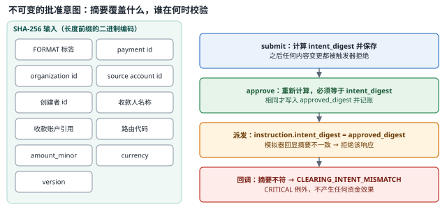

# 不可变的批准意图与内容摘要 {#ch-intent}

:::: opener
::: q
业务问题

Wiremu 在屏幕上看到“向 Northstar Supplier 付 80.00”，点了批准。在他点击之前的一秒，Aroha 把金额改成了 8,000.00。银行记账时用的是哪一个数字？“被批准的东西”到底是什么？
:::
::: k
本章证据

- `CorporatePaymentDigest`、`PayrollContentDigest`：规范化编码与 SHA-256
- `V8__add_policy_b_payments_and_durable_events.sql`：`enforce_corporate_payment_intent()` 触发器
- `ClearingInstructionOutboxHandler`：派发前与模拟器回显时再次比对摘要
:::
::::

## 批准的是内容，不是一行数据库记录

“批准付款 #123”这句话有歧义：#123 是一个可变的数据库行，批准的那一刻它的内容是 A，记账的那一刻可能已经是 B。职责分离如果只绑定“行”，就可以被“先让别人批准，再改内容”绕过。正确的做法是：**批准绑定内容本身**，而内容用一个密码学摘要来代表。

LedgerCore 对付款意图的所有财务字段做规范化编码，再计算 SHA-256（@fig-digest）。

{#fig-digest}

## 规范化编码

摘要的输入必须是**确定的**：同样的内容永远得到同样的字节。把对象序列化成 JSON 再求哈希看起来简单，但字段顺序、空白、数字格式、Unicode 规范化都可能让相同的内容产生不同的字节。`CorporatePaymentDigest` 用一种朴素而可靠的方式避免了这些问题（@code-10-1）。

@@excerpt backend/src/main/java/nz/ac/ledgercore/payments/CorporatePaymentDigest.java | static String calculate | block | 用 DataOutputStream 按固定顺序写入长度前缀的字段，再求 SHA-256

几个设计细节：

- **格式标签**写在最前面（`FORMAT`）。将来如果字段集合改变，新版本使用新标签，旧摘要不会与新摘要意外相等。
- **字符串带长度前缀**。如果只是简单拼接，“收款人 AB + 引用 C”与“收款人 A + 引用 BC”会得到同一串字节；长度前缀消除了这种歧义。
- **金额是 `long` 型的最小单位**，币种单独写入。不存在“80”与“80.00”的格式差异。
- **版本号也在摘要里**。每次在草稿阶段修改内容，版本号递增；批准时记录 `approved_version`，与摘要一起构成双重绑定。

工资批次用同样的方法计算 `PayrollContentDigest`，格式标签是 `ledgercore-payroll-intent-v1`，覆盖批次的付款账户与每一个工资项的员工引用、姓名、收款账户与金额。

## 数据库里的第二道锁

摘要在应用里计算，但“提交之后内容不可改”这条规则写在数据库里。V8 的触发器在每一次 `UPDATE` 之前检查（@code-10-2）。

@@excerpt backend/src/main/resources/db/migration/V8__add_policy_b_payments_and_durable_events.sql | IF OLD.status <> 'DRAFT' AND \( | 16 | 一旦离开 DRAFT，ID、金额、收款人、版本、摘要与提交信息都不能再变

同一个触发器还规定了批准本身的不可变性，以及批准必须独立并绑定提交的意图（@code-10-3）。

@@excerpt backend/src/main/resources/db/migration/V8__add_policy_b_payments_and_durable_events.sql | IF NEW.status = 'APPROVED' AND \( | 9 | 批准人不能是创建者或提交者，批准版本与批准摘要必须等于提交时的版本与摘要

注意这条检查与上一章 Java 代码里的检查是**重复的**。这种重复是刻意的：Java 的检查给用户清晰的错误信息；数据库的检查保证即使有一天某段代码绕过了 Java 的检查，也无法写出一条“自己批准自己”的记录。

## 批准与修改的竞态

回到开篇的问题。Aroha 在草稿阶段修改金额，Wiremu 在同一时刻批准。可能的时序只有三种：

1. Aroha 先提交修改：付款还是 DRAFT，修改成功，版本号加一；Wiremu 的批准请求随后到达，但付款不是 SUBMITTED，批准被拒绝（409 `PAYMENT_NOT_SUBMITTED`）。Wiremu 看到的是新内容的提交之后，才能重新批准。
2. 付款已经 SUBMITTED，Aroha 试图修改：数据库触发器拒绝（“Submitted corporate payment content is immutable.”）。
3. 两个请求在应用层交错：批准方法先用 `SELECT ... FOR UPDATE` 锁住付款行，重新计算摘要并与保存的 `intent_digest` 比较，最后用一条带条件的 `UPDATE ... WHERE status = 'SUBMITTED' AND intent_digest = ? AND version = ?` 写入批准。只要任何一个条件不再成立，更新 0 行，批准失败（409 `PAYMENT_STATE_CHANGED`）。

在任何一种时序下，都不存在“批准了 80.00、记账了 8,000.00”的结局。第二轮审计在工资批次上发现过这类问题的一个变种（R2-01：工资项可以被移出一个已提交的批次），V7 修复了它，并补充了“修改与批准争抢锁”的并发测试。

## 摘要一路跟到清算系统

摘要不只在批准时使用。批准事务写入的清算指令带着 `intent_digest`；派发时，清算处理器只读取 `approved_digest = intent_digest` 且指令摘要一致的行；模拟器在响应里回显摘要，回显不一致时处理器拒绝这个响应（“Simulator response did not match the approved operation identity.”）。模拟器发回的每一个回调也带着摘要；摘要与批准意图不符的回调不会产生任何资金效果，而是记录一条 CRITICAL 级别的 `CLEARING_INTENT_MISMATCH` 例外（第 15 章）。

这条链的意义在于：从 Wiremu 点击批准，到清算系统确认结算，**每一个环节都在核对“这仍然是被批准的那件事”**。任何一个环节被篡改或出错，资金都会停在原地并留下例外，而不是流向一个未经批准的目的地。

::: takeaway
批准是对内容的承诺。把内容压缩成一个摘要，然后让每一个下游环节核对摘要，就把“一次批准”变成了一条贯穿整个生命周期、可以被机器验证的约束。
:::

::: exercise
1. 如果 `CorporatePaymentDigest` 改为把各字段用逗号拼接后求哈希，举一个会产生碰撞的具体例子，并说明攻击者如何利用它。（答案见 [附录 G](#ans-10-1)）
2. 为什么批准写入要用 `UPDATE ... WHERE status = 'SUBMITTED' AND intent_digest = ? AND version = ?`，而不是在 Java 里检查完之后直接 `UPDATE ... WHERE id = ?`？在已经 `SELECT ... FOR UPDATE` 的前提下，这些条件还有什么用？（答案见 [附录 G](#ans-10-2)）
:::
