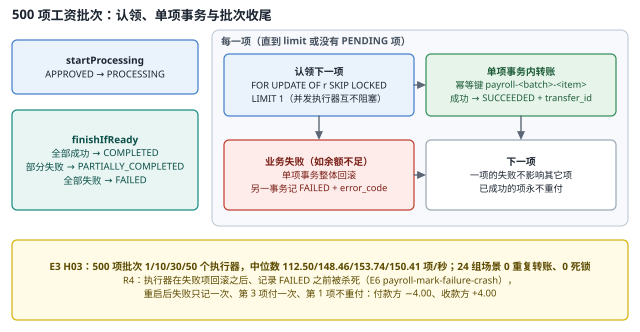
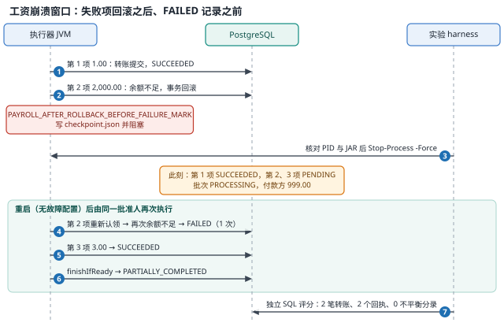

# 500 人工资批次：认领、单项原子性与部分失败 {#ch-payroll}

:::: opener
::: q
业务问题

500 名员工的工资要在几十秒内发完。执行器可能同时有好几个，可能在任何一项的中途崩溃；某一项可能因为余额不足而失败，而失败不能拖累其他 499 个人。怎样保证每个人恰好收到一次工资？
:::
::: k
本章证据

- `PayrollItemExecutor`、`PayrollExecutionService`
- E2 进程崩溃实验：`evidence/e2/VALIDATION.md`（3 项已提交、497 项待处理时被杀）
- E3 H03/H04：`evidence/e3/verdicts/`
- 第四轮工资崩溃窗口实验：E12 用例 E12-C03
:::
::::

## 一个批次，五百个事务

把 500 笔工资写进**一个**事务看起来最“原子”，其实最脆弱：任何一项失败都会让全部回滚；事务持有锁的时间随批次线性增长；崩溃之后，要么全有要么全无，无法从中间继续。银行需要的是另一种原子性：**每一项**是原子的，批次是**可恢复**的。

LedgerCore 的工资执行把一个批次拆成 500 个独立的单项事务（@fig-payroll-claim）。编排方法本身刻意**不**加 `@Transactional`；它在循环里反复调用一个单项事务的方法，每次处理一项。

{#fig-payroll-claim}

## 用 SKIP LOCKED 认领

多个执行器同时处理同一个批次时，每个执行器都要拿到“下一项还没有人在做的工资”。数据库提供了一个恰好合适的工具（@code-11-1）。

@@excerpt backend/src/main/java/nz/ac/ledgercore/payroll/PayrollItemExecutor.java | public ExecutionResult executeNext | block | 单项事务：以 FOR UPDATE OF r SKIP LOCKED 认领序号最小的待处理项

`FOR UPDATE OF r SKIP LOCKED` 的含义是：锁住结果行；如果某一行已经被别的事务锁住，**跳过它**去找下一行，而不是等待。于是两个执行器自然地错开，各自拿到不同的项，互不阻塞。被认领的项在事务提交（SUCCEEDED）或回滚（释放锁）之前，对其他执行器不可见。崩溃的执行器持有的锁随连接断开而释放，那一项重新变得可认领。

## 单项事务里发生了什么

认领之后，执行器以批次创建者的身份调用转账服务，幂等键固定为 `payroll-<batch>-<item>`（@code-11-2）。

@@excerpt backend/src/main/java/nz/ac/ledgercore/payroll/PayrollItemExecutor.java | private ExecutionResult executeLocked | block | 稳定幂等键、转账与结果记录在同一事务；失败按“永久业务失败 / 无法分类”区分

这段代码里有三个值得细读的决定：

1. **转账与结果同生共死。** `transferAndRecord` 接受一个回调，在转账写入的同一事务里把结果行从 PENDING 改为 SUCCEEDED 并写入 `transfer_id`。第二轮在 V7 里又加了一条数据库规则：SUCCEEDED 的结果必须引用一笔恰好支付本项的转账与回执（INV-06、INV-13）。
2. **幂等键属于批次创建者。** 键的命名空间 `payroll-` 被保留给工资执行器，客户自己提交的转账不能使用它。即使同一项因为崩溃被执行两次，第二次也只会重放第一次的回执。
3. **失败分为两类。** 余额不足、账户不存在或已关闭、请求无效、企业审批缺失，这些是**永久业务失败**：再试一次结果也一样，于是抛出 `PayrollItemTransferFailure`，单项事务回滚，然后由编排方法在**另一个**事务里把该项标记为 FAILED 并记录错误码。其余无法安全分类的异常则让该项保持 PENDING，返回 409，留待之后重试——在不知道发生了什么的时候，不把它写成“失败”。

## 收尾与批次状态

当一次执行请求处理完它的配额（或没有待处理项），编排方法调用 `finishIfReady`：所有项都 SUCCEEDED 则批次 COMPLETED；有成功也有失败则 PARTIALLY_COMPLETED；全部失败则 FAILED。V7 的触发器保证批次只有在每一项都有一个完整、正确链接的结果时才能进入终态；Java 层在结果不完整时同样“闭合失败”（`PAYROLL_RESULTS_INCOMPLETE`）。

## 崩溃：E2 的五百项实验

第一轮的 E2 实验让一个 500 项批次真实地执行，在第 4 项的事务中途（通过一个仅用于实验的 `pg_sleep` 触发器让事务边界可观察）杀死应用进程（PID 66872）。被杀时，数据库里是 3 项 SUCCEEDED、497 项 PENDING、0 项 FAILED。重启后再次执行，批次完成，没有任何重复转账，付款方与收款方的投影与过账之和逐一相等。

::: limit
E2 的延迟来自一个注入的 PostgreSQL 触发器，用来让“事务进行中”这个时刻可观察；它不模拟断电或操作系统级别的故障，也只覆盖了一个崩溃点。
:::

## 崩溃：失败已回滚、失败尚未记录

第三轮为工资实现了一个故障检查点 `PAYROLL_AFTER_ROLLBACK_BEFORE_FAILURE_MARK`，却从未执行过它。第四轮补上了这个实验（@fig-payroll-crash）：一个三项批次，金额分别是 1.00、2,000.00、3.00；付款账户只有 1,000.00，所以第二项必然因余额不足失败。进程恰好在第二项的事务**已经回滚**、而“记为 FAILED”的事务**尚未开始**的那一刻被杀死。

{#fig-payroll-crash}

这个窗口之所以重要，是因为崩溃时数据库里**没有任何关于第二项失败的记录**：它仍然是 PENDING，attempt_count 仍是 0（失败的转账在回滚的事务里，从未写到结果行）。恢复的正确行为是“把它当作从未尝试过”：重新认领、再次因余额不足失败、记一次 FAILED；第三项正常支付；第一项绝不重付。独立 SQL 评分检查了十项事实：批次 PARTIALLY_COMPLETED；第一项与第三项各恰好一笔转账、一个回执；第二项 FAILED、错误码 `INSUFFICIENT_FUNDS`、没有转账；付款方恰好减少 4.00、收款方恰好增加 4.00；零不平衡分录、零投影偏差；再次执行是终态上的空操作。

这个用例在第四轮先以预演方式执行（发现并修复了评分 SQL 的一个列名错误），再作为 E12-C03 在冻结提交上正式执行（第 26 章）。

## 性能：E3 H03 与 H04

第一轮的 E3 H03 在 500 项与 5,000 项批次、1/10/30/50 个执行器下各重复三次。500 项批次的中位吞吐分别为 112.50、148.46、153.74、150.41 项/秒；24 组场景全部零失败、零重复转账、零死锁。吞吐在 10 个执行器之后不再增长，原因与第 7 章相同：所有工资项都从**同一个付款账户**扣款，付款账户的行锁让扣款串行化。

H04 则测出了一个真实的扩展性问题：批次进度查询对 `payroll_item_results` 做全表扫描，其他组织新增 50,000 行不相关的结果之后，目标批次的进度查询扫描行数从 71,500 增加到 121,500，而返回的仍然只是它自己的 5,000 行。第三轮试图用一个新索引（V10）改善认领路径，预注册实验表明计划器没有选用它，也没有降低 p50/p95，于是 V11 把它向前移除（第 22 章）。

::: exercise
1. 两个执行器同时处理同一个批次。执行器 A 认领了第 7 项并在转账途中崩溃（连接断开）。执行器 B 此刻正在认领。B 会拿到第 7 项吗？什么时候？第 7 项会不会被支付两次？（答案见 [附录 G](#ans-11-1)）
2. 为什么“无法分类”的转账异常要让工资项保持 PENDING，而不是标记为 FAILED？举一个把它标记为 FAILED 会导致错误结果的场景。（答案见 [附录 G](#ans-11-2)）
:::
