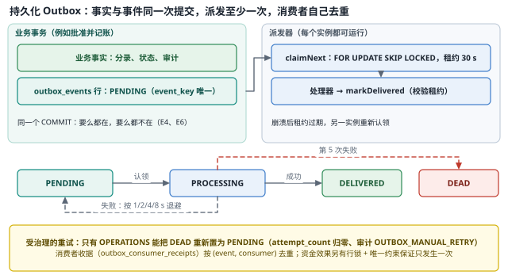

# 持久化 Outbox 与至少一次投递 {#ch-outbox}

:::: opener
::: q
业务问题

Wiremu 批准了付款，银行记了账。现在需要“通知”清算系统。如果在记账提交之后、通知发出之前进程崩溃，这笔付款会不会永远不被发出？如果通知发出去了，确认却没回来，会不会发两次？
:::
::: k
本章证据

- `DurableEventStore`：入队、认领、交付、失败与受治理重试
- `OutboxDispatcher`、`DurableOutboxConsumer`
- E4（第三轮）：持久事件与重启后的排空；E6 `outbox-before-dispatch`
- 第四轮发现 R4-05：处理器缺席时的“静默确认”
:::
::::

## 双写问题

“写数据库，然后发消息”是分布式系统里最常见的错误之一，名字叫**双写**（dual write）。两个写操作之间没有共同的事务：数据库提交了、消息没发出去，或者消息发出去了、数据库回滚了，系统就处于一个两边互相矛盾的状态。在消息之前崩溃，付款永远不会被发出；先发消息再写库，又可能发出一笔银行从未记账的付款。

**事务性发件箱**（transactional outbox）模式的思路很简单：不要在事务里“发”消息，而是在**同一个事务里把“需要发送的消息”写进一张表**。业务事实与待发送事件同时提交或同时回滚；之后由一个独立的派发器读取这张表，把事件送达处理器，成功之后再标记为已交付（@fig-outbox）。

{#fig-outbox}

## 入队：与业务事实同一个提交

`enqueue` 只是一条 `INSERT`，它的全部力量来自调用它的位置（@code-12-1）。

@@excerpt backend/src/main/java/nz/ac/ledgercore/events/DurableEventStore.java | public UUID enqueue | block | 入队就是在调用者的事务里插入一行；事件键唯一，并记录关联 ID 与产生它的追踪上下文

付款批准方法在同一个 `@Transactional` 里依次记账、插入清算指令、写审计、入队两个事件（第 9 章）。四者之一失败，全部回滚；全部成功，则一起提交。`event_key` 上的唯一约束让“同一个业务事实只产生一个事件”成为数据库保证——例如 `clearing.instruction.ready:<operationId>` 对每个操作身份只能存在一次。第四轮还在事件上记录了产生它的请求的 W3C 追踪上下文（V14，第 21 章）。

## 认领：租约与 SKIP LOCKED

派发器可以在多个实例上同时运行。认领一个事件需要同时解决两个问题：多个派发器不能同时处理同一个事件；处理到一半崩溃的派发器不能把事件永远占着（@code-12-2）。

@@excerpt backend/src/main/java/nz/ac/ledgercore/events/DurableEventStore.java | public OutboxEvent claimNext | block | 先把超过重试上限且租约过期的事件转为 DEAD，再以 SKIP LOCKED 认领一个，提交 30 秒租约后才调用处理器

这里有两个关键设计：

- **租约**（lease）。认领把事件改为 PROCESSING、attempt_count 加一，并写入 `lease_until = now + 30 s`，然后**立即提交**。处理器在租约之外运行。如果派发器在处理中途崩溃，租约到期后事件重新变得可认领，另一个实例会再处理一次。
- **SKIP LOCKED**。与工资认领（第 11 章）相同：多个派发器错开，各自拿到不同的事件，互不等待。

## 至少一次从哪里来

派发器的主体逻辑是：找到第一个支持该事件类型的处理器，调用它，然后标记已交付。处理器在自己的事务里提交效果，`markDelivered` 是另一个事务。于是存在这样一个窗口：处理器的效果已经提交，`markDelivered` 还没有执行，进程崩溃了。租约到期后事件被再次认领，处理器被**再调用一次**。

这就是“至少一次投递”（at-least-once delivery）的来源，它不是实现缺陷，而是任何没有分布式事务的系统必须接受的现实。正确的回应是让**每个处理器都是幂等的**：

- 对只需要“知道这件事发生过”的消费者，`recordConsumerReceipt` 在 `outbox_consumer_receipts` 上按 `(event_id, consumer_key)` 插入，冲突即说明重复，计数器 `ledgercore.events.duplicate.receipts` 加一，效果不重复。
- 对会产生资金效果的消费者（清算结算），幂等性来自更强的机制：锁住付款行、检查结算是否已经存在、数据库对“同一付款的第二张结算分录”的唯一约束（第 16 章）。

`markDelivered` 自己也做了防护：它只把 PROCESSING 状态的事件改为 DELIVERED，如果租约已经丢失（事件被别人重新认领），更新 0 行并抛出异常，而不是覆盖别人的处理结果。

## 失败、退避与死信

处理器抛出异常时，派发器记录失败（@code-12-3）。

@@excerpt backend/src/main/java/nz/ac/ledgercore/events/DurableEventStore.java | public void markDeliveryFailure | block | 失败后按 1、2、4、8 秒退避重新排队；达到第 5 次失败即成为 DEAD；错误信息去掉换行并截断

退避时间是 `min(30, 2^(attempt-1))` 秒，第五次失败后事件成为**死信**（DEAD）。死信不会被自动重试：一个连续失败五次的事件通常意味着需要人来判断原因——下游服务长时间不可用、数据有问题、或者像第 17 章那样准备金不足。死信由运营控制台展示（“Failed deliveries”），由对账报告为 `DEAD_OUTBOX_EVENT`。

把死信重新送回队列是一个**受治理**的动作（@code-12-4）。

@@excerpt backend/src/main/java/nz/ac/ledgercore/events/DurableEventStore.java | public int retryDeadLetter | block | 只有 DEAD 且属于本组织的事件可以重试；attempt_count 归零并写入审计 OUTBOX_MANUAL_RETRY

只有 OPERATIONS 角色能调用这个接口（E8 矩阵中的 `OPS-OUTBOX-RETRY`），事件必须属于调用者的组织，必须仍是 DEAD；V8 的触发器只允许 attempt_count 在“DEAD → PENDING 且归零”这一种情况下变小。第四轮的准备金实验让两名运营人员**同时**重试同一个死信：结果恰好一个 200、一个 400，审计里恰好一条记录（第 17 章）。

## 当处理器不存在时：R4-05

派发器使用“第一个支持该事件的处理器”。`DurableOutboxConsumer` 支持**所有**事件，并且排在最后：它只记录一个收据。这让那些“只需要被持久记录、暂时没有下游”的事件也能正常完成生命周期。

第四轮审计发现，这个兜底在一种配置下变成了陷阱。清算指令处理器只在 `ledgercore.clearing.enabled=true` 时存在，而这个开关的默认值是 `false`。如果一个环境忘了打开清算集成，付款仍然可以被批准、记账；`clearing.instruction.ready` 事件被兜底消费者“收下”并标记为 DELIVERED——指令从未发出，付款永远停在 PENDING_CLEARING，钱停在清算应付里，而且没有任何东西报警。

修复分两部分：检测已经完成——对账增加了 `CLEARING_INSTRUCTION_NOT_DISPATCHED`（CRITICAL），覆盖“指令仍是 READY，而派发事件已经 DELIVERED、DEAD 或根本不存在”的情况，只有在复核通过之后才能关闭；而“受治理地重新发送指令”的路径被明确记录为**延后处理的风险**（DEFERRED_WITH_RISK）。推荐的长期方案是：清算集成关闭时让批准直接失败，而不是记了账却发不出去——这会改变许多现有测试依赖的行为，属于需要负责人决定的业务政策。

::: takeaway
Outbox 解决的是“事实与事件不一致”，不解决“事件有没有被正确处理”。后者需要幂等的消费者、可见的死信、受治理的重试，以及一个能发现“事件说已交付、但应该发生的事情没有发生”的独立对账。
:::

::: exercise
1. 处理器提交了效果，但 `markDelivered` 之前进程被杀。描述接下来 60 秒里这个事件的状态变化，并说明为什么效果不会发生两次。（答案见 [附录 G](#ans-12-1)）
2. 有人提议：“既然死信需要人工处理，不如把重试上限从 5 改成 1000，让系统自己一直重试。”这个提议有什么问题？（答案见 [附录 G](#ans-12-2)）
:::
