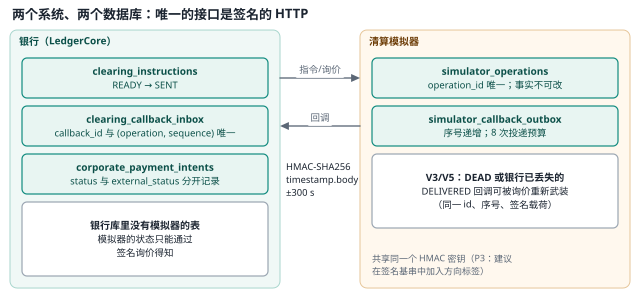
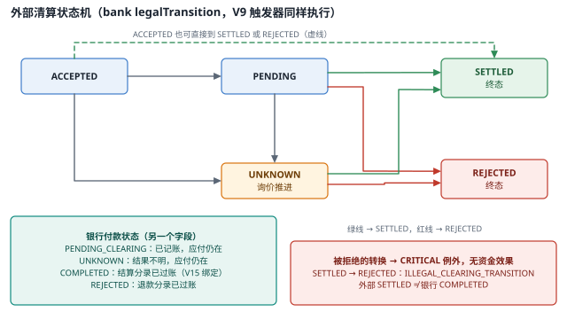

# 独立的清算模拟器与外部状态机 {#ch-simulator}

:::: opener
::: q
业务问题

银行把一笔付款交给清算系统之后，得到的第一个回答往往不是“成功”或“失败”，而是“已受理”“处理中”，甚至“不确定”。银行应当怎样表示这些中间状态？哪些状态转换是合法的？谁说了算？
:::
::: k
本章证据

- 模拟器：`clearing-simulator/`（独立 Spring Boot 进程与数据库）
- 银行侧：`ClearingCallbackService.legalTransition`、V9 外部状态触发器
- E5（第三轮）：两个进程、两个数据库上的结算、UNKNOWN 询价、模拟器重启
- 第四轮 E12-E09：模拟器在 ACCEPTED 时被杀死后的恢复
:::
::::

## 为什么需要一个“真的”外部系统

清算是银行之间结算资金的过程。真实的清算网络有各自的报文格式、截止时间与差错处理，LedgerCore 不打算模拟其中任何一种具体协议。它需要的是一个具备**外部系统一切让人头疼的性质**的对手：

- 运行在另一个进程里，可以独立崩溃、独立重启；
- 有自己的数据库，银行无法读写；
- 结果是异步的，可能先说“已受理”，很久之后才说“已结算”；
- 可能说“不知道”；
- 通过网络回调通知银行，回调可能失败、重复、乱序。

清算模拟器就是这样一个进程（@fig-two-db）。它与银行之间唯一的接口是 HMAC 签名的 HTTP：银行向它提交指令、询价；它向银行投递回调。两边各自持久化自己发出与收到的每一条消息。

{#fig-two-db}

## 操作身份与幂等提交

每笔企业付款在创建时获得一个**操作身份**（operation id）。它在批准时被写入清算指令，此后在所有重试、询价与回调中保持不变。模拟器对同一个操作身份的重复提交是幂等的（@code-13-1）。

@@excerpt clearing-simulator/src/main/java/nz/ac/ledgercore/clearing/simulator/SimulatorOperationService.java | List<OperationResponse> existing = find\(request.operationId\(\), true\); | 13 | 同一操作身份、同一事实：返回原结果；同一身份、不同事实：409；同一付款换新身份：409

三条规则缺一不可：

1. 同一身份、同一事实 → 返回已经存在的操作。银行的派发器因为超时重试时，模拟器不会创建第二笔操作。
2. 同一身份、不同事实 → 409。操作身份不能被“借用”去做另一件事。
3. 同一笔付款、不同身份 → 409。银行即使因为缺陷生成了新的操作身份，也无法为同一笔付款创建第二个外部操作——这是对“换个身份重发”这种危险补救的直接防御。

## 路由代码：可控的外部行为

为了让实验可以重复，模拟器按收款人的路由代码决定行为（@code-13-2）。

@@excerpt clearing-simulator/src/main/java/nz/ac/ledgercore/clearing/simulator/SimulatorOperationService.java | private Route route\(String routingCode\) | block | 五种虚构的路由代码决定初始外部状态；目录之外的代码返回 422

`SIM-SETTLE` 立即给出 SETTLED；`SIM-REJECT` 立即拒绝；`SIM-ACCEPT` 与 `SIM-PENDING` 停在中间状态，需要询价推进；`SIM-UNKNOWN` 模拟“连模拟器自己也不确定”的情况。每一个状态变化都会在模拟器的回调发件箱里生成一条带递增序号的签名回调。

询价是推进中间状态的唯一方式：ACCEPTED 被询价后变为 PENDING，PENDING 或 UNKNOWN 被询价后变为 SETTLED（@code-13-3）。

@@excerpt clearing-simulator/src/main/java/nz/ac/ledgercore/clearing/simulator/SimulatorOperationService.java | String next = current.status\(\); | 7 | 模拟器的询价推进规则：ACCEPTED → PENDING，PENDING/UNKNOWN → SETTLED

::: limit
这是一个玩具规则：真实清算系统的 UNKNOWN 不会因为被问一次就变成 SETTLED，它的结果可能要等到日终对账才确定，也可能是拒绝。本书从这个模拟器得出的结论，只关于**银行如何处理不确定性**，不关于任何真实清算网络的行为或保证。
:::

## 银行侧的状态机

银行在付款行上用两个字段分别记录两件事：`external_status` 是清算系统说了什么，`status` 是银行自己处于什么阶段（@fig-clearing-states）。混用这两者，正是第 16 章 R4-01 之前界面把“外部已结算、本地未记账”显示为“已结算”的原因（第 24 章）。

{#fig-clearing-states}

银行只接受合法的外部状态转换（@code-13-4）。

@@excerpt backend/src/main/java/nz/ac/ledgercore/clearing/ClearingCallbackService.java | private boolean legalTransition | block | 外部状态只能向前：ACCEPTED/PENDING/UNKNOWN 可以走向终态，终态不可再变

不合法的转换——例如已经 SETTLED 的付款又收到 REJECTED——不会产生任何资金效果，而是记录一条 CRITICAL 级别的 `ILLEGAL_CLEARING_TRANSITION` 例外，回调被确认为 `EXCEPTION_RECORDED`。V9 的数据库触发器对 `external_status` 执行同样的规则：即使绕过 Java，也写不进一个倒退的外部状态。

为什么终态之后的矛盾消息不能“以最新的为准”？因为一旦银行已经根据 SETTLED 记了结算分录，一个随后到来的 REJECTED 如果被采纳，就会触发退款——客户拿回了钱，收款人也收到了钱，银行凭空损失一笔。面对矛盾，正确的做法是停下来、记录、让人核实，而不是选择相信某一条消息。

## E5 与 E12-E09：模拟器崩溃

第三轮的 E5 在两个真实进程、两个数据库上验证了结算、UNKNOWN 询价、模拟器重启与回调重放。第四轮把“模拟器重启”变成了一个独立评分的故障实验（E12-E09）：

1. 一笔 4.44 的付款以 `SIM-ACCEPT` 提交，银行收到 ACCEPTED 回调；
2. 实验脚本核对 PID 与 JAR 之后杀死模拟器进程；
3. 运营人员在银行界面上询价：请求失败（≥ 500），**银行没有假设任何结果**；对账报告 `CLEARING_SIMULATOR_INQUIRY_FAILED`；付款仍是 PENDING_CLEARING / ACCEPTED，应付 4.44 仍在，没有结算也没有退款；
4. 模拟器从自己的数据库重启，同一个操作仍是 ACCEPTED；两次询价把它推进到 PENDING、再到 SETTLED；
5. 银行按序收到全部回调，结算恰好一次，客户与准备金各恰好减少 4.44。

这个实验验证的是一种克制：**外部系统不可达时，银行什么也不做**——不重发、不退款、不标记失败，只是让问题可见，并在对方恢复后用同一个身份把事情问清楚。

::: exercise
1. 银行的派发器提交指令时超时，三秒后重试同一个操作身份。模拟器第一次其实已经收到并创建了操作。第二次提交会得到什么？如果第二次提交错误地携带了不同的金额呢？（答案见 [附录 G](#ans-13-1)）
2. 一笔付款的外部状态是 SETTLED，银行已经记了结算分录。这时收到一条签名有效、序号更大的 REJECTED 回调。银行应当怎样处理？为什么“以最新消息为准”是错误的？（答案见 [附录 G](#ans-13-2)）
:::
