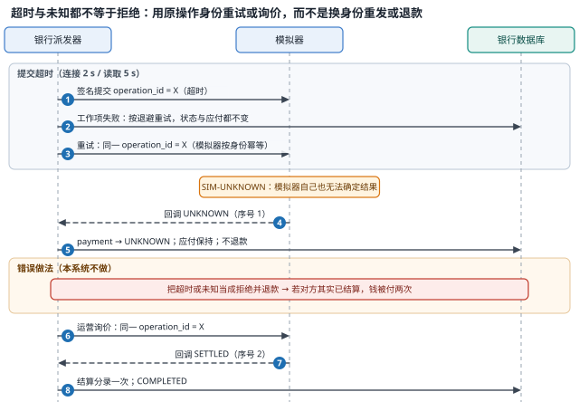

# 记账、结算与退款：超时不等于拒绝 {#ch-settlement}

:::: opener
::: q
业务问题

批准时客户的钱已经被转入清算应付。之后，银行在什么条件下可以把它结算出去？在什么条件下可以退还给客户？如果清算系统长时间不回答，能不能“先退款，以后再说”？
:::
::: k
本章证据

- `LedgerWriter.bookApprovedCorporatePayment`、`settleClearingPayment`、`refundRejectedCorporatePayment`
- `ClearingInstructionOutboxHandler`：派发与身份核对
- V8/V15 约束；评分器字段 `refundAfterSettlementOrWithoutRejection`
:::
::::

## 三张分录，三个触发条件

企业付款在账本上最多留下三张分录，每一张都有严格的前提（第 5 章 @fig-journals）：

| 分录 | 何时写 | 前提（数据库与代码共同检查） |
|---|---|---|
| 记账 booking | 批准的同一事务 | 付款 APPROVED、批准独立、摘要一致；客户余额充足 |
| 结算 settlement | 外部 SETTLED 之后 | 付款 PENDING_CLEARING 或 UNKNOWN，外部状态 SETTLED，尚无结算；准备金充足 |
| 退款 refund | 外部 REJECTED 之后 | 付款 PENDING_CLEARING 或 UNKNOWN，外部状态 REJECTED，**没有结算** |

Table: 企业付款的三张分录与其前提 {#tbl-three-journals}

三张分录的引用分别是 `corporate-payment:<id>:booking`、`:settlement`、`:refund`。V8 的约束让同一付款的同一种分录只能存在一张；V15 让付款终态与分录一一对应（第 3 章）。

## 结算：再检查一遍，然后一次写完

结算方法把“谁授权了这次结算”放在第一步：它以 `SELECT ... FOR UPDATE` 锁住付款行，并且只接受外部状态为 SETTLED、银行状态仍在清算中的付款（@code-14-1）。

@@excerpt backend/src/main/java/nz/ac/ledgercore/ledger/LedgerWriter.java | public UUID settleClearingPayment | block | 结算：锁付款行与两个系统账户，检查应付与准备金，写分录，并以带条件的 UPDATE 恰好一次地完成付款

读这段代码时请注意最后的 `UPDATE`：它不仅设置 COMPLETED，还带着四个条件——状态仍在清算中、外部状态是 SETTLED、尚未链接结算分录。只要有任何一个不成立（例如另一个线程刚刚完成了同一笔结算），更新 0 行，方法抛出异常，**整个事务回滚，包括刚写的结算分录**。这是“恰好一次”的最后一道应用层保障；它之下还有数据库的唯一约束。

还有一点：`reserveBalance < amount` 时抛出的是 `InsufficientLedgerBalanceException`，而不是让准备金变成负数。准备金不足时结算被**拒绝**，付款停在原地，应付保持不变——第 17 章会讲这时候银行该做什么。

## 退款：只在明确拒绝时

退款的前提里最重要的一条是**没有结算**。一笔已经结算的付款，无论之后收到什么消息，都不能退款（评分器字段 `refundAfterSettlementOrWithoutRejection` 必须为 0）。退款也只在外部状态为 REJECTED 时发生——这是清算系统明确的、终态的拒绝，而不是银行自己的推断。

## 派发：只发被批准的东西

清算指令的派发由 Outbox 处理器完成（@code-14-2）。

@@excerpt backend/src/main/java/nz/ac/ledgercore/clearing/ClearingInstructionOutboxHandler.java | public void handle\(OutboxEvent event\) | block | 只读取批准摘要与意图摘要一致的指令；签名提交后核对模拟器回显的身份；失败记录原因并抛出，交给 Outbox 退避重试

三个细节：查询条件 `approved_digest = intent_digest AND c.intent_digest = p.intent_digest` 保证只有被批准的内容会被发出；模拟器的响应必须回显同一个操作身份、付款与摘要，否则拒绝这个响应；任何失败都会写入 `clearing_instructions.last_error` 并重新抛出，由 Outbox 的退避机制重试——重试使用的是**同一个操作身份**。

## 超时不等于拒绝

现在回到开篇的最后一个问题：清算系统长时间不回答，能不能先退款？

不能。超时只说明“银行不知道”。对方可能根本没收到，也可能已经结算、只是回答丢了。如果银行在不知道的时候退款，而对方其实已经结算，那么收款人拿到了钱，客户也拿回了钱——银行凭空付了两次。@fig-timeout-unknown 把正确与错误的做法并排画了出来。

{#fig-timeout-unknown}

LedgerCore 的规则可以总结为三句话：

1. **提交超时**：派发失败、按退避用同一个操作身份重试；模拟器对同一身份幂等，不会产生第二笔操作。付款状态与应付都不变。
2. **结果未知**：收到 UNKNOWN 回调时，付款从 PENDING_CLEARING 变为 UNKNOWN，应付保持，不退款。界面明确显示“结果不确定，先询价再采取行动”。
3. **询价**：运营人员（或对账运行）用同一个操作身份询价；模拟器给出确定的结果后，按正常路径结算或退款。

E12 的 E12-E02 用例（UNKNOWN 由询价在原操作身份下解决）与浏览器旅程“Operations resolves an UNKNOWN clearing result”在冻结提交上验证了这条路径。

::: why
为什么不干脆在银行侧设定一个“超时 N 小时自动退款”？因为 N 的选择取决于外部系统对“未确认的付款”最终如何处理，而这一点银行无法单方面知道。真实的支付系统用的是双方约定的差错处理流程（查询、撤销请求、对账），而不是一方的计时器。LedgerCore 把这个决定留给有证据的人：例外、询价与复核。
:::

## 权衡

把每一次不确定都交给询价与人工复核，代价是运营负担：UNKNOWN 的付款会停在原地，客户的钱在这段时间里既不在他的账户里，也没有到达收款人。这正是第 21 章要为“欠着的效果”和“最旧的欠款年龄”设置告警、第 24 章要在界面上把它们单独显示的原因——不确定性不可避免，**看不见的**不确定性才是问题。

::: exercise
1. 某笔付款外部状态为 UNKNOWN，运营人员询价后得到 SETTLED，于是银行结算。随后，模拟器因为一次重投又送来一条 UNKNOWN 回调（序号更小，较早产生）。银行会怎样处理？（答案见 [附录 G](#ans-14-1)）
2. 如果把 `settleClearingPayment` 最后那条 `UPDATE` 改为 `WHERE id = ?`（去掉其他条件），在什么并发场景下会出错？数据库还有哪一道防线？（答案见 [附录 G](#ans-14-2)）
:::
