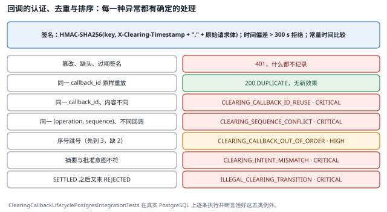

# 回调：签名、去重、顺序与重放 {#ch-callbacks}

:::: opener
::: q
业务问题

任何人都可以向银行的 `/api/clearing/callbacks` 发一个 POST，说“付款 X 已结算”。银行怎么知道这条消息来自清算系统、没有被篡改、不是十分钟前那条消息的重放、也不是跳过了中间某一步的乱序消息？
:::
::: k
本章证据

- `ClearingSignature`、`ClearingCallbackController`、`ClearingCallbackService.receive`
- `ClearingCallbackLifecyclePostgresIntegrationTests`：在真实 PostgreSQL 上逐条执行每一种异常
- 第四轮独立审查中的 P3 建议：签名基串缺少方向标签
:::
::::

## 认证：HMAC 签名与时间窗口

回调用 HMAC-SHA256 签名：发送方用双方共享的密钥，对“时间戳 + 点 + 原始请求体”计算消息认证码，放在 `X-Clearing-Signature` 头里，时间戳放在 `X-Clearing-Timestamp` 头里（@code-15-1）。

@@excerpt backend/src/main/java/nz/ac/ledgercore/clearing/ClearingSignature.java | public boolean verify | block | 缺头、超过 16 KiB、时间偏差超过窗口、签名不符，一律验证失败；比较使用常量时间

这几行里藏着几个容易被忽视的决定：

- **签的是原始字节。** 控制器以 `byte[]` 接收请求体，验证签名之后才反序列化。如果先把 JSON 解析成对象再重新序列化去验证，空白、字段顺序或数字格式的任何差异都会让签名失配——或者更糟，让两个“语义不同、序列化后相同”的请求通过验证。
- **时间戳在签名里。** 攻击者截获一条合法回调，十分钟后原样重放：签名仍然有效，但时间戳超出了 300 秒的窗口，验证失败。窗口内的重放则由下面的去重机制处理。
- **常量时间比较。** `MessageDigest.isEqual` 的耗时不依赖于两个值在第几个字节开始不同，避免通过响应时间逐字节猜出签名。
- **密钥长度与窗口在启动时校验。** 少于 32 字节的密钥、超出 1–900 秒的窗口都会让应用拒绝启动。

验证失败的请求得到 401，银行**什么都不记录**——没有收件箱行、没有例外、没有状态变化。对一个无法证明来源的请求，最安全的做法是当它从未发生。

## 收件箱：每一条回调只被处理一次

通过认证的回调进入收件箱 `clearing_callback_inbox`。收件箱有两个唯一键：回调自身的 ID，以及“操作身份 + 序号”。接收逻辑按固定顺序检查一系列情况（@code-15-2），每一种都有确定的结果（@fig-hmac-sequence）。

@@excerpt backend/src/main/java/nz/ac/ledgercore/clearing/ClearingCallbackService.java | List<String> callbackDigests = jdbc.query | 40 | 同一回调 ID：内容相同即重复，不同即 ID 被重用；同一序号：内容不同即序号冲突；序号必须恰好是下一个

{#fig-hmac-sequence}

逐条看：

- **原样重放**（同一 ID、同一内容摘要）：返回 200 `DUPLICATE`。模拟器因为没收到确认而重试时，银行不会处理第二次。
- **ID 被重用**（同一 ID、内容不同）：这不是网络重试能产生的情况，只能是对方的缺陷或攻击，记 CRITICAL `CLEARING_CALLBACK_ID_REUSE`。
- **序号冲突**（同一操作、同一序号、不同回调）：同样不可能来自正常重试，CRITICAL `CLEARING_SEQUENCE_CONFLICT`。
- **乱序**（序号不是“已收到的最大序号 + 1”）：HIGH `CLEARING_CALLBACK_OUT_OF_ORDER`，不写入收件箱、不改状态。银行不会跳过一个它没见过的中间状态。
- **摘要不符**：CRITICAL `CLEARING_INTENT_MISMATCH`（第 10 章）。
- **非法转换**：CRITICAL `ILLEGAL_CLEARING_TRANSITION`（第 13 章）。

除了 401，所有这些情况都以 200 应答，结果字段说明发生了什么（`DUPLICATE` 或 `EXCEPTION_RECORDED`）。为什么异常也用 200？因为对发送方而言，“银行已经收到并处理了这条消息”是事实；再重发一次不会改变任何结论。异常的处理属于银行内部的运营流程，而不是让发送方无休止重试的理由。

## 重复的回调为什么还要发布事件

仔细看重复分支：它在返回 `DUPLICATE` 之前，**再次发布**了 `ClearingOutcomeRecorded` 事件。这是一个看起来多余、实际上很有分量的设计：如果第一次收到这条终态回调时，提交后的结算因为某种原因没有完成，那么对方的重投就成了再触发一次结算的机会——而结算处理器本身是幂等的，已经结算过的付款只会得到 `ALREADY_APPLIED`。

第四轮修复前的复现实验恰好捕捉到了这个机制的两面：同一个崩溃窗口跑了两次，一次（`1fb80896`）结算永久丢失，另一次（`721bd898`）却恢复了——因为模拟器恰好重投了同一条回调，重复分支再次触发了结算。**依赖对方的重投来补救自己的缺陷，不是恢复能力，是运气。** 第 16 章讲修复如何把运气变成保证。

## 一个测试，五类例外

`ClearingCallbackLifecyclePostgresIntegrationTests` 在真实 PostgreSQL 上用一个测试专用密钥签名，依次发送合法回调、篡改的回调、缺头的回调、过期的回调、重放、ID 重用、序号冲突、乱序、摘要不符与非法转换，然后断言数据库里恰好出现这五类例外，各自的严重度正确（`CLEARING_CALLBACK_ID_REUSE:CRITICAL`、`CLEARING_CALLBACK_OUT_OF_ORDER:HIGH`、`CLEARING_INTENT_MISMATCH:CRITICAL`、`CLEARING_SEQUENCE_CONFLICT:CRITICAL`、`ILLEGAL_CLEARING_TRANSITION:CRITICAL`），并且没有任何资金效果；测试最后还检查输出日志里没有出现密钥本身。

## 独立审查：一把钥匙，两个方向

第四轮的独立审查把一个问题记为 P3（卫生级别）：同一把 HMAC 密钥既用于“银行 → 模拟器”的请求，也用于“模拟器 → 银行”的回调，签名基串里没有方向标签。理论上，一条银行发出的签名请求可以被原样发回给银行。当前它会被拒绝——请求体的结构与回调不同，反序列化或字段校验会失败——但这是**碰巧安全**，而不是**设计安全**。在接入任何真实系统之前，应当使用两把密钥，或者在签名基串中加入方向与用途标签（例如 `v1.callback.<timestamp>.<body>`）。

::: exercise
1. 一条合法回调在网络上被截获，攻击者在 120 秒后把它原样重放给银行，又在 20 分钟后再重放一次。两次分别会得到什么结果？各由哪一层机制拦截？（答案见 [附录 G](#ans-15-1)）
2. LedgerCore 的模拟器按序投递：序号 3 会排在尚未投递成功的序号 2 之后。假设换成一个有缺陷的发送方，它在序号 2 还在退避时先投递了序号 3。银行会怎样处理序号 3？序号 2 到达之后呢？序号 3 最终如何被银行接受？（提示：第 18 章的询价重新武装。）（答案见 [附录 G](#ans-15-2)）
:::
