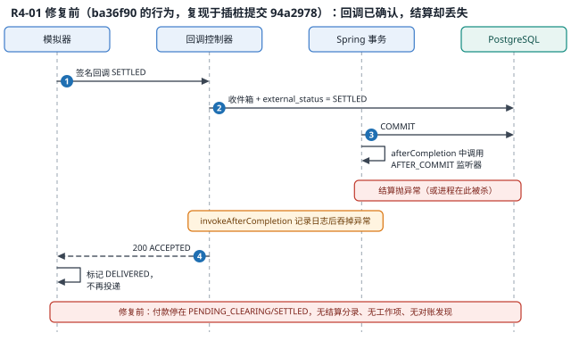
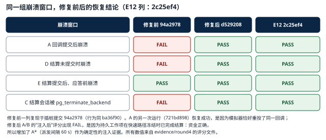
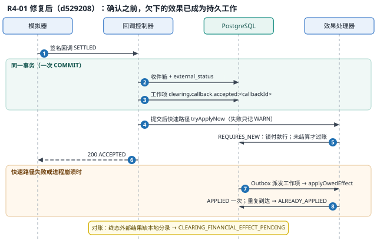

# 案例研究 R4-01：提交之后、结算之前 {#ch-r401}

:::: opener
::: q
业务问题

清算系统说“已结算”，银行回答“收到了”。然后，银行自己的结算分录没有写成——不是因为准备金不足，不是因为任何业务规则，而是因为一次恰好发生在错误时刻的崩溃。没有报警，没有例外，没有重试。这笔钱会在清算应付里待多久？
:::
::: k
本章证据

- 发现登记：`docs/v2/ROUND-4-FINDINGS.md` R4-01；决策：`docs/v2/ADR/0006-durable-clearing-financial-effects.md`
- 复现：`evidence/round4/reproductions/`（修复前矩阵、会话终止、Spring 吞掉异常的日志）
- 修复：提交 `d529208`；修复后矩阵：`evidence/round4/remediation/`
- 冻结提交上的 E12 重跑：E12-E04、E12-E05
:::
::::

## 一个已经被验收过的缺陷

第三轮结束时，E5（清算）被标为 PARTIAL，但它的主体——结算、拒绝、UNKNOWN 询价、回调签名——都有测试，也有两个进程上的手工验证。第四轮的审计没有从“还缺什么测试”开始，而是从一个更朴素的问题开始：**在一笔付款的生命周期里，有没有一个时刻，银行已经对外承诺了什么，却还没有把这个承诺持久化？**

答案就在回调处理里。银行收到 SETTLED 回调、写入收件箱、更新外部状态、提交事务、回答 200——这一串动作之后，模拟器把回调标记为已投递，不会再发。而结算分录呢？它在**提交之后**才开始写。

## 修复前的机制

第三轮把结算写在一个 Spring 事件监听器里（@code-16-1）。

@@excerpt ba36f90:backend/src/main/java/nz/ac/ledgercore/clearing/ClearingOutcomeListener.java | @TransactionalEventListener | block | 修复前（ba36f90）：结算在 AFTER_COMMIT 监听器中执行，只捕获准备金不足

`@TransactionalEventListener(phase = AFTER_COMMIT)` 的语义是“在发布事件的事务成功提交之后运行”。这听起来正是想要的：只有回调被持久记录了，才去结算。问题在于**它在哪里运行**。Spring 在事务同步的 `afterCompletion` 回调中调用这类监听器；此时事务已经提交，监听器抛出的任何异常都由 `TransactionSynchronizationUtils.invokeAfterCompletion` 记录一条 ERROR 日志之后**吞掉**，不会传回调用者。于是（@fig-r401-before）：

1. 回调事务提交：收件箱有了这条回调，外部状态是 SETTLED；
2. 监听器开始结算，结算失败——数据库会话被终止、连接池耗尽、任何意外异常，或者进程恰好在这里被杀；
3. Spring 吞掉异常，控制器照常返回 200 ACCEPTED；
4. 模拟器把回调标记为 DELIVERED，不再重试；
5. 付款永远停在 PENDING_CLEARING / SETTLED，没有结算分录、没有持久工作项、对账也看不见（R4-03）。

{#fig-r401-before}

第 15 章提过，回调重复到达时会再次发布结算事件。所以这个缺陷有时会“自愈”——如果模拟器恰好又投递了一次同一条回调。这让它更难被发现：同一个实验跑两次，结果可能不同。

## 先复现，再修复

第四轮对 P1 级别的发现有一条硬规则：**修复之前，先在真实的崩溃窗口里复现它，并写出一个在修复前失败的测试。**

插桩提交 `94a2978` 只做了一件事：在三个精确的位置加上故障检查点，并为实验室增加对应的用例——回调已提交、结算尚未开始（A/B）；结算分录已写、事务尚未提交（D）；结算已提交、应答尚未返回（E）。另一个用例（C）不杀进程，而是用 `pg_terminate_backend` 终止正在执行结算的那个数据库会话：实验脚本用一个独立的 psql 会话先锁住付款行，让结算会话在锁上等待，从 `pg_stat_activity` 找到它的 PID（每次循环都调用 `pg_stat_clear_snapshot()`，否则同一事务里看到的是冻结的快照——这是实验脚本自己第一次运行时踩到的坑），然后终止它。

这些用例在修复前的结果见 @fig-e6-matrix 的“修复前”一列：A、C、D 的恢复判定都是 FAIL；A 的另一次运行与 E 是 PASS，原因前面已经说明。同一提交上的回归测试也是红的：`terminatedSettlementSessionStillAcknowledgesButLeavesDurableWorkThatCompletesOnce` 在 `94a2978` 上失败——回调被确认，期望存在的持久工作项数量是 1，实际是 0。Spring 吞掉异常的那一行日志被原样保存在 `evidence/round4/reproductions/red-green/`。

{#fig-e6-matrix .data}

## 修复：确认之前，欠下的效果必须已经持久化

修复的原则只有一句话：**银行在回答“收到”之前，必须已经持久记录了“欠着一笔结算”。** 具体做法是在回调被接受的**同一个事务**里，写入一个持久工作项（@code-16-2）。

@@excerpt backend/src/main/java/nz/ac/ledgercore/clearing/ClearingCallbackService.java | events.recordAudit\(null, "CLEARING_CALLBACK_ACCEPTED" | 9 | 回调被接受的同一事务里：审计、入队 clearing.callback.accepted 工作项、发布结果事件

工作项的事件键是 `clearing.callback.accepted:<callbackId>`，与收件箱行、外部状态一起提交。从这一刻起，无论之后发生什么——进程崩溃、会话被杀、监听器抛异常——这笔欠着的结算都有一个**持久的所有者**：Outbox 会把它交给结算处理器，失败了会按退避重试，五次失败会变成可见的死信（第 12 章）。

真正执行结算的是一个幂等的处理器（@code-16-3）。

@@excerpt backend/src/main/java/nz/ac/ledgercore/clearing/ClearingFinancialEffectProcessor.java | public EffectResult apply\(UUID paymentId\) | block | 在独立事务中锁住付款行，按已持久化的外部结果决定欠什么：未结算则结算，已结算则 ALREADY_APPLIED，已结算的付款绝不退款

它有三个关键性质：

1. **REQUIRES_NEW**：无论谁调用它，它都在自己的事务里运行、自己提交。调用者的失败不会把结算一起回滚，结算的失败也不会污染调用者。
2. **先锁行，再判断**：`SELECT ... FOR UPDATE` 锁住付款行，然后根据**数据库里已经持久化的**外部状态与分录链接决定“欠什么”。快速路径、工作项、重复回调可能同时到达，锁让它们排队；第一个完成结算的得到 APPLIED，其余得到 ALREADY_APPLIED。
3. **结算优先于退款**：REJECTED 分支要求 `settlementEntryId == null`，已经结算的付款永远不会被退款。

工作项的处理器只是把“操作身份”翻译成付款 ID，然后调用同一个处理器，再记录消费收据（@code-16-4）。

@@excerpt backend/src/main/java/nz/ac/ledgercore/clearing/ClearingCallbackEffectOutboxHandler.java | public void handle\(OutboxEvent event\) | block | 持久路径：找到付款、应用欠下的效果、记录消费收据；失败即抛出，由 Outbox 重试与升级

## 为什么还保留快速路径

既然持久工作项已经能保证结算，为什么提交后的监听器还在？因为**延迟**。工作项要等派发器的下一次轮询，而绝大多数回调到达时一切正常，客户期望看到付款立刻完成。修复后的监听器仍然在提交后尝试结算，但它的角色变了（@code-16-5）。

@@excerpt backend/src/main/java/nz/ac/ledgercore/clearing/ClearingFinancialEffects.java | public void tryApplyNow | block | 快速路径从不抛出异常：失败只记一条 WARN，持久工作项仍是效果的所有者

快速路径成功了，工作项随后被派发，处理器发现已经结算，返回 ALREADY_APPLIED，计数器 `ledgercore.clearing.effect.duplicates` 加一；快速路径失败了，工作项负责完成。两条路径共享同一个加锁、幂等的处理器，所以“两条路径同时成功”不可能产生两张结算分录（@fig-r401-after）。

{#fig-r401-after}

## 修复后的同一组实验

修复提交 `d529208` 上，同一组用例的恢复判定全部为 PASS（@fig-e6-matrix 的中间一列）。其中有一个值得讲的细节：A 用例修复后两次运行的“注入后”评分都是 FAIL——评分期望在进程被杀时付款仍未结算，可实际上已经结算了。原因是在快速路径被检查点冻结、等待被杀的那几秒里，派发器已经拿到工作项并完成了结算。**资金结果完全正确，只是实验没有观察到它想观察的中间状态。** 修复的做法不是放宽评分，而是增加一个确定性的变体 A*：故障运行时把派发器的轮询间隔调到 60 秒，让中间状态稳定存在，再杀进程、重启、观察工作项完成结算（A* 恢复用时 26.1 秒）。冻结提交上的 E12 运行使用的正是这种配置。

修复前就已经运行过修复前代码的数据库怎么办？V12 为这些“已结算未记账”的付款补登工作项，不写任何分录（第 6 章）。

## 这件事教给我们什么

::: takeaway
1. **“提交之后再做”与“一定会做”是两回事。** 任何在提交之后执行的副作用，都需要一个与提交同时持久化的所有者，否则它只是一次尽力而为。
2. **确认（acknowledge）是一个承诺。** 只有当承诺的履行已经被持久化，才可以对外确认。
3. **框架的语义要读到底。** `@TransactionalEventListener(AFTER_COMMIT)` 的异常不会传回调用者，这是 Spring 文档化的行为，不是缺陷——缺陷在于把必须完成的财务动作放在了这里。
4. **测试必须杀死真实的进程。** 在测试里抛一个异常，只能证明“这个异常被处理了”；只有在真实的崩溃窗口里杀进程、终止会话，才能证明“这个窗口被关闭了”。
:::

::: exercise
1. 修复后，假设派发器的工作项在第一次尝试时因为数据库短暂不可用而失败，而快速路径也失败了。描述接下来付款、工作项与对账分别会经历什么，直到结算完成。（答案见 [附录 G](#ans-16-1)）
2. 有人提议用 `@TransactionalEventListener(phase = BEFORE_COMMIT)` 来修复 R4-01：在回调事务提交之前就完成结算。这能解决问题吗？会引入什么新问题？（答案见 [附录 G](#ans-16-2)）
:::
