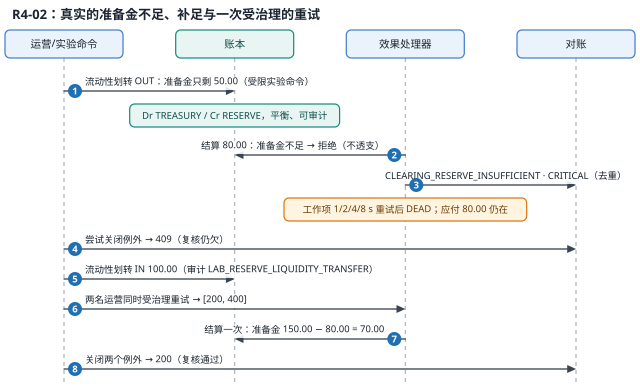

# 有限准备金：真实的不足与受治理的补足（R4-02） {#ch-reserve}

:::: opener
::: q
业务问题

清算系统说一笔 80.00 的付款已经结算，可银行放在清算系统里的准备金只剩 50.00。银行能不能先“记上再说”？能不能把付款退回给客户？如果都不能，这笔钱应该停在哪里、由谁、经过什么手续把它解决？
:::
::: k
本章证据

- 发现：`docs/v2/ROUND-4-FINDINGS.md` R4-02（含基线数据库上的不可达性证明）
- 迁移 V13、`LedgerWriter.transferReserveLiquidity`、`ReserveLiquidityLabRunner`
- 测试：`genuinelyFiniteReserveHoldsTheObligationUntilAuditedReplenishmentAndGovernedRetry`
- 实验：`evidence/round4/remediation/clearing-reserve-shortage-postfix.json`；E12-E06
:::
::::

## 一个永远不会发生的故障

第三轮已经为准备金不足写好了处理分支：`settleClearingPayment` 在准备金不够时抛出 `InsufficientLedgerBalanceException`，监听器捕获它并记录例外。也有一个测试证明这条分支“工作”：它用 `MockitoSpyBean` 让结算方法抛出这个异常，再手工重放同一条回调。

第四轮审计问了一个问题：**在真实系统里，这个异常能不能发生？** 答案是不能，而且可以证明。V1–V11 中所有能触及准备金的分录只有这几种：开户注入与模拟存款（借准备金、贷客户存款）、转账（两个负债之间）、企业付款记账与退款（存款与应付之间）、结算（借应付、贷准备金）。逐条检查就会发现，任何时刻都有

> 准备金 = 全部客户存款 + 清算应付

结算 A 的前提是应付 ≥ A（结算方法先检查这一点），而应付 ≥ A 推出准备金 ≥ A。**准备金不足的分支在数学上不可达。** 第四轮在基线数据库上验证了这条等式：95 个测试跑完之后，1,263 张分录，准备金 61,400,650 分，存款 61,400,350 分加应付 300 分，一分不差。

一个不可能被合法触发的恢复路径，等于一个从未被测试过的恢复路径。用 Mock 抛出的异常证明了“异常被捕获后事务回滚”，但证明不了“准备金不足时，钱停在哪里、谁会知道、怎样恢复”——那是一个跨越多个事务、多个角色、多个时间点的生命周期。

## 让不足合法地发生

修复的思路不是伪造一个余额（例如用 SQL 直接改投影表——这是被明确禁止的），而是给银行一个**合法的、受限的**方式改变准备金：

1. V13 增加第二个银行自有的模拟资产 **SIMULATION_TREASURY**（司库）；
2. 增加一种新分录 **RESERVE_LIQUIDITY_TRANSFER**：在准备金与司库之间平衡地移动流动性，资产换资产，R + T = D + P 保持不变；
3. 用延迟约束触发器限定它（第 6 章 @code-6-3）：恰好两行、一行在司库、方向与引用一致；其他任何分录都不能触碰司库；同一个请求号只能对应一张分录。

写入方法本身也遵守同样的规则（@code-17-1）。

@@excerpt backend/src/main/java/nz/ac/ledgercore/ledger/LedgerWriter.java | public LiquidityTransfer transferReserveLiquidity | block | 锁两个系统账户；同一请求号重放返回原分录、金额不同则拒绝；付出方不足则拒绝；平衡地写一张划转分录

## 一个没有 HTTP 路由的命令

谁可以调用这个方法？LedgerCore 的回答是：**没有任何在线接口。** 它只能由一个实验命令调用，而这个命令有五道门（@code-17-2）。

@@excerpt backend/src/main/java/nz/ac/ledgercore/faultlab/ReserveLiquidityLabRunner.java | public void run\(ApplicationArguments arguments\) | 12 | 需要专用配置、显式开关、确认令牌，并且只接受环回地址上名字标明为一次性的库

五道门分别是：Spring 配置 `reserve-lab`；属性 `ledgercore.reserve-lab.enabled=true`；环境变量 `LEDGERCORE_RESERVE_LAB_CONFIRM=DISPOSABLE_ONLY`；数据库 URL 必须匹配 `127.0.0.1` 上三个实验端口之一、库名以 `ledgercore_e6_`、`ledgercore_e12_` 或 `ledgercore_r4_` 开头；以及连接之后由服务器自己报告的库名、地址与端口再核对一次。命令还要求一个理由（不超过 200 字符）与一个请求号，每次划转写入审计 `LAB_RESERVE_LIQUIDITY_TRANSFER`，打印一行结果后退出。普通启动不会注册这个组件，`LedgerCoreApplicationTests.reserveLiquidityLabCommandIsAbsentWithoutItsDedicatedProfile` 验证了这一点。

为什么不提供一个“管理员调整准备金”的接口？因为那就是一个不受限制的造钱按钮。真实银行里，准备金的补足来自司库的资金调拨，有自己的审批与对账流程；LedgerCore 用一个只存在于实验环境、只做资产换资产的命令来**代表**这个流程，而不是在产品里留下一个后门。

## 不足时的生命周期

有了合法的手段，就可以真实地走一遍准备金不足的全过程（@fig-reserve）。

{#fig-reserve}

结算失败时，效果服务把准备金不足当作一种**延期**而不是错误（@code-17-3）。

@@excerpt backend/src/main/java/nz/ac/ledgercore/clearing/ClearingFinancialEffects.java | catch \(InsufficientLedgerBalanceException exception\) | 7 | 准备金不足：计数、记录（去重的）CRITICAL 例外，并以“延期”异常交回 Outbox 保留工作项

逐步看会发生什么：

1. **义务保留。** 结算事务回滚，付款停在 PENDING_CLEARING / SETTLED，80.00 仍在清算应付里。客户的存款已经在批准时扣减，这一点不变；银行**不会**把钱退给客户——清算系统已经说了“结算”，退款会让钱被付两次。
2. **立即可见。** `CLEARING_RESERVE_INSUFFICIENT` 例外以 CRITICAL 级别记录，同一付款只有一条未关闭的（去重）。运营控制台的“Reserve-blocked settlements”卡片与“Unresolved clearing payable”同时显示（第 24 章），Prometheus 的两条告警在一分钟之后触发（第 21 章）。
3. **自动重试，然后死信。** 工作项按 1、2、4、8 秒退避重试，每次都因准备金不足失败；第五次之后成为 DEAD，`last_error` 是 `ClearingEffectDeferredException`。
4. **关闭被拒绝。** 运营人员试图关闭例外——复核发现付款仍未结算，返回 409。
5. **补足。** 司库通过实验命令划入 100.00（审计记录理由与请求号）。准备金变为 150.00。
6. **一次受治理的重试。** 两名运营人员同时点击重试：恰好一个得到 200、另一个得到 400，审计里恰好一条 `OUTBOX_MANUAL_RETRY`。工作项被派发，结算恰好一次，准备金 150.00 − 80.00 = 70.00。
7. **复核后关闭。** 两条例外的关闭请求都经过复核：付款已 COMPLETED、没有欠着的效果，返回 200。

这个生命周期在测试与实验室中都被完整执行：测试在单个进程内以确定的时序验证每一步；实验室在真实的银行与模拟器进程之间重现它，并在步骤之间重启银行。两者的最终数字一致：准备金 70.00、司库 850.00、客户存款 920.00、应付 0，借方正常合计与贷方正常合计都是 92,000 分。冻结提交上的 E12-E06 再次执行了实验室版本（第 26 章）。

## 如果永远不补足

这是本章最重要的一个结论：**如果准备金永远不被补足，系统不会“自己想办法”。** 应付一直在，CRITICAL 例外一直在，告警一直在，死信一直在。没有自动退款，没有静默成功，没有超时后的默认动作。这看起来不够“自动化”，但在资金系统里，一个无法自动安全解决的问题，正确的结局就是**持续地、明确地等待人的决定**。

::: limit
LedgerCore 的准备金与司库是实验室的模拟资产。真实银行的流动性管理涉及中央银行结算账户、日间透支额度、抵押品与监管报告，远比一次资产间划转复杂。本章演示的是“资金不足时银行软件应当怎样表现”，不是任何真实的流动性管理流程。
:::

::: exercise
1. 证明：在只有 V1–V11 分录类型的系统中，结算一笔金额为 A 的付款时，准备金必然 ≥ A。指出证明依赖的每一条代码或约束。（答案见 [附录 G](#ans-17-1)）
2. 实验命令被同一个请求号调用了两次（第一次的输出因为终端关闭而丢失）。第二次会发生什么？如果第二次传入的金额与第一次不同呢？（答案见 [附录 G](#ans-17-2)）
3. 为什么准备金不足时，银行不能把这笔付款退给客户？请从清算系统、客户、收款人三方的角度说明。（答案见 [附录 G](#ans-17-3)）
:::
