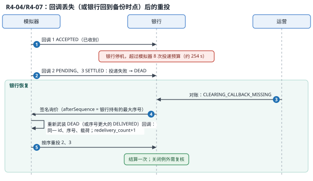

# 丢失的回调与重投（R4-04、R4-07） {#ch-redelivery}

:::: opener
::: q
业务问题

银行停机维护了十分钟。这期间清算系统把一笔付款推进到了“已结算”，并试着通知银行八次，全部失败，然后放弃了。银行恢复上线，对这笔付款的认识停留在“已受理”。它怎样才能知道结果？如果银行是从昨晚的备份恢复的，连清算系统**已经成功送达**的消息也丢了呢？
:::
::: k
本章证据

- 发现：R4-04（死信回调无法重投）、R4-07（银行恢复到旧时点后无法重投）
- 模拟器：`SimulatorOperationService.inquire`、迁移 V3 与 V5
- 银行：`ClearingOperationsService.inquire` 携带银行已持有的最大序号
- 实验：修复前 `ecf5a9ab`（R4-04 复现）、修复后 `clearing-lost-callback`；E12-E07、E12-G02
:::
::::

## 投递预算用完之后

模拟器为每一条回调准备了 8 次投递机会，间隔为 2、4、8……128 秒，总计约 254 秒；第 8 次失败之后，回调成为 DEAD（第 13 章）。为了保持顺序，后面的序号会排在尚未投递成功的前一个序号之后。

第三轮的设计里，DEAD 是一个终态：模拟器的触发器禁止回调离开 DEAD；询价接口只返回当前状态，不产生任何投递。第四轮复现了这样一个场景（运行 `ecf5a9ab`）：银行停机超过投递预算，期间操作推进到 SETTLED（序号 3）；序号 2 成为 DEAD，序号 3 被它挡住。银行恢复后，对账正确地发现了 `CLEARING_CALLBACK_MISSING`；运营人员的签名询价得到“SETTLED / 序号 3”——**然后什么都没有发生**。银行知道了结果，却拿不到那两条签名回调；没有它们，银行不会、也不应该凭一个询价响应去结算（询价响应不是可去重、可排序、可审计的事件）。付款永远停在 ACCEPTED。

## 修复：询价重新武装原来的回调

R4-04 的修复让询价不只是“告诉你”，而是“再送一次”：一次经过认证的询价，会把该操作所有 DEAD 回调**重新武装**——同一个回调 ID、同一个序号、同一份签名载荷，投递预算从零开始（@fig-lost-callback）。

{#fig-lost-callback}

为什么必须是“原来的回调”，而不是根据当前状态生成一条新的？因为银行的收件箱以回调 ID 与“操作 + 序号”去重（第 15 章）。新生成的回调会带着新的 ID、可能占用一个已经使用过的序号：要么被当成序号冲突（CRITICAL），要么让同一个状态变化以两种身份存在于两边的记录里，之后的任何对账都说不清哪一条才是事实。**恢复的原则是重放事实，而不是重新创造事实。**

## R4-07：已经送达的也可能需要再送

R4-04 的修复只覆盖了 DEAD 的回调。设计 E12 的恢复实验时，第四轮发现了另一种情况：银行从备份恢复到一个**更早**的时点。备份之后，模拟器已经成功投递了序号 2、3，它们是 DELIVERED，不是 DEAD；可恢复后的银行库里根本没有它们。这时 R4-04 的重新武装帮不上忙。

R4-07 的修复让银行在询价时告诉模拟器“我手里最大的序号是多少”（@code-18-1）。

@@excerpt backend/src/main/java/nz/ac/ledgercore/clearing/ClearingOperationsService.java | // The highest callback sequence the bank holds | 9 | 询价携带银行收件箱里该操作的最大序号；审计记录银行序号与模拟器序号

模拟器据此重新武装：所有 DEAD 的回调，以及所有序号大于银行所持序号的 DELIVERED 回调（@code-18-2）。

@@excerpt clearing-simulator/src/main/java/nz/ac/ledgercore/clearing/simulator/SimulatorOperationService.java | int rearmed = jdbc.update\(""" | 10 | 重新武装 DEAD 回调与银行尚未持有的 DELIVERED 回调：清空投递时间、预算归零、重投计数加一

注意这里**没有**任何“信任银行”的成分：银行报告的序号只能让模拟器**多送**它本来就签过名的回调，不能让它改变任何事实。如果银行谎报了一个更小的序号，结果只是多收到几条重复回调——它们会被收件箱识别为 `DUPLICATE`，没有任何资金效果。

## 数据库守住“重投”的含义

模拟器的 V5 迁移把重投规则写进了触发器（@code-18-3）。

@@excerpt clearing-simulator/src/main/resources/db/migration/V5__redeliver_callbacks_after_bank_restore.sql | IF OLD.delivery_status IN \('DEAD', 'DELIVERED'\) AND NEW.delivery_status = 'PENDING' THEN | 9 | 只有“预算归零、无租约、重投计数恰好加一并记录时间”的重新武装才被允许

同一个触发器还保证：回调的 ID、操作、序号、状态、载荷与创建时间永远不变；重投计数只能增加，而且只能在重新武装时增加。于是每一次重投都是**可归因的**：事后可以看到某条回调被重新武装了几次、最近一次在什么时候。模拟器测试 `rearmingCannotRewriteCallbackFactsOrKeepTheSpentBudget` 逐条尝试了这些违规写入，`inquiryFromABankBehindTheDeliveredSequenceRedeliversOnlyTheLaterCallbacks` 验证了只有银行缺少的那几条被重投。

## 实验：银行停机超过投递预算

修复后的实验室用例 `clearing-lost-callback` 走完了完整的故事：

1. 一笔 6.54 的付款以 `SIM-ACCEPT` 提交，银行收到序号 1（ACCEPTED）；
2. 银行进程被停止，时间长于模拟器的投递预算；期间两次签名询价把操作推进到 SETTLED，序号 2、3 的投递全部失败、成为 DEAD；
3. 银行重启；对账运行发现 `CLEARING_CALLBACK_MISSING`；
4. 运营人员询价：模拟器重新武装序号 2、3，按序重投；银行依次接受，结算恰好一次；
5. 关闭“回调缺失”例外的请求经过复核，返回 200。

独立评分确认：恰好一张记账、一张结算、零退款；全部回调都是 DELIVERED，并且银行收件箱的条数等于模拟器的回调条数；客户与准备金各恰好减少 6.54。冻结提交上的 E12-E07 再次执行了它。R4-07 的场景——银行回到备份时点——由第 23 章的恢复实验（E12-G02）覆盖。

::: takeaway
跨系统恢复的核心不是“重试”，而是**用原来的身份重放原来的事实**，并让每一次重放都留下痕迹。任何“重新生成一条等价消息”的捷径，都会在之后的某一次对账中变成说不清的分叉。
:::

::: exercise
1. 银行停机期间，模拟器的序号 2 成为 DEAD，序号 3 仍是 PENDING（被 2 挡住）。银行恢复后、询价之前，银行与模拟器两边分别是什么状态？对账会报告什么？（答案见 [附录 G](#ans-18-1)）
2. 一个有缺陷的银行版本在询价时总是报告 `afterSequence = 0`。这会造成什么后果？会不会造成资金错误？为什么？（答案见 [附录 G](#ans-18-2)）
:::
