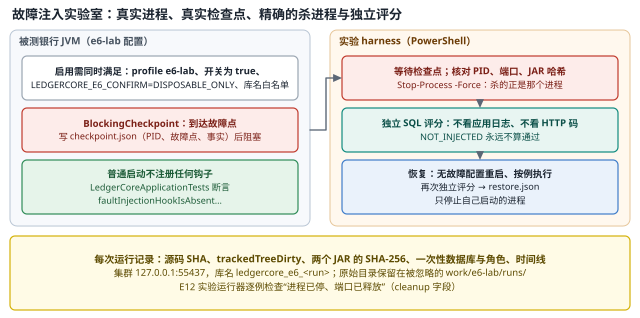

# 故障注入实验室与独立 SQL 评分 {#ch-fault-lab}

:::: opener
::: q
业务问题

“系统在崩溃后能正确恢复”——这句话要怎样才算被证明？在哪一行代码之后崩溃？是谁杀的进程，杀的是不是那个进程？恢复之后由谁判断“正确”？如果判断的依据是应用自己的日志或 HTTP 状态码，它还算独立吗？
:::
::: k
本章证据

- `E6FaultLabConfiguration`：只在专用配置下存在的阻塞检查点
- `assessment/e6/`：transfer、payroll、clearing、recovery 四类实验脚本与共享守卫
- 用例清单：`evidence/round3/e6/CASE-INVENTORY.md`；第四轮新增用例见 `assessment/e6/README.md`
- E12 实验运行器：`assessment/e12/run-e12-lab.ps1`、`evidence/round4/e12/lab/E12-LAB.json`
:::
::::

## 为什么不在测试里抛异常

在单元测试或集成测试里模拟故障，最常见的做法是让某个依赖抛出异常（Mock、Spy、测试替身）。这能验证“异常被捕获并回滚”，但验证不了三件事：

1. **进程真的消失了**。异常之后，JVM 还在，`finally` 块会运行，连接池会归还连接，Spring 会执行事务同步回调——R4-01 正是藏在这些“还在运行”的回调里。进程被杀死时，这一切都不会发生。
2. **数据库真实地看到了什么**。被杀进程持有的连接由数据库端断开，未提交的事务由 PostgreSQL 回滚；已提交的事务一条不少。测试替身不会产生这种边界。
3. **重启之后的系统**。恢复依赖的是新进程从数据库读到的状态，而不是旧进程内存里的任何东西。

LedgerCore 的故障实验室（E6）做的事情很简单：让真实的银行进程在一个精确的代码位置停下来，从外部杀死它，然后让一个新进程启动、恢复，最后用**独立的 SQL** 判断结果（@fig-e6-lab）。

{#fig-e6-lab}

## 检查点：只在实验里存在

故障点在业务代码里只是一行调用：`hook.checkpoint(名字, 当时的事实)`。`hook` 来自 `ObjectProvider<E6FaultInjectionHook>`；普通部署里这个 Bean 根本不存在，`getIfAvailable()` 返回 null，这一行什么也不做。它只有在六个条件同时成立时才会被创建（@code-19-1）。

@@excerpt backend/src/main/java/nz/ac/ledgercore/faultlab/E6FaultLabConfiguration.java | E6FaultInjectionHook e6FaultInjectionHook\(Environment environment, DataSource dataSource\) | block | 用例与故障点必须是允许的组合；确认令牌、运行号、运行目录与一次性数据库逐一核对后才创建检查点

条件依次是：配置 `e6-lab`；属性 `ledgercore.e6.enabled=true`；用例名与故障点必须是白名单里的一对；确认令牌 `DISPOSABLE_ONLY`；运行号是 GUID，运行目录正是 `work/e6-lab/runs/<运行号>`；数据库 URL 必须是 `127.0.0.1:55437` 上 `ledgercore_e6_` 开头的库，连接后再由服务器核对身份。任何一条不满足，应用**启动失败**，而不是在没有故障注入的情况下“正常”运行、让实验误以为通过。

检查点本身的实现同样克制（@code-19-2）。

@@excerpt backend/src/main/java/nz/ac/ledgercore/faultlab/E6FaultLabConfiguration.java | public void checkpoint\(String point, Map<String, \?> facts\) | block | 只在配置的故障点触发一次：原子地写出检查点文件，然后阻塞，等待实验脚本杀死进程

两个细节：检查点文件先写临时文件再原子改名，实验脚本永远不会读到写了一半的 JSON；阻塞最多 10 分钟，超时则抛出异常——“故障没有按计划完成”必须是一个明确的失败，而不是一个悄悄继续的进程。

## 实验脚本：等待、核对、杀死、评分

每个实验分两个动作。`inject`：创建一次性的集群、库与角色，启动模拟器与带故障配置的银行，构造业务夹具（用户、组织、账户、付款或工资），触发业务动作，等待检查点文件出现；确认文件里的 PID 正是自己启动的那个进程、端口上的监听者正是那个 JAR（第 4 章 @code-4-2），然后 `Stop-Process -Force`。随后立即用独立 SQL 给“崩溃后”的状态评分。`restore`：以**无故障配置**重启银行，按用例执行恢复动作（重试同一请求、等待工作项、运营人员询价或重试），再评分一次。

“独立评分”的含义是：评分只读数据库，不读应用日志，不看 HTTP 状态码，不调用应用接口。它重新计算分录是否平衡、投影是否等于过账之和、付款与分录是否对应、准备金与应付是多少、每个回调与工作项处于什么状态。应用说“成功”不算数，数据库里的事实才算数。

评分结果只有三种：PASS、FAIL，以及 **NOT_INJECTED**——检查点从未出现，或者出现的不是被测进程。NOT_INJECTED 永远不算通过：如果一个“崩溃恢复”实验根本没有崩溃，它什么也没证明。

## 用例清单

| 类别 | 用例 | 故障方式 | 恢复动作 |
|---|---|---|---|
| 转账 | 提交前 / 提交后应答前 / Outbox 派发前 | 检查点 + 杀进程 | 同键重试；派发 |
| 工资 | 失败回滚后、记录 FAILED 前 | 检查点 + 杀进程 | 重新执行批次 |
| 清算 | 回调提交后、结算前（A/A*） | 检查点 + 杀进程 | 重启后由工作项结算 |
| 清算 | 结算分录已写、未提交（D） | 检查点 + 杀进程 | 租约到期后重试 |
| 清算 | 结算已提交、应答前（E） | 检查点 + 杀进程 | 重投的回调为 DUPLICATE |
| 清算 | 结算会话被终止（C） | `pg_terminate_backend` | 工作项重试 |
| 恢复 | 准备金不足（R4-02） | 实验命令真实划走准备金 | 补足 + 受治理重试 |
| 恢复 | 回调超出投递预算（R4-04） | 银行停机超过 254 秒 | 询价重新武装 |
| 恢复 | 模拟器崩溃（E5） | 杀死模拟器进程 | 重启 + 询价 |

Table: E12 实验运行器依次执行的 11 个故障用例 {#tbl-lab-cases}

每个用例的恢复判定都写入 `E12-LAB.json`，同时记录运行号、注入是否被观察到、未通过的检查项，以及“所有进程已停止、端口已释放”的清理结果。原始目录（进程日志、检查点文件、两个数据库的数据目录、时间线）保留在被 Git 忽略的 `work/e6-lab/runs/<运行号>/`，可以随时复查。

## 实验室自己也会出错

本书不回避一个事实：实验脚本是代码，也会有缺陷。第四轮遇到过四次：

- 会话终止实验第一次运行时，脚本在一个事务的循环里反复查询 `pg_stat_activity`，看到的却始终是同一份快照（PostgreSQL 在一个事务内缓存统计视图），于是永远找不到等待中的会话。修复是每次循环调用 `pg_stat_clear_snapshot()`。
- 工资实验的评分 SQL 读了一个不存在的列；全栈评估的 Playwright 参数被 PowerShell 拆开（第 4 章）。
- 第一次官方 E12 评估中，实验运行器用数组展开传参，11 个用例全部以 `HARNESS_ERROR` 结束（第 4 章）。

这些问题有一个共同点：它们都表现为**失败**，而不是虚假的通过。这是有意的设计：脚本在任何不确定的地方都选择抛出异常，评分在任何缺失的地方都给出 FAIL 或 NOT_INJECTED。一个会在出错时“宽容地”给出 PASS 的实验室，比没有实验室更危险。

::: limit
实验室覆盖的是**进程级**的故障：进程被杀、数据库会话被终止、外部进程不可达、资金不足、消息丢失。它没有覆盖磁盘损坏、文件系统满、网络分区（两个进程都活着但彼此不可达且各自继续工作）、时钟跳变、PostgreSQL 本身崩溃或锁等待超时等类别。这些未执行的类别列在第 26 章与 `docs/v2/ROUND-4-HANDOFF.md` 中。
:::

::: exercise
1. 某次实验的检查点文件显示 PID 为 4120，而端口 18095 上的监听者是 PID 5308、命令行包含同一个 JAR。实验脚本应当怎样做？为什么不能“反正是同一个 JAR，就杀 5308”？（答案见 [附录 G](#ans-19-1)）
2. 为什么评分只读数据库、不看 HTTP 状态码？举一个“HTTP 200 而资金结果错误”的例子，以及一个“HTTP 500 而资金结果正确”的例子，均来自本书。（答案见 [附录 G](#ans-19-2)）
:::
