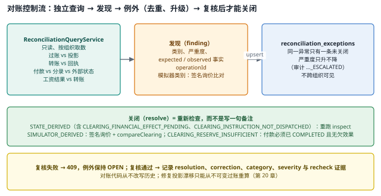
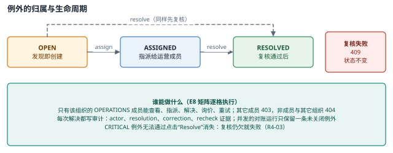

# 对账：独立检查、例外与复核后的关闭 {#ch-reconciliation}

:::: opener
::: q
业务问题

约束、幂等、持久工作项都在努力让错误不发生。可总有约束没想到的情况，总有尚未被处理的工作，总有外部系统说法与银行不一致的时候。谁负责发现它们？发现之后，怎样保证它们不会被一句“已处理”轻轻带过？
:::
::: k
本章证据

- `ReconciliationQueryService`（独立检查）、`ReconciliationService`（复核）、`ReconciliationExceptionService`（例外）
- 第四轮发现：R4-03（盲点与“备注关闭”）、R4-05（静默确认的指令）、R4-06（终态与分录未绑定）
- 负例测试：`ReconciliationNegativeFixturesPostgresIntegrationTests`
:::
::::

## 对账不是“再算一遍余额”

在 LedgerCore 里，对账（reconciliation）是一组**独立于业务代码路径**的只读检查：它不调用转账、结算或工资的任何方法，而是直接从数据库重新推导“应该是什么”，与“实际是什么”比较。它覆盖了七个方面：

- 过账与投影：每个账户的投影是否等于过账之和；
- 转账与回执：每笔转账是否恰有一张分录与一个成功回执；
- 工资：每个成功项是否链接到支付它的转账，终态批次是否完整；
- 企业付款：状态、外部状态与记账、结算、退款分录是否一致；
- 清算跨系统：银行与模拟器对同一操作的状态、序号、身份是否一致（通过签名询价）；
- 持久事件：事件是否缺失、是否死信、是否属于正确的组织；
- 组织所有权：账户与资源的归属是否一致。

每个发现（finding）都带着类别、严重度、资源、操作身份，以及“期望事实”与“观察事实”两组数据（@fig-reconciliation）。

{#fig-reconciliation}

## 盲点：R4-03

第三轮的对账已经覆盖了大部分检查，却有一个恰好对准 R4-01 的盲点：它只在付款**已经 COMPLETED** 时才要求结算分录存在。一笔外部 SETTLED、银行仍 PENDING_CLEARING 的付款，在它看来一切正常——银行与模拟器都说 SETTLED，两边一致。于是在 R4-01 的三个复现用例里，运营人员手动运行的对账在重启前后都返回了**零个发现**。

修复增加了一个专门的类别（@code-20-1）。

@@excerpt backend/src/main/java/nz/ac/ledgercore/reconciliation/ReconciliationQueryService.java | private List<ReconciliationFinding> clearingEffectsPending | 39 | 外部终态而本地效果缺失：连同终态回调、工作项的重试/死信/已交付计数、最近错误与年龄一起报告

这个查询值得注意的地方，是它报告的“观察事实”：终态回调的 ID 与序号、工作项有几个在重试、几个已死、几个已交付、最近一次的状态与错误、距离最终结果到达已经多少秒、准备金当前余额。运营人员看到一条发现时，不需要再去翻日志，就能知道“这笔欠款现在由谁负责、卡在哪里”。

严重度的规则是：仍有自动重试在排队、且最终结果到达不足 60 秒时为 HIGH——系统大概率会自己完成；没有待执行的重试，或者已经超过 60 秒，则为 CRITICAL。这个 60 秒与第 21 章告警规则的阈值一致。

## 例外：去重与只升不降

发现在每次对账运行时都会重新计算；如果每次都创建一条新例外，运营人员会被同一个问题淹没。`upsertFinding` 先查找同一组织、同一类别、同一资源的**未关闭**例外（@code-20-2）。

@@excerpt backend/src/main/java/nz/ac/ledgercore/reconciliation/ReconciliationExceptionService.java | if \(!existing.isEmpty\(\)\) \{ | 13 | 同一异常只保留一条未关闭例外；原始事实不可变；严重度只能升高，升高时写审计

两条规则：已存在的例外，其原始事实不被覆盖（后来的观察只进入审计记录）；严重度只能升高。一个开始时是 HIGH 的“结算排队中”，在工作项变成死信之后，下一次对账会把它升为 CRITICAL，并留下 `RECONCILIATION_EXCEPTION_ESCALATED` 审计。负例测试还让两个对账运行**并发**执行：最终每个异常只有一条未关闭例外，并且没有任何例外泄露到另一个组织。

## 关闭：先复核，再关闭

第三轮的例外可以用一段 1–500 字符的备注关闭。对于一条 CRITICAL 的“结算缺失”，这意味着一个点击就能让问题从控制台消失，而钱仍然停在应付里。第四轮把“关闭”改成了“复核”（@fig-exception-lifecycle）。

{#fig-exception-lifecycle}

复核按类别采用不同的方法（@code-20-3）。

@@excerpt backend/src/main/java/nz/ac/ledgercore/reconciliation/ReconciliationService.java | if \(STATE_DERIVED.contains\(category\)\) \{ | 10 | 由数据库状态推导的类别：重新运行独立检查，异常仍在即 409

- **由数据库状态推导的类别**（包括 `CLEARING_FINANCIAL_EFFECT_PENDING`、`CLEARING_INSTRUCTION_NOT_DISPATCHED`、`DEAD_OUTBOX_EVENT`、投影偏差等）：重新运行一次独立检查，只要该资源上的同一异常仍然存在，就返回 409。
- **跨系统类别**（回调缺失、序号或状态不一致、询价失败等）：发起一次签名询价并重新比较；模拟器不可达或两边仍不一致，返回 409。
- **准备金不足**：付款必须已经 COMPLETED，并且没有欠着的效果。
- **由收到的消息构成的类别**（回调 ID 重用、序号冲突、乱序、摘要不符、非法转换、未知操作）：这些异常描述的是一条**已被拒绝、没有产生资金效果**的消息，事后不存在可以“复核”的状态。它们以“已确认记录的消息”（`RECORDED_MESSAGE_ACKNOWLEDGEMENT`）关闭，复核方法与关闭人一起写入审计。如果这类消息背后真的有资金后果（例如对方已结算而银行拒收了回调），那个后果会以一条状态类发现单独出现，而那一条无法被“确认”掉。

每一次关闭都在审计中记录：谁、何时、写了什么理由、是否关联了更正分录、复核方法与复核结果。

::: limit
消息类例外由单人确认关闭。对一个生产系统，CRITICAL 级别的确认应当要求第二人复核（四眼原则）；LedgerCore 没有实现这一点，它被记录为后续改进。
:::

## 负例：数据库拒绝了什么

对账能发现问题，但更好的情况是问题根本写不进去。E7 的负例测试在所有约束启用的情况下，逐条尝试 18 种破坏，断言每一种都被拒绝、并且以**特定的**约束名或错误信息被拒绝，同时已有的有效数据不变：

| 破坏 | 拒绝方式 |
|---|---|
| 付款标为 COMPLETED 而无结算分录；写入 FAILED | `ck_corporate_payment_terminal_journals`（V15，R4-06） |
| 修改已提交付款的金额或收款人 | “Submitted corporate payment content is immutable” |
| 给未结算的付款链接一张结算分录 | “Clearing settlement is not linked to a verified settled payment” |
| 给未拒绝的付款链接退款分录 | “Refund is not linked…” |
| 非法的工资批次状态跳转 | “Illegal payroll batch transition” |
| 删除或改写工资结果、分录、过账、审计 | retained / immutable / append-only |
| 同一付款第二张结算 | 唯一约束（duplicate key） |

Table: E7 负例测试中被数据库拒绝的破坏（节选） {#tbl-negative}

第一行就是第 3 章讲过的 R4-06：负例测试最初期望它被拒绝，结果它**被接受了**——测试先红，V15 让它变绿。负例测试的价值正在于此：它不是证明“系统能检测到问题”，而是证明“这个问题根本无法被写入”。

## R4-05：没有人发出的指令

第 12 章讲过，清算集成关闭时，指令事件会被兜底消费者“收下”。对账为此增加了 `CLEARING_INSTRUCTION_NOT_DISPATCHED`（CRITICAL）：付款已记账、指令仍是 READY，而它的派发事件已经 DELIVERED、DEAD 或根本不存在。测试 `bookedInstructionAcknowledgedWithoutDispatchIsReportedInsteadOfStayingSilentlyPending` 在清算集成关闭的配置下复现了这个状态，并断言对账会报告它、复核前无法关闭它。

## 对账从不改写历史

对账发现投影比过账之和多了 5.00，应当怎么修？答案永远是：从不可变的过账**重算**投影，而不是反过来调整过账去迎合投影；对账代码本身只读，修复是单独的、被审计的动作（第三轮 E7 的投影漂移用例精确地检测并修复了这种偏差）。对于资金层面的错误——例如一笔多付的款项——更正只能是一张新的、引用原分录的冲销或更正分录，关闭例外时把这张分录的 ID 一并记录（`correctionJournalEntryId`）。

::: exercise
1. 一条 `CLEARING_FINANCIAL_EFFECT_PENDING` 例外在 10:00:05 以 HIGH 级别创建。10:00:20 工作项第五次失败成为死信；10:01:00 对账再次运行。这条例外会发生什么变化？审计里会多出什么？（答案见 [附录 G](#ans-20-1)）
2. 运营人员 A 在模拟器不可达时尝试关闭一条 `CLEARING_CALLBACK_MISSING` 例外。会得到什么结果？为什么这比“允许关闭并备注‘模拟器暂时不可达’”更安全？（答案见 [附录 G](#ans-20-2)）
:::
