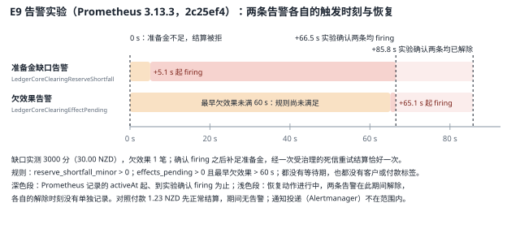
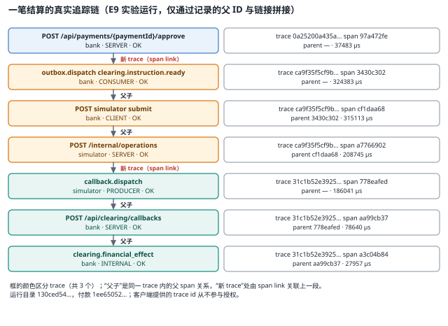

# 可观测性：指标、告警与 W3C Trace Context {#ch-observability}

:::: opener
::: q
业务问题

凌晨两点，一笔已结算的付款因为准备金不足停在应付里。值班的人怎样在几分钟内知道？知道之后，怎样从一条告警追到具体的请求、具体的回调、具体的结算尝试——而不需要登录到每一台机器上翻日志？
:::
::: k
本章证据

- `LedgerCoreObservability`：数据库派生的仪表与告警评估
- `assessment/e9/ledgercore-round4-alerts.yml`、`assessment/e9/alert-lab.ps1`：真实 Prometheus 上的触发与恢复
- `TraceContext`、`TraceContextFilter`、`SpanRecorder`；`assessment/e9/extract-traces.py`
- 冻结提交上的证据：`evidence/round4/e5-e9/E9-ALERT-LAB.json`、`E9-TRACES.json`
:::
::::

## 三种信号，三种问题

可观测性常被概括为指标、日志、追踪三种信号。它们回答的是不同的问题：

- **指标**回答“现在有没有问题、有多严重”：欠着的结算有几笔、最旧的一笔等了多久、准备金缺口是多少。
- **追踪**回答“这一笔事情经过了哪些地方”：一次批准如何触发派发、派发如何调用模拟器、模拟器的回调如何触发结算。
- **日志**回答“那一刻具体发生了什么”：异常类型、参数、错误信息。

LedgerCore 第三轮实现了指标与结构化日志，追踪被标为未实现。第四轮补上了追踪，并为 R4-01/R4-02 引入的新风险增加了指标与告警。

## 指标：只用低基数标签

第三轮的 E9 已经为转账、工资、清算、Outbox、对账、回滚、重复投递、恢复动作、Hikari 连接等待与 PostgreSQL 锁等待建立了 Micrometer 指标。所有标签都是低基数的（例如 `outcome=success|failure`、`path=after_commit|outbox`），**从不**把客户、账户、组织、付款、关联 ID 或幂等键放进标签——那会让时间序列的数量随业务量无限增长，也会把客户数据泄露到监控系统里。数据库派生的仪表通过一条独立的 JDBC 连接读取，因此即使 Hikari 连接池被打满，监控仍然能看到。

第四轮增加了五个仪表：欠着的清算效果数量、最旧一笔的等待秒数、准备金余额、清算应付余额，以及准备金缺口。缺口的定义很直接（@code-21-1）。

@@excerpt backend/src/main/java/nz/ac/ledgercore/LedgerCoreObservability.java | GREATEST\(0, COALESCE\(\(SELECT sum\(amount_minor\) FROM corporate_payment_intents | 6 | 准备金缺口 = max(0, 外部已结算而未过账的金额之和 − 准备金余额)

## 告警：在真实的故障状态上触发

告警规则写成 Prometheus 规则文件（@code-21-2），同样的判定在应用里也有一份纯函数实现，供单元测试使用（@code-21-3）。

@@excerpt assessment/e9/ledgercore-round4-alerts.yml | - alert: LedgerCoreClearingEffectPending | 17 | 两条第四轮告警：欠效果超过一分钟；准备金缺口大于零。注释里写着处置方式

@@excerpt backend/src/main/java/nz/ac/ledgercore/LedgerCoreObservability.java | public static List<String> evaluateClearingEffectAlerts | block | 同一判定的应用内实现：数据库可用、欠效果且最旧超过 60 秒；缺口大于零

注意规则的 `runbook` 注释：它告诉值班的人**不要做什么**——不要手工过账，不要给已结算的付款退款。告警的价值一半在于让人知道，另一半在于让人不做错事。

告警规则写出来不难，难的是证明它们会在**真实的**故障状态上触发、在恢复后解除。`alert-lab.ps1` 做了这件事：启动一个真实的 Prometheus 3.13.3，用一个 OPERATIONS 成员的会话抓取实验银行的 `/actuator/prometheus`（这个端点只对 OPERATIONS 开放），然后：

1. 先让一笔 1.23 的对照付款正常结算，确认期间没有任何告警；
2. 用受限的实验命令把准备金划到只剩 50.00，批准一笔 80.00 的付款；
3. 等待两条告警都进入 firing；
4. 补足准备金，等待工作项成为死信后执行一次受治理的重试；
5. 等待两条告警都解除，确认结算恰好一次。

@fig-alert-timeline 是冻结提交上这次实验的实测时间线。

{#fig-alert-timeline .data}

准备金缺口告警在故障发生约 5 秒后、Prometheus 的第一次评估时就进入 firing——它的规则没有等待期；欠效果告警在约 65 秒时进入 firing，正是规则里“超过 60 秒”的阈值加上抓取与评估的间隔。实验在约 66 秒时确认两条都在 firing，测得的缺口恰好是 30.00（80.00 − 50.00）。补足准备金并执行一次受治理的重试之后，实验在约 86 秒时确认两条都已解除；两条告警各自的解除时刻没有单独记录。这个实验只验证规则评估，不包括通知投递（Alertmanager、寻呼）。

## 追踪：W3C Trace Context

追踪的标准格式是 W3C Trace Context：请求头 `traceparent` 携带 `版本-trace id-父 span id-标志`。LedgerCore 只接受版本 `00`、小写十六进制、非全零的 ID（@code-21-4）。

@@excerpt backend/src/main/java/nz/ac/ledgercore/api/TraceContext.java | public static Optional<TraceContext> parse\(String header\) | block | 只接受 00 版本、小写十六进制、非全零的 trace id 与 span id；不合格的头被忽略而不是报错

`TraceContextFilter` 为每个进入的请求建立一个 SERVER span：如果请求带了合格的 `traceparent`，新 span 是它的子节点，同一个 trace 延续下去；否则开一个新的 trace。响应头 `traceresponse` 把服务器的 span 返回给调用者，`tracestate` 原样传递（截断到 512 字符）。

有一条规则必须明确：**客户端提供的 trace id 从不参与授权。** 它只是一个关联标识，任何人都可以伪造；把它用于任何访问控制或去重判断，都是安全缺陷。

## 跨越 Outbox 与进程边界的追踪

一次批准在 HTTP 请求里完成；指令的派发却发生在之后、在派发器的线程里；回调又来自另一个进程。追踪怎样跨越这些边界？

- 入队时，事件记录产生它的请求的 `traceparent`（V14 的 `outbox_events.trace_parent`，与事件的其他事实一样不可修改）；
- 派发时，派发器为每一次尝试开一个**新的** trace（CONSUMER span），并用 span link 指向产生事件的那个 span，而不是把派发当成原请求的子节点——派发可能在几秒、几分钟或一次重启之后才发生，它是一个独立的工作单元；
- 调用模拟器时，CLIENT span 的上下文写入请求头，模拟器的 SERVER span 延续同一个 trace；
- 模拟器把产生回调的请求上下文存入自己的回调发件箱（模拟器 V4），投递回调时开一个新的 PRODUCER trace，链接到那个请求；
- 银行收到回调，SERVER span 延续模拟器的投递 trace；提交后的结算是它的子 span。

这些 span 以结构化日志记录在本地（logger `ledgercore.trace` 与 `ledgercore.simulator.trace`），每条包含 trace id、span id、父 span id、名称、类型、状态、耗时、链接与少量属性。`extract-traces.py` 从一次实验运行的日志中，**只依据记录下来的父 ID 与链接**（从不按时间或名称猜测）重建一笔付款的完整链路。@fig-trace-chain 是冻结提交上 E9 实验中对照付款的真实链路。

{#fig-trace-chain .data}

::: limit
LedgerCore 没有接入任何追踪后端（Jaeger、Tempo 或商业服务），span 只保存在本地结构化日志中，也没有采样策略。这足以证明上下文在每个边界上被正确传播、链路可以被确定地重建，但离一个生产级的追踪系统还有距离。
:::

::: exercise
1. 为什么派发器为每一次派发尝试开一个新的 trace、用 link 关联原请求，而不是把派发作为原请求 trace 里的一个子 span？至少给出两个理由。（答案见 [附录 G](#ans-21-1)）
2. 有人提议给 `ledgercore.clearing.effect.applied` 计数器加一个 `paymentId` 标签，“方便排查”。说明这个提议的问题，以及排查单笔付款应当使用哪种信号。（答案见 [附录 G](#ans-21-2)）
:::
