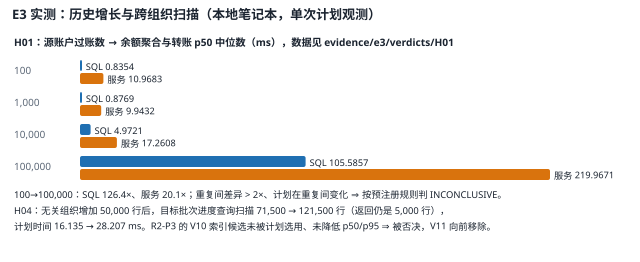

# 性能：预注册假设、查询计划与一个被否决的索引 {#ch-performance}

:::: opener
::: q
业务问题

周五的工资越发越慢：前 50 项每项十几毫秒，最后 50 项要三十多毫秒。账户历史越长，转账越慢。是缺索引吗？是锁吗？是连接池吗？加一个索引会更好吗——你怎么知道它真的更好了？
:::
::: k
本章证据

- E3（第一轮）：`evidence/e3/hypotheses/` 预注册、`verdicts/` 结论、`measurements/` 原始样本与查询计划
- R2-P2 投影读取补充、R2-P3 索引候选：`evidence/round3/e9/`
- 迁移 V10 与 V11
:::
::::

## 先写下判定规则，再测量

性能实验最常见的问题不是测得不准，而是**结论先于数据**：看到一组数字之后再决定什么算“改善”，几乎总能找到支持预期的解释。LedgerCore 的性能工作遵循预注册（pre-registration）：在运行任何测量之前，把假设、工作负载、重复次数、判定规则与“什么情况下结论为不确定”提交到 `main`，记录提交 SHA；测量之后，严格按规则给出结论，包括 INCONCLUSIVE、MIXED 与 REJECTED。被否定的结论与原始数据一起保留。

## H01：历史越长，余额越慢

H01 预测：源账户的过账从 100 条增长到 100,000 条时，余额聚合与转账服务的耗时会显著增长（超过 5 倍）。实测（@fig-query-plans）确实如此：余额聚合的中位数从 0.8354 ms 增长到 105.5857 ms（126.4 倍），转账服务从 10.9683 ms 增长到 219.9671 ms（20.1 倍）。

{#fig-query-plans .data}

可是结论是 **INCONCLUSIVE**。原因写在预注册规则里：在 100,000 条过账时，三次重复之间的中位数范围相差 2.3 倍（SQL 46.8–107.1 ms，服务 99.3–224.4 ms），而且保存下来的查询计划在重复之间发生了变化（统计信息更新前后，PostgreSQL 在位图扫描与索引扫描之间切换）。规则规定：重复不一致或计划变化时，不能给出 PASS。

这个结论令人不舒服——明明增长了一百多倍——但它是正确的。“增长了”是观测；“增长 126.4 倍”这个精确数字不可靠，因为同样的实验再跑一次可能是 50 倍；而“原因是计划变化还是数据量”尚未被隔离。预注册阻止了作者把一个不稳定的数字写成结论。

## R2-P2：投影读取有多快

第 7 章解释了为什么扣款时读权威余额而不读投影。第三轮按第二轮的建议补充了一个测量：在 12 个夹具上并排比较两种读法。在 100,000 条过账时，权威 SQL 的 p50/p95 为 39.165/51.389 ms，读投影为 0.330/0.558 ms；12 个夹具全部投影一致，独立 SQL 核对了 360 笔转账与 360 个回执。

注意这里的 39.165 ms 与 H01 的 105.59 ms 并不矛盾：它们是不同轮次、不同运行、不同夹具上的测量，H01 自己的重复范围就跨越了 46.8–107.1 ms。两组数字不应当被拼成一条曲线。R2-P2 的原始结论同样保持 **INCONCLUSIVE**（它的基线运行使用了不同的源码 SHA，且计划节点有变化），写路径没有因此做任何改动。

## H02、H03：锁与连接池

H02（第 7 章）与 H03（第 11 章）共同揭示了一个容易被误读的现象：吞吐在 10 个并发之后不再增长，p95 却急剧上升。只看这两个数字，很难分辨原因是**行锁**（所有扣款都要锁同一个付款账户）还是**连接池**（Hikari 只有 10 个连接，第 11 个请求开始排队）。

第三轮的 E9 为这两者分别建立了信号：`hikaricp_connections_pending`（等待连接的线程数）与 PostgreSQL 的锁等待会话数（`pg_stat_activity` 中 `wait_event_type = 'Lock'` 的会话）。集成测试分别**真实地制造**了这两种状态——一种是占满连接池，另一种是用另一个会话持有行锁——并验证对应的信号出现、清除之后消失。区分这两者很重要：连接池等待可以通过调整池大小缓解；行锁等待是正确性的代价，扩大连接池只会让更多线程在同一把锁上排队。

## H04：别人的数据让我变慢

H03 的查询计划里有一个细节：5,000 项批次的进度查询扫描了整张 `payroll_item_results` 表的 71,500 行，尽管它只返回自己的 5,000 行。H04 作为一个补充预注册专门检验这件事：插入 10 个无关组织、每个 5,000 项待处理工资之后，同一个查询扫描的行数变成 121,500，计划时间从 16.135 ms 增加到 28.207 ms，返回结果完全不变。结论：**SUPPORTED**——一个组织的查询成本随其他组织的数据量增长。这是一个真实的多租户扩展性问题，被记录为风险，而没有在验收压力下仓促修补。

## R2-P3：一个被否决的索引

工资认领在批次的后半段变慢（第二轮的 R2-12 风险）。第三轮提出了一个看起来很合理的候选：为“待处理结果”按批次建立部分索引（@code-22-1）。

@@excerpt backend/src/main/resources/db/migration/V10__index_pending_payroll_results_by_batch.sql | CREATE INDEX ix_payroll_item_results_pending_batch_item | 3 | V10 的候选：按 (batch_id, item_id) 索引待处理结果

按预注册规则，基线与候选各在三个全新数据库上运行同样的负载（3 × 500 项与 1 × 5,000 项批次，单执行器）。结果：

| 批次 | 指标 | 基线 | 候选 | 变化 |
|---|---|---:|---:|---:|
| 500 项 | 批次 p50 中位数（ms） | 30.591 | 33.028 | +8.0% |
| 500 项 | 批次 p95 中位数（ms） | 62.567 | 53.253 | −14.9% |
| 5,000 项 | 批次 p50（ms） | 13.016 | 13.888 | +6.7% |
| 5,000 项 | 批次 p95（ms） | 21.867 | 22.746 | +4.0% |
| 5,000 项 | 末十分位中位数（ms） | 17.897 | 18.719 | +4.6% |

Table: R2-P3 索引候选与基线（`evidence/round3/e9/R2-P3-CANDIDATE-RESULTS.md`） {#tbl-r2p3}

更关键的是查询计划：在第 4,999 项时，候选的三个计划仍然按序号顺序扫描 5,000 个工资项，对每一项探测**原有的**待处理索引，新索引根本没有被选用；共享缓冲区命中数与基线几乎相同（约 10,130–10,150）。500 项批次上 p95 的下降不能说明任何问题——计划没有变，差异只是噪声。结论：**否决**。

否决之后怎么办？V10 已经发布，不能修改或删除（第 6 章）。正确的做法是一条新的迁移把这个无用的索引移除，并写明理由（@code-22-2）。

@@excerpt backend/src/main/resources/db/migration/V11__drop_unhelpful_pending_payroll_index.sql | DROP INDEX IF EXISTS | 1 | V11：向前移除没有改变计划的索引，理由写在迁移注释里

索引不是免费的：每一次插入、更新结果行都要维护它。一个计划器不使用的索引只有成本、没有收益。

::: takeaway
性能工作里最有价值的产出之一，是一个**有证据的“不”**：这个索引没用，这个结论不确定，这个数字不可靠。它们阻止了团队把精力花在错误的方向上，也阻止了一个看起来合理的改动悄悄增加系统的负担。
:::

::: limit
本章所有数字都来自一台 Windows 笔记本上的本地 PostgreSQL 18.7 与合成负载，不包括网络、TLS 或浏览器时间，计划时间多为单次观测。它们用于解释机制与比较方案，不代表任何生产容量或延迟承诺。
:::

::: exercise
1. 某个候选优化让 5,000 项批次的 p95 从 21.9 ms 降到 19.8 ms，但查询计划完全没有变化。你会如何判断这个改善？还需要什么证据？（答案见 [附录 G](#ans-22-1)）
2. 一个读取 `EXPLAIN (ANALYZE, BUFFERS)` 的练习：H04 中，目标批次的进度查询在插入无关数据之后，“实际扫描行数”与“返回行数”分别是多少？这说明计划缺少了什么？提出一种可能的改进，并说明你会怎样预注册它的验证。（答案见 [附录 G](#ans-22-2)）
:::
