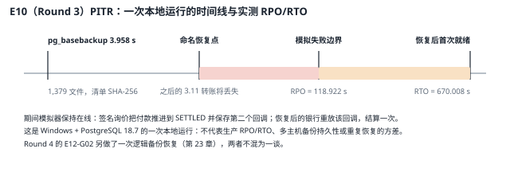
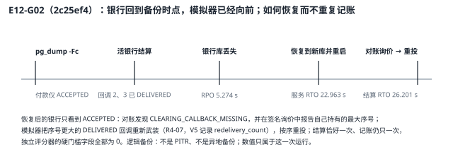

# 备份、PITR 与跨系统恢复 {#ch-recovery}

:::: opener
::: q
业务问题

银行的数据库坏了，运维从备份恢复。备份是凌晨做的；清算系统没有回到凌晨，它记得白天结算过的每一笔付款。恢复之后的银行，怎样才能既不丢掉清算系统已经完成的结算，又不把已经记过的账再记一次？
:::
::: k
本章证据

- E10（第三轮）：物理备份、PITR 与清算重放，`evidence/round3/e10/`（一次本地运行）
- 第四轮 E12-G02：逻辑备份、银行回到备份时点、模拟器重投（R4-07），`assessment/e12/run-e12-restore.ps1`
- 冻结提交上的结果：`evidence/round4/e12/lab/E12-RESTORE.json`
:::
::::

## 备份只备份了一半的世界

数据库备份恢复的是**一个系统**在某个时刻的状态。银行恢复到凌晨三点，它的账本、付款、回调收件箱都回到了三点；可清算系统是另一个系统，它在三点之后发生的一切——收到的指令、给出的结算、投递过的回调——都还在它自己的数据库里。恢复之后，两边对同一笔付款的认识出现了**时间上的分歧**。

这意味着对银行来说，“恢复”从来不只是 `pg_restore`。恢复包括三个步骤：把数据库还原到一个一致的时点；让应用在还原后的数据上安全地启动；**与外部世界重新对齐**——发现两边的分歧，并用原来的身份把缺失的事实补回来。第三步才是金融系统特有的难点。

## E10：物理备份与 PITR

第三轮的 E10 做了一次完整的物理备份与时间点恢复（PITR，point-in-time recovery）实验（@fig-pitr）：

1. `pg_basebackup` 以流式方式做一个带 SHA-256 清单的物理备份：3.958 秒，1,379 个文件，35,161,072 字节；`pg_verifybackup` 校验通过（第一次调用因为用了不支持的参数而失败，这次失败本身也作为负面证据保留）。
2. WAL 持续归档。归档脚本在 Windows 上实现了一个容易被忽视的要求：**同名的段如果已经存在，必须内容相同才能视为成功，否则拒绝覆盖**（@code-23-1）。
3. 备份之后，创建一个命名恢复点（LSN `0/2A0000C8`），再做一笔 3.11 的转账——它应当在恢复后**不存在**。
4. 模拟银行故障。银行停机期间，模拟器保持在线：一次签名询价把一笔早已存在的企业付款推进到 SETTLED，并保存了第二个回调。
5. 恢复到命名恢复点，提升（promote）集群，启动银行。3.11 的转账不在了；原来的转账回执与付款义务都在。模拟器的回调被重放，结算恰好一次。

{#fig-pitr}

@@excerpt evidence/round3/e10/archive-wal.ps1 | if \(Test-Path -LiteralPath \$destination -PathType Leaf\) \{ | 30 | WAL 归档：已存在的同名段必须哈希一致；先复制到临时文件、校验、再原子移动，最后再校验一次

按预注册的定义，这次运行的 **RPO 为 118.922 秒**（命名恢复点到模拟故障边界），**RTO 为 670.008 秒**（故障边界到应用首次就绪）。这是一次 Windows 上的本地运行：它证明了这条恢复路径可以走通，不代表生产环境的 RPO/RTO，也没有测量多次恢复之间的方差。

## 一个被设计过程发现的缺陷：R4-07

E10 的场景里，模拟器的第二个回调在银行停机期间**还没有投递成功**——银行恢复后，模拟器的正常重试就能把它送到。第四轮设计 E12 的恢复实验时，换了一个更残酷的时序：

- 备份时，付款只是 ACCEPTED；
- 备份之后，模拟器推进到 SETTLED，并且**成功**把回调 2、3 投递给了当时还活着的银行；活着的银行结算了这笔付款；
- 然后银行数据库丢失，从备份恢复。

恢复后的银行只认识 ACCEPTED。而在模拟器那边，回调 2、3 是 DELIVERED——第三轮的设计里这是终态，没有任何东西会让它们再被发送一次。R4-04 的修复只覆盖了 DEAD 的回调。付款将永远停在 ACCEPTED，这就是 R4-07（第 18 章）。

修复之后，银行在询价时报告自己持有的最大序号，模拟器把更大序号的回调重新武装。

## E12-G02：逻辑备份与跨系统恢复

E12-G02 用逻辑备份（`pg_dump -Fc`，只备份银行库）完整地执行了上面的时序（@fig-restore）：

@@excerpt assessment/e12/run-e12-restore.ps1 | # Failure: the bank database is lost | 16 | 银行“丢失”：停止银行，把备份恢复到一个新库，在新库上重启银行，记录服务恢复用时

{#fig-restore .data}

恢复之后，脚本只做一件“运营”动作：运行一次对账。对账发现 `CLEARING_CALLBACK_MISSING`，它自己的签名询价报告银行持有的序号 1；模拟器重新武装序号 2、3 并按序重投；银行依次接受，结算恰好一次。独立评分检查了十一项事实：恢复后确实回到了备份时点（ACCEPTED、零结算）；缺口被发现；恰好一张记账、一张结算、零退款；付款 COMPLETED / SETTLED；应付清零；客户与准备金各恰好减少 5.55；银行收件箱的回调数等于模拟器的回调数；评分器的全部硬门槛字段为 0。

脚本同时记录了本次运行的 RPO 与 RTO。它们的含义需要说清楚：

- **RPO**（恢复点目标的实测值）= 备份开始到故障的时间。这段时间里银行提交的历史（包括那张结算分录）随着恢复丢失了——但这笔结算**没有**真正丢失，它通过模拟器的重投被重新建立。对一个与外部系统对账的银行来说，“数据丢失”与“资金事实丢失”是两回事。
- **RTO** 有两个：故障到恢复后的银行健康（服务 RTO），以及故障到这笔付款重新完成结算（对账 RTO）。

::: limit
E12-G02 是一次**逻辑**备份与恢复：只覆盖银行库，不是 PITR，不是异地备份，不涉及存储故障或数据库软件损坏；RPO/RTO 只属于这一次本地运行。第三轮的 E10 是本书唯一的 PITR 证据，本书引用它而没有重新执行。磁盘故障、异地恢复、多次恢复的方差都没有被测试，列在第 26 章的未执行类别中。
:::

## 恢复的检查清单

把两个实验合在一起，可以得到一份可操作的恢复清单（附录 D 有完整版本）：

1. 还原之前，记录故障时刻与选定的恢复目标；
2. 还原到新的库或集群，**不要**覆盖可能仍有取证价值的旧数据；
3. 以只读方式运行独立评分器，确认还原后的账本内部一致（平衡、投影、链接）；
4. 启动应用，确认健康；
5. 运行对账，让它对每一个未完成的清算操作发起签名询价；处理回调缺失、序号不一致等发现；
6. 等待重投完成，再运行一次评分器与对账，确认零硬门槛失败、零未解释的例外；
7. 记录本次恢复的实测 RPO/RTO，以及哪些步骤需要人工判断。

::: exercise
1. 在 E12-G02 中，恢复后的银行为什么不能直接根据询价响应（“SETTLED，序号 3”）记结算分录，而必须等待回调 2、3 被重投？（答案见 [附录 G](#ans-23-1)）
2. 假设恢复之后、对账运行之前，客户在界面上看到付款是“已受理”，于是要求运营人员“作废这笔付款并退款”。正确的回答是什么？依据是哪几条不变量？（答案见 [附录 G](#ans-23-2)）
:::
