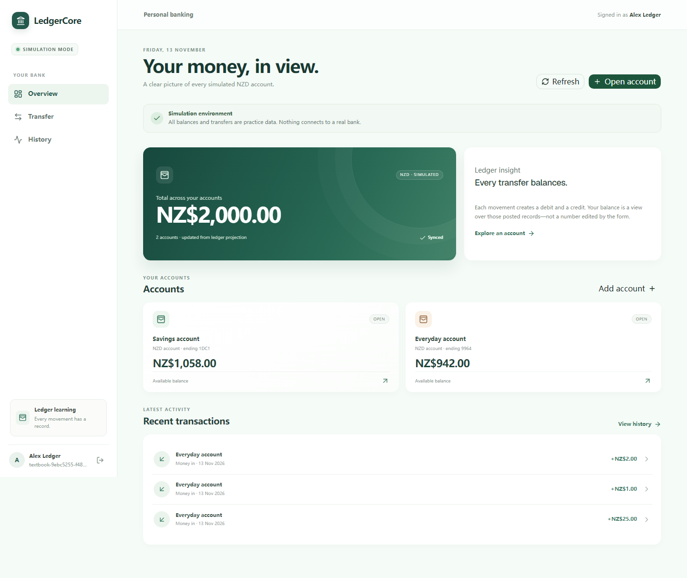
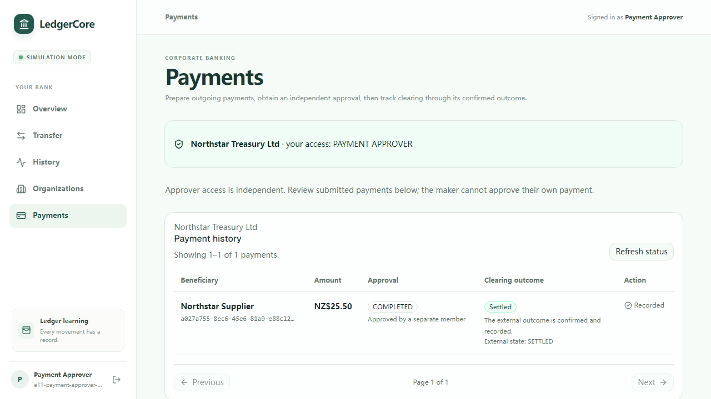
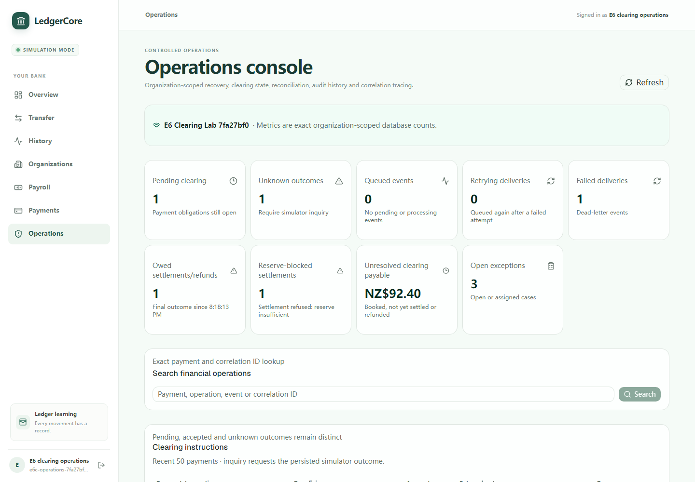
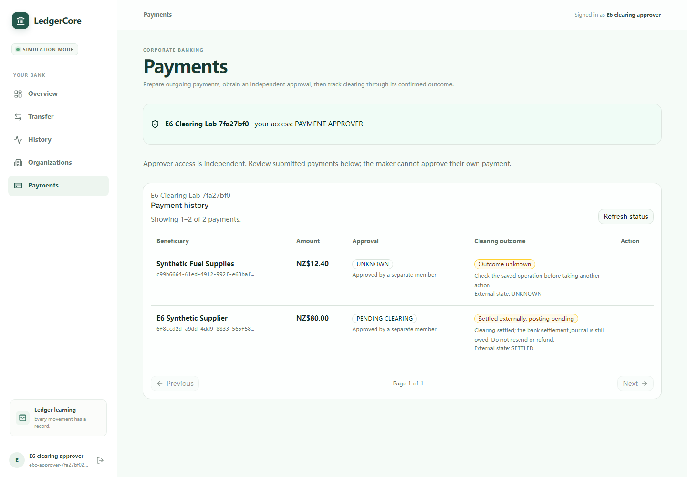
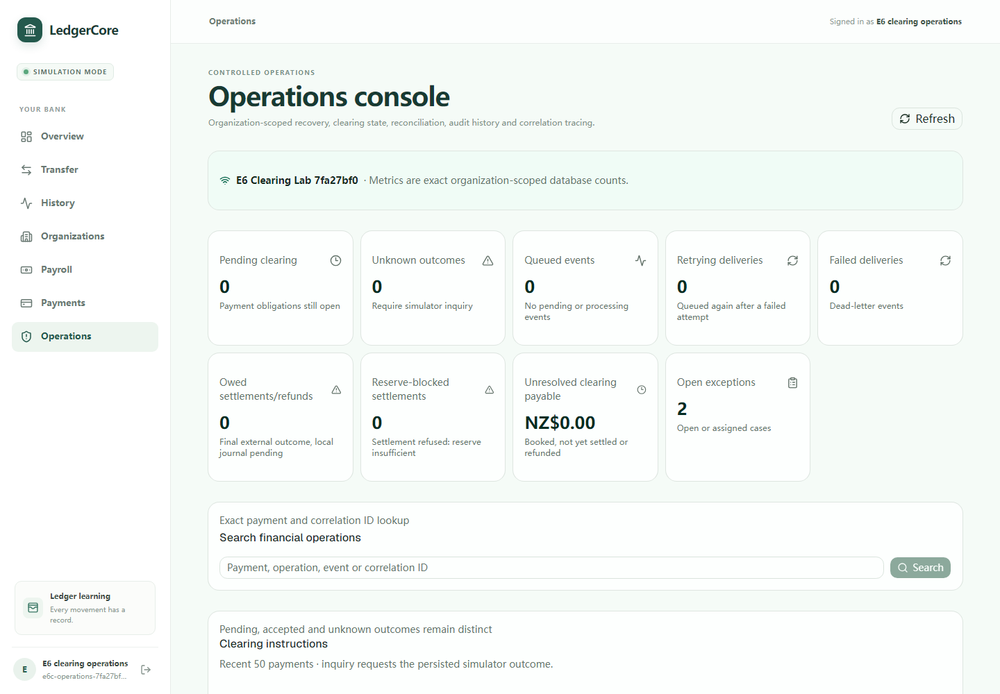
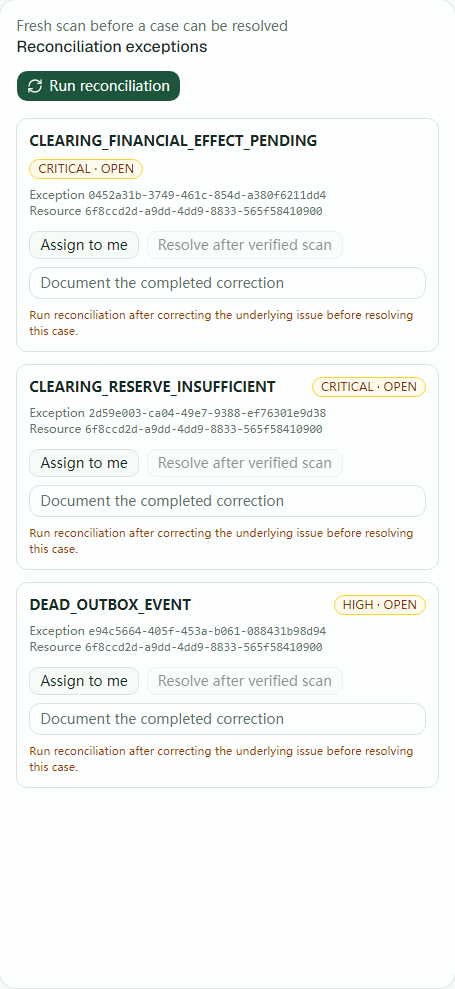
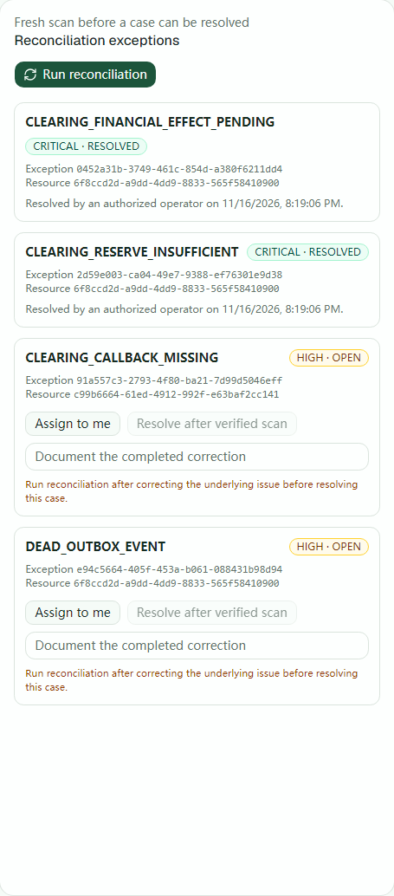
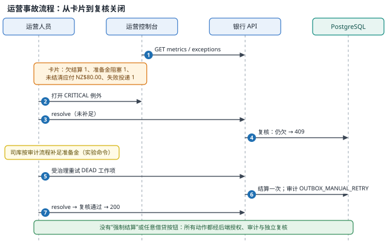
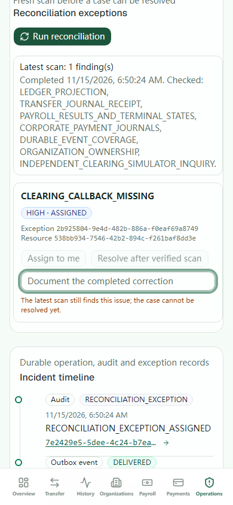

# React 界面：把不确定性诚实地显示出来 {#ch-react}

:::: opener
::: q
业务问题

后端已经区分了“外部已结算”和“银行已完成”、“结果未知”和“被拒绝”。如果界面把它们都画成一个绿色的“已完成”，前面所有章节的努力都会在最后一步被抹掉。界面应当告诉用户什么？又应当**不给**用户哪些按钮？
:::
::: k
本章证据

- `frontend/src/pages/PaymentsPage.tsx`、`OperationsPage.tsx`（React 19、TanStack Query、生成的 OpenAPI 类型）
- 真实截图：V1（提交 `484b9ad`）、E11（提交 `fdd4e0d`）、本书采集（冻结提交，`manual/v2/figures/screenshots/capture-manifest.json`）
- 浏览器旅程与无障碍子集：`frontend/e2e/`
:::
::::

## 前端的位置

LedgerCore 的前端是 React 19 单页应用，数据层用 TanStack Query，类型来自后端 OpenAPI 文档生成的 `schema.d.ts`（第 25 章会讲 CI 如何保证两者一致）。前端不做任何资金计算：余额、状态、能否执行某个动作，全部来自后端。会话使用 HttpOnly Cookie，所有改变状态的请求都带 CSRF 令牌。

这一章关心的不是组件怎么写，而是一个更难的问题：**界面上的每一个词和每一个按钮，是否与后端的事实一致。**

## 客户的视角

个人银行的界面从第一版沿用至今：总览、开户、转账、历史、账户详情。转账在响应丢失时显示“结果未知”，并在当前标签页里保存原始请求，让用户用同一个幂等键检查结果（第 8 章）。@fig-shot-dashboard 是第一版教材采集的真实总览页面。

{#fig-shot-dashboard .h90}

## 企业付款：区分“外部已结算”与“已完成”

企业付款页面把制单、提交、审批放在同一张表里，每一行显示状态标签与说明。@fig-shot-payments-e11 是第三轮 E11 在一次真实的制单—审批—结算旅程之后采集的页面。

{#fig-shot-payments-e11 .h90}

第四轮修改了这个页面的状态逻辑。修改前，“外部已结算”和“银行已完成”被合并成同一个标签（@code-24-1）。

@@excerpt d185416:frontend/src/pages/PaymentsPage.tsx | function statusLabel | /^}/ | 修改前（d185416）：外部 SETTLED 与银行 COMPLETED 都显示为“Settled”

在 R4-01 修复之前，这正是那种“回调已确认、结算丢失”的付款在界面上的样子：绿色的“Settled”，说明文字是“外部结果已确认并记录”。用户和运营人员都没有任何理由怀疑它。修改后（@code-24-2），只有银行**已经过账**的付款才显示“Settled”；外部已结算、本地仍欠着的付款显示为“Settled externally, posting pending”，并明确提示“不要重发，也不要退款”。

@@excerpt frontend/src/pages/PaymentsPage.tsx | function statusLabel | /^}/ | 修改后：COMPLETED 才是“Settled”；外部 SETTLED/REJECTED 而本地欠着的，单独显示为“posting pending”/“refund pending”

E12 的浏览器旅程仍然断言一笔正常结算的付款最终显示为“Settled”且状态为 COMPLETED——它们在快速路径完成结算之后才会出现。

## 运营控制台：事故的全貌

运营控制台是唯一可以采取恢复动作的界面，它只对 OPERATIONS 角色开放。第四轮按主提示第 18 节的要求，让它能同时回答一次清算事故里的所有关键问题：

| 卡片 | 回答的问题 | 来源 |
|---|---|---|
| Pending clearing / Unknown outcomes | 有多少付款还在等待外部结果，其中多少结果不明 | 付款状态 |
| Owed settlements/refunds | 有多少外部已终态、本地还欠着的效果，最早从何时开始 | 第四轮新增 |
| Reserve-blocked settlements | 有多少结算因为准备金不足被拒 | 第四轮新增，来自 CRITICAL 例外 |
| Unresolved clearing payable | 本组织已记账、尚未结算或退款的金额合计 | 第四轮新增 |
| Queued / Retrying / Failed deliveries | 持久事件在排队、在重试、已成为死信 | 第四轮新增“重试中” |
| Open exceptions | 未关闭的对账例外 | 对账 |

Table: 运营控制台的指标卡片（全部按组织隔离；E8 矩阵验证非 OPERATIONS 访问被拒绝） {#tbl-ops-cards}

@fig-shot-ops-incident 与 @fig-shot-payments-incident 是在冻结提交上、针对一次**真实制造**的准备金不足事故采集的截图：受限的实验命令把准备金划到只剩 50.00，一笔 80.00 的付款被清算系统结算，银行的结算因准备金不足被拒、五次重试之后成为死信，对账运行生成了例外；同时还有一笔清算系统报告为 UNKNOWN 的付款。采集时检出的是 `719a758`——它在冻结提交之后只增加了文档与证据，应用代码没有任何改动；银行与模拟器 JAR 的 SHA-256 与 E12 运行记录完全一致（见 `capture-manifest.json`）。

{#fig-shot-ops-incident .h120}

{#fig-shot-payments-incident .h110}

截图上的每个数字都可以与同一时刻的数据库状态逐一核对：采集脚本在截图之后立即用 SQL 读取银行的状态，写进 `capture-manifest.json` 的 `incidentState`（@tbl-incident-facts）。

| 截图上的值 | 同一时刻的数据库事实（`incidentState`） |
|---|---|
| Pending clearing 1；Payments 页面上 80.00 的付款显示 PENDING CLEARING | 这笔付款 `status = PENDING_CLEARING`、`external_status = SETTLED`；清算指令 SETTLED；收件箱里恰好一条终态回调 |
| Owed settlements/refunds 1；Reserve-blocked settlements 1 | 记账分录 1 笔、结算分录 0 笔；承载效果的工作项 `DEAD`，5 次尝试，最后的错误是 `ClearingEffectDeferredException` |
| Failed deliveries 1 | 就是上面那个 DEAD 工作项 |
| Unknown outcomes 1；12.40 的付款显示 UNKNOWN | 第二笔付款以路由代码 `SIM-UNKNOWN` 提交，玩具模拟器对它报告 UNKNOWN（`incidentState` 只记录 80.00 那笔，这一行的依据是采集脚本与截图本身） |
| Unresolved clearing payable NZ$92.40 | `CLEARING_PAYABLE` 账本余额 9,240 分，与投影一致；这个一次性数据库里只有这两笔付款：80.00 + 12.40 = 92.40 |
| Open exceptions 3 | `CLEARING_RESERVE_INSUFFICIENT` 与 `CLEARING_FINANCIAL_EFFECT_PENDING`（CRITICAL）、`DEAD_OUTBOX_EVENT`（HIGH），全部 OPEN |
| （截图上没有） | 准备金 5,000 分；付款方存款 90,760 分；不平衡分录 0、投影偏差 0、负投影 0 |

Table: 事故截图上的数字与同一时刻的数据库事实（来源：`manual/v2/figures/screenshots/capture-manifest.json`） {#tbl-incident-facts}

最后一行与前面几行同样重要：事故期间账本始终平衡。80.00 停在应付里，不是因为哪里算错了，而是因为准备金只剩 50.00，银行**拒绝**让准备金透支——这正是第 17 章要求的行为。界面的任务是把这个“正确地停住”的状态如实地摆在运营人员面前。

恢复分三步：用受限的实验命令补足准备金（+100.00，写审计）；对死信执行一次受治理的重试，结算日记账恰好过账一次；对两条 CRITICAL 例外执行“复核后关闭”——后端先确认付款已经 COMPLETED、欠着的效果已经应用，才允许关闭。之后又运行了一次对账。@fig-shot-ops-recovered 是这时的控制台：欠着的结算、准备金阻塞、未结应付与死信都已归零，但 **Open exceptions 仍然是 2**。

{#fig-shot-ops-recovered .h120}

同一时刻的数据库状态（`recoveredState`）与截图一致：80.00 的付款 COMPLETED，结算分录恰好 1 笔且已与付款关联；承载效果的工作项 DELIVERED（受治理的重试之后 1 次尝试），带着消费回执 `clearing-financial-effect-v1`；`CLEARING_PAYABLE` 余额 0；准备金 5,760 分，正是 50.00 + 100.00 − 80.00 − 12.40；付款方存款仍是 90,760 分——补足与结算都没有碰客户的钱；不平衡分录、投影偏差与负投影依旧为 0。

@fig-shot-exceptions-incident 与 @fig-shot-exceptions-recovered 是同一张例外卡片在事故期间与恢复之后的样子。事故期间，对账生成了三条例外：`CLEARING_FINANCIAL_EFFECT_PENDING` 是 CRITICAL，因为承载效果的工作项已经成为死信，不再有自动重试（规则见第 20 章）；`CLEARING_RESERVE_INSUFFICIENT` 是 CRITICAL；死信本身是一条 HIGH 的 `DEAD_OUTBOX_EVENT`。恢复之后，两条 CRITICAL 例外已经复核关闭，剩下的两条 HIGH 例外恰好说明“计数归零”与“事故关闭”不是一回事：

- `DEAD_OUTBOX_EVENT`：死信已经重试成功，但这条例外属于状态派生类，需要运营人员自己点击“Resolve after verified scan”，由后端重新做一次独立的 SQL 扫描、确认这条死信已经不存在之后才能关闭。采集脚本只关闭了两条 CRITICAL 例外，没有替人完成这一步。
- `CLEARING_CALLBACK_MISSING`（资源是那笔 12.40 的付款）：第二次对账运行对它做了认证询价，玩具模拟器在这次询价中把 UNKNOWN 改判为 SETTLED，返回的序号比银行收到的最后一条回调大，对账于是记下“回调缺失”。不到 0.1 秒之后，SETTLED 回调到达，结算日记账过账——运行日志里依次是模拟器的 `Simulator operation inquiry changed status`、银行的 `Clearing callback accepted status=SETTLED` 与 `Clearing financial effect applied`。这条例外由模拟器派生，关闭它需要一次新的认证询价，证明双方的序号与状态已经一致。

::: figpair
{#fig-shot-exceptions-incident .h110}

{#fig-shot-exceptions-recovered .h110}
:::

@fig-ops-incident 把这次事故的处理流程画成了时序图。

{#fig-ops-incident}

## 不给的按钮

运营控制台上能做的事情只有这些：询价（用原操作身份）、指派与关闭例外（关闭前复核）、重试死信（只对 DEAD 事件、写审计）、运行对账、搜索与查看审计。**没有**“强制结算”、“标记为已完成”、“调整余额”或任意借贷的按钮。这些按钮在一次事故的压力下看起来很有用，但它们会让一个人的判断绕过前面所有章节建立的规则——双人审批、摘要、准备金检查、幂等、对账。界面的克制是安全设计的一部分。

## 移动端与无障碍

E11 验证了 390 像素宽度下没有横向溢出、键盘焦点可见（@fig-shot-mobile）。第四轮增加了一个不依赖第三方库的无障碍子集（E12-H02）：在九个界面上读取浏览器计算出的可访问性树，断言每个交互控件与图片都有可访问名称、恰有一个 `main` 地标、至少一个一级标题、文档语言与标题存在、没有重复的元素 ID；打开模态对话框时，对话框有名称、背景被隐藏。九个界面全部通过。

{#fig-shot-mobile .h110}

::: limit
无障碍子集不是 axe-core 或 WCAG 合规审计：没有检查颜色对比度、完整的焦点顺序或真实屏幕阅读器的行为。界面的文字是英文，本书正文用中文描述它们。
:::

::: exercise
1. 一笔付款 `status = PENDING_CLEARING`、`externalStatus = SETTLED`。修改前与修改后的界面分别显示什么？运营人员看到修改前的显示，最可能做出什么错误判断？（答案见 [附录 G](#ans-24-1)）
2. 产品经理希望在运营控制台增加一个“标记为已结算”的按钮，用于“清算系统已经确认、但银行这边卡住了”的情况。请写一段回复，说明为什么不这样做，以及现有的哪些动作覆盖了这个需求。（答案见 [附录 G](#ans-24-2)）
3. @fig-shot-exceptions-recovered 里还有两条 HIGH 例外没有关闭。运营人员分别该怎样关闭它们？后端在关闭前会做什么复核、把什么写进证据？什么情况下会返回 409？（答案见 [附录 G](#ans-24-3)）
:::
