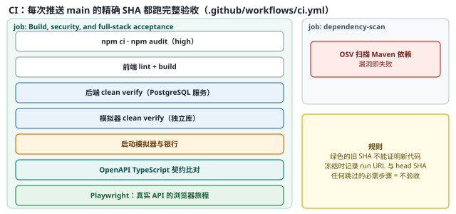

# 契约、浏览器测试与精确提交的 CI {#ch-ci}

:::: opener
::: q
业务问题

后端给运营指标加了三个字段，前端还按旧的类型渲染；一个新的浏览器测试在本地通过，在 CI 里却因为没有启动模拟器而失败；一次 CI 是绿的，可它测的是三个提交以前的代码。怎样让“通过”这个词在团队里只有一个意思？
:::
::: k
本章证据

- 工作流：`.github/workflows/ci.yml`
- 契约：`frontend/src/api/schema.d.ts`（由 OpenAPI 文档生成）
- 浏览器旅程：`frontend/e2e/*.spec.ts`（9 个旅程，真实 API、真实模拟器）
- 第四轮的精确提交 CI 运行：见 `docs/v2/E12-SOURCE-FREEZE.md`
:::
::::

## 一份契约，两种语言

后端用 springdoc 从 Spring 控制器生成 OpenAPI 文档；前端用 `openapi-typescript` 把它转换成 TypeScript 类型 `schema.d.ts`，所有 API 调用都使用这些类型。于是“后端返回什么”与“前端以为后端返回什么”只有一份来源。

这份来源要真正可靠，还差一步：**生成的文件必须与当前后端一致**。第四轮给运营指标增加 `pendingFinancialEffects`、`unresolvedPayableMinor`、`reserveBlockedSettlements`、`retryingEvents` 等字段时，第一次构建前端就因为类型缺失而失败——这正是契约在起作用：前端无法引用后端不存在的字段，后端改了字段名，前端会在编译时知道。CI 把这一点变成了门禁（@code-25-1）。

@@excerpt .github/workflows/ci.yml | - name: Verify generated OpenAPI TypeScript contract | 5 | CI 启动真实后端后重新生成类型，并要求与提交的 schema.d.ts 完全一致

`git diff --exit-code` 是这里的关键：如果有人改了后端却没有重新生成并提交类型，或者手工编辑了生成的文件，CI 都会失败。

## 浏览器旅程：真实 API，真实模拟器

LedgerCore 的 Playwright 测试从不 Mock 后端。每一个旅程都在真实的银行与真实的清算模拟器（各自连接独立的 PostgreSQL 库）上运行，通过真实的登录、真实的 CSRF 令牌、真实的数据库约束。第三轮的一次 CI 失败恰好说明了这条规则的价值：E11 新增的旅程在 CI 中失败，原因是工作流没有启动独立的清算模拟器——它不是一个“跳过的测试”，而是一个被测试暴露出来的环境缺口；工作流随后增加了带隔离库与签名配置的模拟器启动步骤。

冻结提交上运行的 9 个旅程是：

| 旅程 | 证明什么 |
|---|---|
| 注册、转账、响应丢失后恢复、分页历史、所有权 | 幂等恢复与个人银行的端到端行为（第 8 章） |
| 组织管理员授予工资制单权限，企业资金不暴露给通用转账 | Policy B（第 9 章） |
| 制单导入并提交工资；独立审批人在响应丢失后执行一次 | 工资与幂等（第 11 章） |
| 制单—审批付款经真实清算结算；自我审批被拒 | 职责分离与清算（第 9、14 章） |
| 运营人员解决 UNKNOWN 清算结果并记录经复核的例外 | 未知结果与对账（第 14、20 章） |
| 运营接口对另一个组织隐藏 | 租户隐藏（第 9 章） |
| 非运营成员的对账操作被后端拒绝 | 授权（第 9 章） |
| 运营角色在业务进行中被撤销后无法询价 | 每次请求重新授权（第 9 章） |
| 九个界面的无障碍子集 | 可访问名称、地标、标题、语言、唯一 ID（第 24 章） |

Table: 冻结提交上运行的 9 个浏览器旅程 {#tbl-journeys}

这些旅程里最有教学价值的是“响应丢失”：Playwright 拦截请求，让它真正到达服务器、确认服务器返回 200，然后以“网络断开”丢弃返回给浏览器的响应。这不是 Mock，而是在真实的请求链路上制造了一个真实的不确定性。

## 精确提交的 CI

工作流在每一次推送到 `main` 时运行（@fig-ci）。一个“通过”的含义是：**这个 SHA** 上的全部步骤都成功——前端依赖审计、构建、后端与模拟器的 `clean verify`（使用 CI 自己的 PostgreSQL 服务）、启动真实的模拟器与银行、契约比对、全部浏览器旅程，以及独立的 OSV 依赖漏洞扫描。

{#fig-ci}

第四轮遵守一条简单的规则：**验收文档引用的 CI 运行，必须是被验收的那个 SHA 的运行。** 一个更早的提交上的绿色，不能证明之后改动过的代码；一个后来的文档提交上的绿色，也不能替代对代码提交本身的验证。`docs/v2/E12-SOURCE-FREEZE.md` 列出了冻结提交与它的 CI 运行，以及之后每一个只改文档或证据的提交的 CI 运行。

## 本地与 CI：两个独立的环境

E12 在本地的专用集群上运行同样的后端、模拟器与浏览器测试（第 26 章），CI 在 GitHub 的运行器上再运行一遍。两者使用不同的操作系统、不同的 PostgreSQL 实例、不同的时间与网络条件。同一个 SHA 在两个环境里都通过，是“可复现性”这个验收维度最直接的证据：结果不依赖作者的机器。

::: why
为什么 E12 不直接引用 CI 的结果，而要在本地再跑一遍？因为 CI 只能运行“非破坏性”的测试：它不能杀进程、不能终止数据库会话、不能让银行停机四分钟、不能恢复备份。E12 的故障实验与恢复实验只能在受守卫的本地实验室里运行。两者各自覆盖对方覆盖不到的部分。
:::

## 依赖与供应链

前端在安装依赖之后运行 `npm audit`，高危漏洞会让 CI 失败；后端与模拟器的 Maven 依赖由 OSV Scanner 单独扫描。扫描结果从不被“压制”以换取绿色：第四轮期间每一次 CI 的依赖扫描都通过了。这只是供应链安全的最基本一层——LedgerCore 没有做 SBOM 签名、依赖固定哈希校验或镜像漏洞扫描（它不发布镜像）。

::: exercise
1. 一位开发者在后端把 `oldestPendingEffectAt` 重命名为 `oldestOwedEffectAt`，提交时忘了重新生成前端类型。CI 会在哪一步失败？如果他手工修改 `schema.d.ts` 让它“看起来对”，又会在哪一步失败？（答案见 [附录 G](#ans-25-1)）
2. 为什么“响应丢失”的浏览器测试要先确认服务器返回 200，再丢弃响应？如果直接让请求失败，测试证明的是什么？（答案见 [附录 G](#ans-25-2)）
:::
