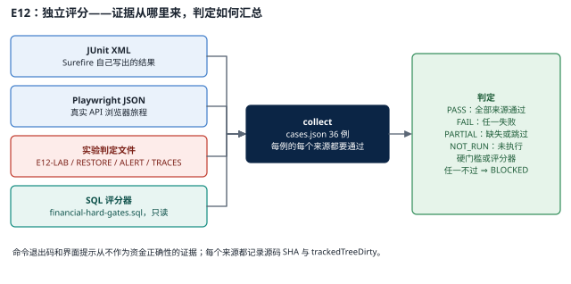
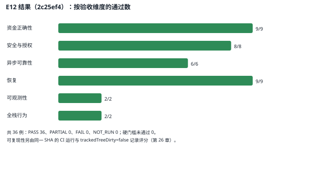

# E12：独立验收的方法、结果与工程教训 {#ch-e12}

:::: opener
::: q
业务问题

前面 25 章讲了很多机制、很多实验。现在要回答一个可以被别人复核的问题：**这个提交，能不能被接受？** 依据是什么？哪些东西证明了，哪些东西没有证明？如果另一位工程师拿着同样的仓库重做一遍，会不会得到同样的结论？
:::
::: k
本章证据

- 用例与脚本：`assessment/e12/`（`cases.json`、`run-e12*.ps1`、`graders/financial-hard-gates.sql`）
- 结果：`evidence/round4/e12/E12-RESULTS.json`、`runs/`、`lab/`；`evidence/round4/e5-e9/`
- 结论：`docs/v2/E12-ACCEPTANCE.md`；冻结：`docs/v2/E12-SOURCE-FREEZE.md`
:::
::::

## E12 不是什么

E12 不是一份把各轮交接文档汇总起来的清单，也不是“CI 是绿的”的另一种说法。它是一个**可执行的、独立评分的**验收套件：每个用例都有明确的目标、来源、期望结果与判定规则；每一个判定都来自测试运行器自己写出的结果、实验的独立 SQL 评分，或者只读的评分器——命令的退出码与界面上的提示从不被当作资金正确性的证据。

## 36 个用例，8 个类别，6 个维度

用例按主提示建议的八个类别组织（@tbl-e12-categories），每个用例同时标注它在验收矩阵中计入的维度：资金正确性、安全与授权、异步可靠性、恢复、可观测性、全栈行为。第七个维度“可复现性”不由某个用例给出，而由同一提交的 CI 运行与每条运行记录中的 `trackedTreeDirty=false` 给出。

| 类别 | 用例数 | 其中硬门槛 | 典型用例 |
|---|---:|---:|---|
| A 账本与内部转账 | 4 | 4 | 分录平衡、幂等重放、热点账户并发、事务内失败整体回滚（含三个转账崩溃窗口） |
| B 企业身份与 Policy B | 5 | 3 | 528 格授权矩阵、自我审批、企业账户不能被通用转账扣款、撤销与暂停、CSRF |
| C 工资 | 4 | 4 | 500 项恰好一次、并发执行器、失败记录前的崩溃、失败的持久性 |
| D 持久事件 | 3 | 2 | 事实与事件同时提交、派发前崩溃、死信与受治理重试 |
| E 清算 | 9 | 9 | 结算/拒绝/中间态、UNKNOWN、签名回调、四个崩溃窗口、会话终止、准备金不足、回调丢失、模拟器重启 |
| F 对账 | 5 | 3 | 投影漂移、欠着的效果、负例、复核后关闭、租户隔离 |
| G 备份与恢复 | 2 | 0 | 迁移兼容、逻辑备份与跨系统恢复 |
| H 界面与运营 | 4 | 0 | 九个浏览器旅程、无障碍子集、告警、追踪链 |

Table: E12 的用例目录（`assessment/e12/cases.json`） {#tbl-e12-categories}

每个用例的英文原题、维度、证据来源的类型与数量以及判定结果，见 [附录 I](#app-e12-cases)；那张目录由脚本从 `cases.json` 与正式结果文件直接生成。

25 个硬门槛用例对应主提示规定的八条硬门槛：零不平衡分录、没有重复生效的付款或结算、没有未授权的企业扣款或自我审批、操作身份在重试与 UNKNOWN 中稳定、已接受的终态清算有可靠的恢复路径、正确检测欠着的资金效果、迁移有效、没有被跳过的必需测试。**任何一个硬门槛失败，结论就是 BLOCKED，无论其余得分多高。**

## 证据从哪里来

@fig-e12-grader 画出了四类证据来源与汇总规则。

{#fig-e12-grader}

汇总的规则只有几行（@code-26-1）。

@@excerpt assessment/e12/run-e12.ps1 | \$verdict = if \(\$case.notRun\) | 5 | 一个用例只有在每个来源都通过时才是 PASS；任何失败即 FAIL；缺失或跳过为 PARTIAL

这里有两个刻意的设计。第一，**缺失不是通过**：一个来源没有运行（例如某个测试名对不上），用例就是 PARTIAL，而不是“没发现问题所以 PASS”。第二，**评分器参与每一个标注了它的用例**：verify 与全栈运行留下的数据库都会被只读的评分器检查（第 5 章与附录 B），18 个硬门槛字段任何一个不为 0，所有引用评分器的用例都会失败。

## 同一个提交，干净的工作区

E12 的正式运行在冻结提交 `{{source-sha7}}` 上完成，耗时约 47 分钟：

1. **verify**（约 6 分钟）：在专用集群的全新库上运行后端与模拟器的 `clean verify`，收集 JUnit 结果与 E8 矩阵，运行评分器；
2. **fullstack**（约 3 分钟）：真实的银行与模拟器进程、Vite 与 Chromium，运行 9 个浏览器旅程，再运行评分器；
3. **lab**（约 34 分钟）：依次执行 11 个故障用例，每个用例都在新的一次性集群上注入、评分、恢复、再评分，并检查端口释放；
4. **restore**、**alert lab**、**trace extraction**、**collect**。

序列开始与结束时都检查了工作区：跟踪文件没有任何未提交的改动，HEAD 没有变化。同一个提交的 GitHub Actions 运行（两个 job）也全部成功。

## 结果

36 个用例全部 PASS，0 个 PARTIAL、FAIL 或 NOT_RUN；25 个硬门槛用例全部通过（@fig-e12-dimensions）。

{#fig-e12-dimensions .data}

几组关键数字：

| 来源 | 结果 |
|---|---|
| 后端 `clean verify` | 118 个测试通过，0 失败、0 错误、0 跳过 |
| 模拟器 `clean verify` | 9 个测试通过，0 失败、0 错误、0 跳过 |
| 浏览器旅程 | 9 个通过（真实银行 + 真实模拟器 + 隔离的 PostgreSQL） |
| E8 授权矩阵 | 528 格全部符合期望；243 个被拒绝的写请求均无副作用 |
| 评分器（verify 库） | 1,327 张分录、2,654 行过账，18 个硬门槛字段全部为 0 |
| 故障实验 | 11 个用例：11 次注入均被观察到，11 次恢复评分 PASS，每例均确认进程已停、端口已释放 |
| 恢复（E12-G02） | PASS；RPO 5.274 秒；服务 RTO 22.963 秒；对账 RTO 26.201 秒 |
| 告警（E12-H03） | 两条规则在真实的 3000 分缺口上触发，补足与一次受治理重试之后恢复 |
| 追踪（E12-H04） | 结算链路完整（7 步加持久工作项的一次尝试） |

Table: E12 正式运行的关键结果（`docs/v2/E12-ACCEPTANCE.md`） {#tbl-e12-results}

## 两次失败让结论更可信

第 4 章讲过，正式评估之前的预演发现了两个脚本缺陷，第一次正式评估又因为实验运行器的参数展开错误而作废。这两段历史没有出现在 36/36 这个数字里，却是读者应当相信这个数字的理由之一：它们说明这套评估**会**失败——会在脚本有缺陷时失败，会在故障根本没有注入时拒绝给出 PASS——而不是一台只会输出绿色的机器。

## 结论：ACCEPTED_WITH_NONBLOCKING_LIMITATIONS

E12 的结论是**带非阻塞限制的接受**。“非阻塞”的意思是：下面这些限制都被如实记录，但没有一项是未解决的 P0/P1 资金或安全缺陷。

- R4-05 的“重新发送指令”路径延后（检测已经存在）；
- 一把 HMAC 密钥签名两个方向，签名基串没有方向标签（P3）；
- 消息类 CRITICAL 例外由单人确认关闭，没有四眼原则；
- 第四轮的恢复证据是一次逻辑备份恢复，不是 PITR；唯一的 PITR 证据仍是第三轮 E10 的一次本地运行；
- 无障碍是一个子集，不是 axe-core 或 WCAG 审计，没有屏幕阅读器评审；
- 未执行的故障类别：锁等待超时、银行提交超时时的进程崩溃、其他工资执行点、存储故障、双方都存活的网络分区、PostgreSQL 服务器崩溃、超出签名窗口的时钟偏差、渗透测试；
- 测得但未优化的性能风险：热点账户串行化、跨组织扫描、随历史增长的余额计算；
- 清算模拟器是一个玩具，不能据此推断任何真实银行间系统的行为。

这是一个工程实验室的验收结论，不是生产银行的认证，也不是任何监管合规的声明。

## 工程教训

把全书压缩成几条可以带走的经验：

1. **钱的正确性靠多层共同守护。** Java 检查让错误尽早出现，数据库约束让绕过应用的写入失败，追加式历史让事实不可改写，独立对账让漏网之鱼显形（第 3 章）。
2. **确认之前，先持久化承诺。** 任何对外的“收到了”，都必须以“欠着的事已经有了持久的所有者”为前提（第 16 章）。
3. **不确定就停下来，用原来的身份去问。** 超时与未知都不是拒绝；重发要用原来的操作身份，恢复要重放原来的事实（第 14、18 章）。
4. **让罕见的故障能够被合法地发生。** 一个无法被真实触发的恢复路径，等于一个从未被测试的恢复路径（第 17 章）。
5. **关闭问题需要证据。** 例外只能在复核通过之后关闭，严重度只升不降（第 20 章）。
6. **测试要杀死真实的进程。** Mock 的异常证明不了崩溃窗口被关闭（第 19 章）。
7. **评估必须会失败。** 预注册判定规则、`NOT_INJECTED` 永不通过、脏工作区不算证据、作废的运行原样保留（第 4、22 章）。
8. **把限制写下来。** 一份诚实的“没有证明什么”的清单，和“证明了什么”同样重要。

::: exercise
1. 假设在 E12 的某次重跑中，36 个用例里只有 E12-H02（无障碍子集）失败，原因是一个新按钮缺少可访问名称。E12 的结论会是什么？为什么？如果失败的是 E12-E05 呢？（答案见 [附录 G](#ans-26-1)）
2. 一位审稿人说：“36/36 全部通过，为什么不直接判为 ACCEPTED，而要写‘带非阻塞限制’？”请用本章的内容回答。（答案见 [附录 G](#ans-26-2)）
:::
